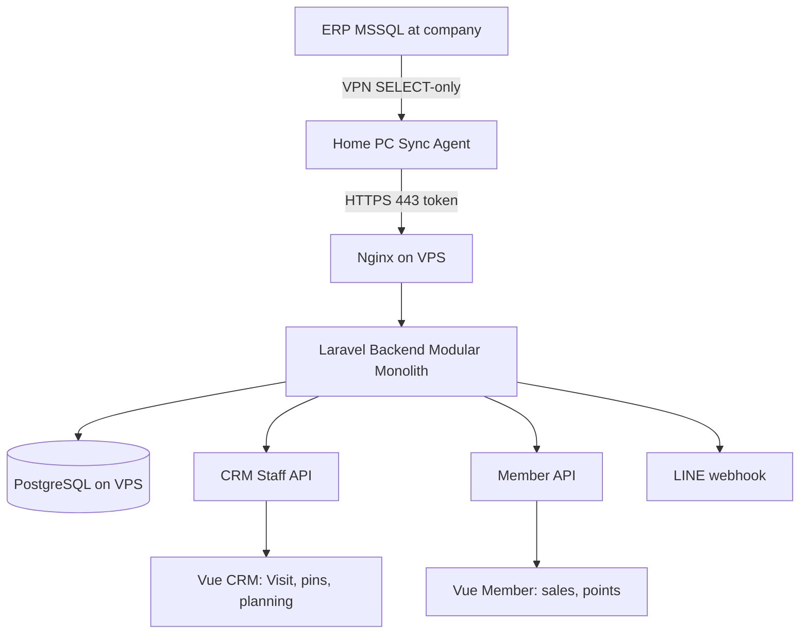

# Architecture v4

- Host Nginx retains ports 80/443, Docker binds ONLY 127.0.0.1:18080–18082.
- CRM auth and Member auth use separate session guards and host-only session cookies. HTTPS everywhere.
- Mirror tables are not modified by CRM/Member. CRM Lead may convert to ERP customer via manually verified `converted_erp_customer_id` (no ERP write).
- Permanent customer location lives in `crm_customer_locations`; Visit check-in location lives in `crm_customer_visits`; no assumption that GPS proves employee presence.
- Source SQL is neither backed up nor migrated by Cloud connector; only authorized selected records are copied.
