# DATABASE MAPPING — BPLUS ERP (SQL SERVER) TO POPSTAR V4 (POSTGRESQL)

**Audit Date:** 2026-11-16 (Live PostgreSQL Schema Verified)  
**Source Database (Read-Only):** Microsoft SQL Server `192.168.88.200:1433` — Database `BPLUSERP_POPSTAR_2021` (Bplus ERP, Thai data cast via `nvarchar` in V4 bridge queries vs `TIS-620` `iconv` in legacy PHP)  
**Target Database (Single Shared App DB):** PostgreSQL 17 (`postgres:17-alpine`, container `popstar-platform-db-1`, database `popstar_business`, user `popstar_app`, **43 public tables**, **18/18 migrations Ran**)  
**Legacy Unconnected DBs Noted:** `popstar_db` MySQL DDL (`db/web_reserve_schema.sql`: `web_reserve_header`, `web_reserve_items`, `web_reserve_logs`) — unused in V4; `backend/database/database.sqlite` — unused in Docker runtime (testing uses SQLite `:memory:`).

---

## 1. Entity Mapping Overview

| Logical Entity | Source Query (`sync-agent/queries/`) | Bplus Catalog Reference | Target PostgreSQL Table | Live Row Count | Natural Upsert Key (`UNIQUE`) | Mapping Status |
|---|---|---|---|---:|---|---|
| **Customers** | `bplus_customers.sql`, `bplus_customers_10.sql` | `SQL05060001`, `SQL01206004` | `erp_customers` | `7,804` | `(source_system, erp_customer_code)` | **PARTIAL** (synced; lacks Phase 6 `erp_key`/`raw_hash`/`synced_at`/`sync_run_id`) |
| **Customer Contacts** | `bplus_customer_contacts.sql` | `SQL01206004` | *(None — preview only; default merged on `erp_customers`)* | — | — | **PARTIAL** (`/preview/customer-contacts` only; no multi-contact PG table) |
| **Products** | `bplus_products.sql` | `SQL11001103` | `erp_products` (+ `erp_product_size_segments`) | `4,208` (`0` segments) | `(source_system, erp_product_code)` | **PARTIAL** (synced; lacks Phase 6 audit columns) |
| **Sales Invoices & Credit Notes** | `bplus_invoices.sql` | `SQL11001205`, `SQL10501001` | `erp_sales_invoices` | `9,247` | `(source_system, branch_code, doc_type, invoice_no)` | **PARTIAL** (`DI_DATE >= '20260101'` & `<> reservation` gap; fails on `>200` line items) |
| **Invoice Line Items** | `bplus_sales_items.sql` | `SQL11001043` | `erp_sales_items` | `25,615` | `(source_system, branch_code, doc_type, invoice_no, line_no)` | **PARTIAL** (synced with invoice batch; stops at `sync_runs` id=186 `>200` lines) |
| **Salespersons** | `bplus_salespersons.sql` | `SQL08050001` | `erp_salespersons` | `21` | `(source_system, salesperson_code)` | **PARTIAL** (synced; lacks Phase 6 audit columns) |
| **ERP Members** | `bplus_members.sql` | `SQL05090002` | `erp_members` | `112` | `(source_system, member_code)` | **PARTIAL** (synced; Member app verification links = `0`) |
| **ERP Member Points Detail** | `bplus_member_points.sql` | `MP0010011`, `MP003002` | *(None dedicated; V4 uses `loyalty_points_ledger` for verified accounts)* | `0` ledger rows | — | **NOT VERIFIED** (`bplus_member_points.sql` exports JSON; no Laravel sync handler) |

---

## 2. Detailed Column-Level Mapping (`ERP table.column → PostgreSQL table.column`)

> Types and constraints below are extracted directly from PostgreSQL `information_schema.columns` and `information_schema.table_constraints`, matched against [`sync-agent/queries/bplus_*.sql`](../sync-agent/queries/).

### 2.1 Customers (`bplus_customers.sql` → `erp_customers`)

| Bplus `Table.Column` | Source Query / Catalog | `erp_customers` Column | PostgreSQL Type | Key / Default | Transformation / Notes |
|---|---|---|---|---|---|
| *(Constant `'BPLUS'`)* | `sync-agent/config.env` (`SYNC_SOURCE`) | `source_system` | `varchar(32)` | `UK(source_system, erp_customer_code)`, `NOT NULL` | Set by bridge/sync payload |
| `ARFILE.AR_KEY` (`erp_row_key`) | `bplus_customers.sql:3` (`SQL05060001`) | *(NOT STORED — used only for cursor)* | — | — | Used as `AR_KEY > ?` cursor (`after_key`); Phase 6 requires persisting `erp_key` |
| `ARFILE.AR_CODE` | `bplus_customers.sql:4` | `erp_customer_code` | `varchar(64)` | `UK(source_system, erp_customer_code)`, `NOT NULL` | Natural key in Bplus |
| `ARFILE.AR_NAME` | `bplus_customers.sql:5` | `customer_name` | `varchar(255)` | `NOT NULL` | Cast `nvarchar(255)` by bridge |
| `COALESCE(ADDRBOOK.ADDB_PHONE, CONTACT.CT_MOBILE)` | `bplus_customers.sql:6` | `phone` | `varchar(128)` | `NULL` | Default address phone first, fallback default mobile contact; widened from smaller length in migration `150000` |
| `COALESCE(SALESMAN.SLMN_CODE, ARFILE.AR_SLMNCODE)` | `bplus_customers.sql:13` | `salesperson_code` | `varchar(64)` | `NULL` | Prefers matched `SALESMAN`, falls back to `AR_SLMNCODE` |
| `SALESMAN.SLMN_NAME` | `bplus_customers.sql:14` | `salesperson_name` | `varchar(120)` | `NULL` | From `LEFT JOIN SALESMAN ON ARFILE.AR_SLMNCODE = SALESMAN.SLMN_CODE` |
| `ADDRBOOK.ADDB_PROVINCE` | `bplus_customers.sql:15` | `province` | `varchar(120)` | `NULL` | Primary `ARADDRESS` (`ARA_DEFAULT='Y'` first, latest `ARA_ADDB` tiebreak) |
| `CONCAT(ADDB_ADDB_1..3, ADDB_POST)` | `bplus_customers.sql:16-21` | `address` | `varchar(500)` | `NULL` | Trimmed whitespace join, empty becomes `NULL` |
| `ARFILE.AR_ENABLE` | `bplus_customers.sql:22` | `ar_enable` | `varchar(8)` | `NULL` | `'Y'`/`'N'` active flag in Bplus |
| `ARLINE.ARL_CODE` | `bplus_customers.sql:23` | `route_code` | `varchar(32)` | `NULL` | Sales/shipping route (`ARFILE.AR_ARL = ARLINE.ARL_KEY`) |
| `ARLINE.ARL_NAME` | `bplus_customers.sql:24` | `route_name` | `varchar(120)` | `NULL` | Route label in Thai |
| `ARSUMMARY.ARS_CRE_LIM` | `bplus_customers.sql:25` | `credit_limit` | `numeric(16)` | `NULL` | Decimal(16,2) in SQL cast |
| `ARCONDITION.ARCD_TERM` | `bplus_customers.sql:26,33-38` | `credit_term_days` | `integer` | `NULL` | `OUTER APPLY` preferring `ARCD_DEFAULT='Y'` |
| `ADDRBOOK.ADDB_TAX_ID` | `bplus_customers.sql:27` | `tax_id` | `varchar(32)` | `NULL` | Tax ID from default address |
| *(Laravel timestamps)* | `ErpMirrorUpserter.php` | `created_at`, `updated_at` | `timestamptz` | `NOT NULL`, `CURRENT_TIMESTAMP` | PG mirror sync timestamps (`synced_at`/`sync_run_id`/`raw_hash` missing) |

> **Side-effect on `crm_customer_masters`:** `ErpMirrorUpserter::upsertCustomer` maintains a 1-to-1 `crm_customer_masters` record (`7,804` rows in PG matching `7,804` `erp_customers` rows) with unique `(erp_customer_id)` and internal code `crm_customer_masters.internal_customer_code`. Contact fields (`contact_name`, `contact_jobtitle`, `contact_mobile`, `contact_email` from `bplus_customers.sql:7-12`) are mapped into CRM master/payload during upsert (`erp_customers` itself has no `contact_name` column).

### 2.2 Products (`bplus_products.sql` → `erp_products`)

| Bplus `Table.Column` | Source Query / Catalog | `erp_products` Column | PostgreSQL Type | Key / Default | Transformation / Notes |
|---|---|---|---|---|---|
| *(Constant `'BPLUS'`)* | `SYNC_SOURCE` | `source_system` | `varchar(32)` | `UK(source_system, erp_product_code)`, `NOT NULL` | Fixed `'BPLUS'` |
| `SKUMASTER.SKU_KEY` (`erp_row_key`) | `bplus_products.sql:3` (`SQL11001103`) | *(NOT STORED — cursor only)* | — | — | Used for `SKU_KEY > ?` cursor pagination |
| `SKUMASTER.SKU_CODE` | `bplus_products.sql:4` | `erp_product_code` | `varchar(64)` | `UK(source_system, erp_product_code)`, `NOT NULL` | Natural SKU code |
| `SKUMASTER.SKU_NAME` | `bplus_products.sql:5` | `product_name` | `varchar(255)` | `NOT NULL` | Cast `nvarchar(255)` |
| `UOFQTY.UTQ_NAME` | `bplus_products.sql:6,16-17` | `unit` | `varchar(30)` | `NULL` | Stock base unit via `SKU_S_UTQ` |
| `ICCAT.ICCAT_CODE` | `bplus_products.sql:7,18-19` | `category_code` | `varchar(32)` | `NULL` | Inventory category code |
| `ICCAT.ICCAT_NAME` | `bplus_products.sql:8` | `category_name` | `varchar(120)` | `NULL` | Category Thai/Eng description |
| `CASE WHEN ICCAT_CODE IN ('CC','CO','AS','PK') THEN 1 ELSE 0 END` | `bplus_products.sql:10-14`, `SalesRules.php` | `is_excluded_kpi` | `boolean` | `NOT NULL`, `false` | Service/packing/asset SKUs excluded from KPI sales |
| *(CRM overlay table)* | UI hidden in `ReportsView.vue:93` (`v-if="false && isManager"`) | `erp_product_size_segments.*` | `size_code` `varchar(40)`, `size_label` `varchar(80)` | `FK(erp_product_id)`, `UK(erp_product_id)` | CRM-managed size grouping; `0` rows |

### 2.3 Sales Invoices, Credit Notes & Reservations (`bplus_invoices.sql` → `erp_sales_invoices`)

| Bplus `Table.Column` | Source Query / Catalog | `erp_sales_invoices` Column | PostgreSQL Type | Key / Default | Transformation / Notes |
|---|---|---|---|---|---|
| *(Constant `'BPLUS'`)* | `SYNC_SOURCE` | `source_system` | `varchar(32)` | `UK(source_system, branch_code, doc_type, invoice_no)` | Fixed `'BPLUS'` |
| `DOCINFO.DI_KEY` (`di_key`) | `bplus_invoices.sql:20,93` | *(NOT STORED in table — stored in `erp_sync_cursors.cursor_value`)* | — | — | Live PG `erp_sync_cursors`: `invoices -> 2064868`. **Must persist `erp_key` in Phase 6.** |
| `COALESCE(BRANCH.BR_CODE, '001')` | `bplus_invoices.sql:21,94` | `branch_code` | `varchar(32)` | Composite UK, `NOT NULL` | Via `DOCINFO.DI_KEY = TRANSTKH.TRH_DI -> BRANCH` |
| `DOCTYPE.DT_DOCCODE` | `bplus_invoices.sql:22,95` | `doc_type` | `varchar(32)` | Composite UK, `NOT NULL` | Bplus document prefix code |
| `DOCINFO.DI_REF` | `bplus_invoices.sql:28,98` | `invoice_no` | `varchar(80)` | Composite UK, `NOT NULL` | Document number (`NULL` excluded) |
| `ARFILE.AR_CODE` | `bplus_invoices.sql:29,99` | `erp_customer_code` | `varchar(64)` | `NOT NULL` | Logical join to `erp_customers` (`ARDETAIL` / `AROE`) |
| `COALESCE(SM.SLMN_CODE, ARC_SM.SLMN_CODE, ARFILE.AR_SLMNCODE)` | `bplus_invoices.sql:30,100` | `salesperson_code` | `varchar(32)` | `NULL` | Checks `SLDETAIL` (`OUTER APPLY TOP 1`), then customer default salesperson |
| `COALESCE(SM.SLMN_NAME, ARC_SM.SLMN_NAME)` | `bplus_invoices.sql:31,101` | `salesperson_name` | `varchar(120)` | `NULL` | Display name |
| `DOCINFO.DI_DATE` | `bplus_invoices.sql:32,102` | `sold_at` | `timestamptz` | `NOT NULL` | SQL `DI_DATE` stored with Bangkok offset (e.g. `2025-12-31 17:00+00` = `2026-01-01 00:00+07`) |
| `DOCTYPE.DT_PROPERTIES` | `bplus_invoices.sql:23,96` (`SQL11001205`) | `dt_properties` | `integer` | `NULL` | Live values in PG: `307` (`5,001`), `207` (`4,150`), `308` (`96`). Supports `302`, `337` |
| `CASE WHEN DT_PROPERTIES=308 'return' WHEN 207 'reservation' ELSE 'sale'` | `bplus_invoices.sql:24-27,97` | `doc_category` | `varchar(24)` | `NOT NULL`, `'sale'` | **Warning:** `bplus_invoices.sql:132` currently blocks `'reservation'` (`WHERE doc_category <> 'reservation'`) |
| `ARDETAIL.(ARD_B_SV + ARD_B_SNV)` / `AROE.(AROE_B_SV + AROE_B_SNV)` | `bplus_invoices.sql:34-38,103` | `before_vat_amount` | `numeric(16)` | `NULL` | Negated (`-ABS(...)`) for `DT_PROPERTIES = 308` |
| `ARDETAIL.ARD_B_VAT` / `AROE.AROE_B_VAT` | `bplus_invoices.sql:41-44,104` | `vat_amount` | `numeric(16)` | `NULL` | Negated (`-ABS(...)`) for `308` |
| `ARDETAIL.ARD_B_AMT` / `AROE.AROE_B_AMT` | `bplus_invoices.sql:47-50,105` | `gross_amount` | `numeric(16)` | `NULL` | Gross incl. VAT; negated (`-ABS(...)`) for `308` |
| `ARDETAIL.(ARD_B_SV + ARD_B_SNV)` / `AROE.(AROE_B_SV + AROE_B_SNV)` | `bplus_invoices.sql:53-57,106` | `net_amount` | `numeric(16)` | `NOT NULL` | Net sales basis before VAT (`B3` confirmed rule) |
| `DOCINFO.DI_ACTIVE` + `DT_PROPERTIES` | `bplus_invoices.sql:59-64,107-111` | `status` | `varchar(20)` | `NOT NULL` | `DI_ACTIVE=1 -> cancelled`; `DI_ACTIVE=0`: `308 -> returned`, `207 -> reserved`, `302/307/337 -> posted` |

### 2.4 Invoice Line Items (`bplus_sales_items.sql` → `erp_sales_items`)

| Bplus `Table.Column` | Source Query / Catalog | `erp_sales_items` Column | PostgreSQL Type | Key / Default | Transformation / Notes |
|---|---|---|---|---|---|
| *(Constant `'BPLUS'`), `BRANCH.BR_CODE`, `DT_DOCCODE`, `DI_REF`* | `bplus_sales_items.sql:3-6` (`SQL11001043`) | `source_system`, `branch_code`, `doc_type`, `invoice_no` | `varchar(32..80)` | Composite UK part (`NOT NULL`) | Matches header `erp_sales_invoices` UK |
| `TRANSTKD.TRD_SEQ` | `bplus_sales_items.sql:7` | `line_no` | `integer` | Composite UK part (`NOT NULL`) | Sequence line # within document |
| `COALESCE(SKUMASTER.SKU_CODE, TRANSTKD.TRD_SH_CODE)` | `bplus_sales_items.sql:8` | `erp_product_code` | `varchar(64)` | `NOT NULL` | Fallback to document line code if SKU missing |
| `COALESCE(SKUMASTER.SKU_NAME, TRANSTKD.TRD_SH_NAME)` | `bplus_sales_items.sql:9` | `product_name` | `varchar(255)` | `NOT NULL` | Fallback to line item description |
| `ICCAT.ICCAT_CODE`, `ICCAT.ICCAT_NAME` | `bplus_sales_items.sql:10-11` | `iccat_code`, `iccat_name` | `varchar(32)`, `varchar(120)` | `NULL` | Joined via `SKUMASTER.SKU_ICCAT` |
| `CASE WHEN ICCAT_CODE IN ('CC','CO','AS','PK')` | `bplus_sales_items.sql:12-17` | `is_excluded_kpi` | `boolean` | `NOT NULL`, `false` | Excluded service/packaging items in KPI calc |
| `TRANSTKD.TRD_QTY` | `bplus_sales_items.sql:18` | `qty` | `numeric(14)` | `NOT NULL`, `'0'` | Decimal(16,4) SQL -> numeric(14,4) PG (note: PG column width 14 vs SQL 16!) |
| `TRANSTKD.TRD_UTQNAME` | `bplus_sales_items.sql:19` | `unit_name` | `varchar(60)` | `NULL` | Selling unit label |
| `TRANSTKD.TRD_U_PRC` | `bplus_sales_items.sql:20` | `unit_price` | `numeric(14)` | `NOT NULL`, `'0'` | Unit selling price |
| `TRANSTKD.TRD_B_SELL`, `TRD_B_VAT`, `TRD_B_AMT` | `bplus_sales_items.sql:21-44` | `before_vat_amount`, `vat_amount`, `gross_amount`, `net_amount` | `numeric(16)` | `net_amount NOT NULL` | Negated (`-ABS(...)`) for `DT_PROPERTIES = 308`; `net_amount = before_vat_amount` |
| `TRANSTKD.TRD_REFER_TRD`, `TRANSTKD.TRD_REFER_REF` | `bplus_sales_items.sql:45-46` | `refer_trd_key`, `refer_doc_ref` | `varchar(64)`, `varchar(80)` | `NULL` | Cross-references original invoice/order line on credit notes/returns |

### 2.5 Salespersons & ERP Members (`bplus_salespersons.sql`, `bplus_members.sql`)

| Entity | Bplus `Table.Column` | PG Mirror `Table.Column` | PG Type | Key / Notes |
|---|---|---|---|---|
| **Salespersons** (`21` rows) | `SALESMAN.SLMN_CODE`, `SLMN_NAME`, `SLMN_ENABLE`, `SLMN_REMARK` | `erp_salespersons`: `salesperson_code`, `salesperson_name`, `is_active`, `remark` | `varchar(32)`, `varchar(120)`, `boolean`, `text` | `UK(source_system, salesperson_code)` |
| **Sales Hierarchy** | `SLLINE.(SLL_CODE, SLL_NAME)`, `SLTEAM.(SLT_CODE, SLT_NAME)`, `SLAREA.(SLR_CODE, SLR_NAME)` | `erp_salespersons`: `line_code`, `line_name`, `team_code`, `team_name`, `area_code`, `area_name` | `varchar(32)` / `varchar(120)` | Left-joined in `bplus_salespersons.sql` (`SQL08050001`) |
| **ERP Members** (`112` rows) | `MEMBER.(MB_CODE, MB_INTL, MB_NAME + MB_SURNME, MB_PHONE, MB_PHONE_HND, MB_EMAIL, MB_ADDR_1..3+MB_POST, MB_SINCE, MB_EXPIRE)` | `erp_members`: `member_code`, `title`, `full_name`, `phone`, `mobile_phone`, `email`, `address`, `member_since`, `member_expire` | `varchar`, `text`, `timestamptz` | `UK(source_system, member_code)` (`SQL05090002`) |
| **Member Type & Balance** | `MBTYPE.(MT_CODE, MT_NAME)`, Aggregated `MBPOINT.(SUM(MBP_POINT), SUM(MBP_RDM), SUM(MBP_AMT), MAX(MBP_DATE))` | `erp_members`: `member_type_code`, `member_type_name`, `erp_point_balance`, `erp_redeemed_total`, `erp_spent_total`, `last_point_at` | `varchar`, `integer`, `numeric(16)`, `timestamptz` | Subquery summary on `MBPOINT` in `bplus_members.sql:29-39` |

---

## 3. Complete Inventory of All 43 PostgreSQL Tables & Schema Gaps

Exact `COUNT(*)` snapshot observed from `popstar_business` on **2026-11-16 07:13 ICT**:

| Logical Group | Table | Live Row Count | Primary / Unique Keys & Foreign Keys |
|---|---|---:|---|
| **ERP Mirror (8)** | `erp_customers` | `7,804` | PK `id`; UK `(source_system, erp_customer_code)` |
| | `erp_products` | `4,208` | PK `id`; UK `(source_system, erp_product_code)` |
| | `erp_product_size_segments` | `0` | PK `id`; UK `erp_product_id`; FK `erp_products`, `staff_users` (`created_by`, `updated_by`) |
| | `erp_sales_invoices` | `9,247` | PK `id`; UK `(source_system, branch_code, doc_type, invoice_no)` |
| | `erp_sales_items` | `25,615` | PK `id`; UK `(source_system, branch_code, doc_type, invoice_no, line_no)` |
| | `erp_salespersons` | `21` | PK `id`; UK `(source_system, salesperson_code)` |
| | `erp_members` | `112` | PK `id`; UK `(source_system, member_code)` |
| | `erp_sync_cursors` | `1` | PK `id`; UK `(source_system, kind)` (`BPLUS\|invoices = 2064868`) |
| **Sync Control (3)** | `sync_runs` | `186` | PK `id` (`150` success, `34` failed, `2` running) |
| | `sync_errors` | `34` | PK `id`; FK `sync_runs(id)` |
| | `sync_batches` | `0` | PK `id`; UK `(source_system, kind, batch_id)` |
| **Customer Master & CRM (11)** | `crm_customer_masters` | `7,804` | PK `id`; UK `internal_customer_code`, `erp_customer_id`, `crm_lead_id`; FK `erp_customers`, `crm_leads`, `staff_users`, self `merged_into_customer_master_id` |
| | `crm_customer_locations` | `0` | PK `id`; UK `erp_customer_id`, `crm_lead_id`; FK `erp_customers`, `crm_leads`, `staff_users` |
| | `crm_leads` | `0` | PK `id`; FK `owner_staff_id`, `created_by`, `updated_by`, `approved_by` -> `staff_users`, `converted_erp_customer_id` -> `erp_customers` |
| | `crm_lead_photos` | `0` | PK `id`; FK `crm_leads`, `staff_users` |
| | `customer_match_candidates` | `0` | PK `id`; UK `(crm_lead_id, erp_customer_id)`; FK `crm_leads`, `erp_customers`, `staff_users` |
| | `crm_customer_visits` | `1` | PK `id`; UK `client_draft_id`; FK `erp_customers`, `crm_leads`, `crm_visit_plan_stops`, `staff_users` |
| | `crm_visit_photos` | `2` | PK `id`; FK `crm_customer_visits`, `staff_users` |
| | `crm_follow_up_tasks` | `0` | PK `id`; FK `crm_customer_visits`, `crm_leads`, `staff_users` |
| | `crm_visit_plans` | `0` | PK `id`; FK `staff_users` (`assigned_to`, `created_by`) |
| | `crm_visit_plan_stops` | `0` | PK `id`; UK `(plan_id, stop_order)`; FK `crm_visit_plans`, `erp_customers`, `crm_leads` |
| | `crm_sales_targets` | `0` | PK `id`; FK `staff_users` |
| **Core & Audit (2)** | `staff_users` | `1` | PK `id`; UK `email` (`admin@popstar.local`, role=`admin`) |
| | `crm_audit_logs` | `2` | PK `id`; FK `staff_users` (`actor_staff_id`) |
| **Member & LINE OA (5)** | `member_accounts` | `0` | PK `id`; UK `email`, `phone` |
| | `member_erp_links` | `0` | PK `id`; UK `erp_customer_id`, `crm_customer_master_id`; FK `member_accounts`, `erp_customers`, `crm_customer_masters` |
| | `member_verification_requests` | `0` | PK `id`; FK `member_accounts`, `crm_customer_masters`, `staff_users` |
| | `member_line_accounts` | `0` | PK `id`; UK `line_user_id`; FK `member_accounts` |
| | `line_link_tokens` | `0` | PK `id`; UK `token_hash`; FK `member_accounts` |
| **LINE Webhook (1)** | `line_webhook_events` | `0` | PK `id`; UK `webhook_event_id` |
| **Loyalty (4)** | `loyalty_rules` | `0` | PK `id`; UK `rule_code`; FK `staff_users` |
| | `loyalty_points_ledger` | `0` | PK `id`; UK `event_key`; FK `member_accounts` |
| | `loyalty_rewards` | `0` | PK `id`; UK `reward_code` |
| | `loyalty_redemptions` | `0` | PK `id`; UK `voucher_code`; FK `member_accounts`, `loyalty_rewards`, `staff_users` |
| **Laravel Framework (9)** | `migrations` (`18`), `users` (`0`), `sessions` (`0`), `cache` (`0`), `cache_locks` (`0`), `jobs` (`0`), `job_batches` (`0`), `failed_jobs` (`0`), `password_reset_tokens` (`0`) | `18` total | Standard Laravel framework tables (note: sessions & cache use file driver in `.env`) |

### Verified Phase 6 Schema & Sync Gaps
1. **Missing Audit Columns on ERP Mirror Tables:** `erp_customers`, `erp_products`, `erp_sales_invoices`, `erp_sales_items`, `erp_members`, `erp_salespersons` do **not** currently store `erp_key` (`AR_KEY`, `SKU_KEY`, `DI_KEY`), `raw_hash`, `synced_at`, or `sync_run_id`.
2. **Table Naming Variance vs Phase 6 Spec:** Existing schema uses `erp_sales_invoices` and `erp_sales_items`, and stores returns (`DT_PROPERTIES = 308`) inline via `doc_category = 'return'` + negative amounts rather than a separate `erp_returns` table. Keeping existing names avoids breaking working models/controllers/tests (`Rule 8`).
3. **`sync_runs` / `sync_errors` Audit Fields:** `sync_runs` uses `kind` and `message` (no `skipped_count`), and `sync_errors` lacks a `payload` column.
4. **Numeric Precision Mismatch Risk:** `erp_sales_items.qty` and `unit_price` are `numeric(14)` while Bplus queries cast `decimal(16, 4)` (`bplus_sales_items.sql:18,20`).
5. **Migration Idempotency Risk:** Migration `2026_11_15_162000_create_erp_product_size_segments.php` lacks a `Schema::hasTable()` guard (already executed in Batch 11, but unsafe if re-ordered/re-run on drifted schemas).

---

## 4. PostgreSQL Entity-Relationship Diagram (Verified Constraints)

Solid lines represent enforced PostgreSQL `FOREIGN KEY` constraints (`pg_constraints.psv`); dashed relationships below the diagram represent logical ERP natural-key joins enforced in application queries (`SalesRules`, `CrmController`, `ErpMirrorUpserter`).

```mermaid
erDiagram
    staff_users ||--o{ crm_leads : owns_approves
    staff_users ||--o{ crm_customer_masters : verifies_creates
    staff_users ||--o{ crm_customer_locations : pins
    staff_users ||--o{ crm_customer_visits : performs
    staff_users ||--o{ crm_follow_up_tasks : assigned
    staff_users ||--o{ crm_visit_plans : assigned_or_created
    staff_users ||--o{ crm_sales_targets : targets
    staff_users ||--o{ crm_audit_logs : logs_action
    staff_users ||--o{ loyalty_rules : configures
    staff_users ||--o{ loyalty_redemptions : reviews
    staff_users ||--o{ erp_product_size_segments : edits

    erp_customers ||--o| crm_customer_masters : canonical_master
    erp_customers ||--o| crm_customer_locations : pinned_at
    erp_customers ||--o{ crm_customer_visits : visited
    erp_customers ||--o{ crm_visit_plan_stops : stop_customer
    erp_customers ||--o{ customer_match_candidates : candidate
    erp_customers ||--o| member_erp_links : verified_link
    erp_customers ||--o{ crm_leads : converted_to

    erp_products ||--o| erp_product_size_segments : size_segment

    crm_leads ||--o| crm_customer_masters : canonical_master
    crm_leads ||--o| crm_customer_locations : pinned_at
    crm_leads ||--o{ crm_lead_photos : has_photos
    crm_leads ||--o{ crm_customer_visits : visited
    crm_leads ||--o{ crm_follow_up_tasks : generates
    crm_leads ||--o{ crm_visit_plan_stops : stop_lead
    crm_leads ||--o{ customer_match_candidates : matches

    crm_customer_masters ||--o{ crm_customer_masters : merged_into
    crm_customer_masters ||--o| member_erp_links : member_binding
    crm_customer_masters ||--o{ member_verification_requests : requested_for

    crm_visit_plans ||--o{ crm_visit_plan_stops : contains
    crm_visit_plan_stops ||--o{ crm_customer_visits : fulfilled_by
    crm_customer_visits ||--o{ crm_visit_photos : has_photos
    crm_customer_visits ||--o{ crm_follow_up_tasks : creates

    member_accounts ||--o{ member_erp_links : owns_link
    member_accounts ||--o{ member_verification_requests : requests
    member_accounts ||--o{ member_line_accounts : line_profile
    member_accounts ||--o{ line_link_tokens : issues_token
    member_accounts ||--o{ loyalty_points_ledger : earns_spends
    member_accounts ||--o{ loyalty_redemptions : redeems

    loyalty_rewards ||--o{ loyalty_redemptions : redeemed_as
    sync_runs ||--o{ sync_errors : logs_failures
```

Logical natural-key links without PostgreSQL FKs:
- `erp_sales_invoices.(source_system, erp_customer_code)` ↔ `erp_customers.(source_system, erp_customer_code)`
- `erp_sales_invoices.(source_system, branch_code, doc_type, invoice_no)` ↔ `erp_sales_items.(source_system, branch_code, doc_type, invoice_no)`
- `erp_sales_items.(source_system, erp_product_code)` ↔ `erp_products.(source_system, erp_product_code)`
- `erp_sales_invoices.(source_system, salesperson_code)` ↔ `erp_salespersons.(source_system, salesperson_code)`
- `member_erp_links.erp_member_code` / `erp_members.member_code` (loose text reference; no DB FK)
