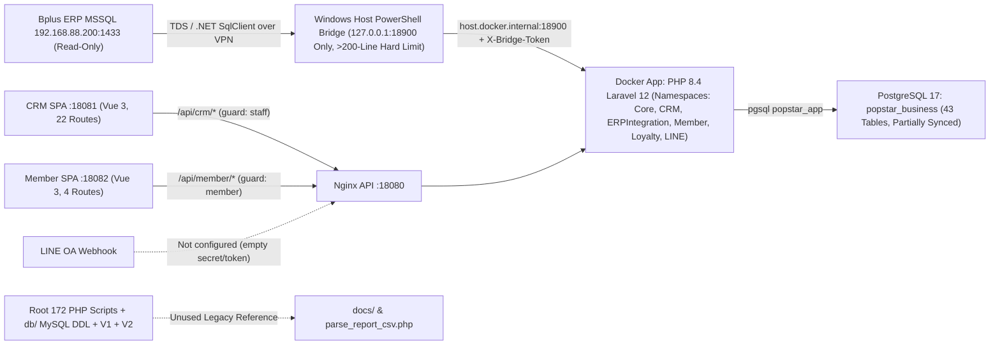
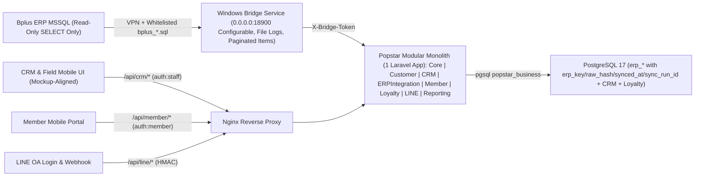

# PROJECT AUDIT & BASELINE — POPSTAR BUSINESS PLATFORM

**Audit Date:** 2026-11-16 07:13–07:17 ICT (Live Runtime Verified)  
**Workspace:** `d:\crm-member\` (`618` non-excluded files scanned)  
**Active Platform:** `d:\crm-member\popstar-business-platform-v4\` (Modular Monolith: Laravel 12 PHP 8.4 + PostgreSQL 17 + Vue 3 SPAs + Windows PowerShell Local Bridge)  
**Status Legend:** `PASS` / `PARTIAL` / `FAIL` / `NOT VERIFIED`

---

## 1. Baseline Snapshot (Phase 1 — No Code Changes Applied)

### 1.1 Services & Containers (`docker compose ps -a`)
Executed in `d:\crm-member\popstar-business-platform-v4\`:

| Service | Container | Image / Build | Status | Ports / Exposure |
|---|---|---|---|---|
| `db` | `popstar-platform-db-1` | `postgres:17-alpine` | **Up 16 hours (healthy)** | `5432/tcp` (internal Docker network) |
| `app` | `popstar-platform-app-1` | `popstar-platform-app` (PHP 8.4-FPM) | **Up ~10 minutes** (recreated ~07:03 ICT) | `9000/tcp`, `extra_hosts: host.docker.internal:host-gateway` |
| `backend_web` | `popstar-platform-backend_web-1` | Nginx (`docker/web/Dockerfile`) | **Up 14 hours** | `127.0.0.1:18080->80/tcp` |
| `crm` | `popstar-platform-crm-1` | `popstar-platform-crm` (Vue 3 SPA) | **Up ~10 minutes** | `127.0.0.1:18081->80/tcp` |
| `member` | `popstar-platform-member-1` | `popstar-platform-member` (Vue 3 SPA) | **Up ~10 minutes** | `127.0.0.1:18082->80/tcp` |

- **Windows Host Bridge Process:** `TCP 127.0.0.1:18900` is `LISTENING` (PID `4`, HTTP.SYS). From inside container `app`, `getent hosts host.docker.internal` resolves `fdc4:f303:9324::254`, and `GET http://host.docker.internal:18900/health` returns `HTTP 200` (`{"driver_mode":".NET SqlClient","message":"Bridge online & SQL config present (.NET SqlClient)","sql_configured":true,"source":"BPLUS","ok":true}`). SQL query endpoints (`/test-connection`, `/preview/*`) were **NOT executed** during Phases 1–3 per rule.

### 1.2 Laravel Routes (`php artisan route:list --json`)
Total registered routes: **100**

| Prefix Group | Count | Middleware / Guard | Sample Endpoints |
|---|---:|---|---|
| `/api/crm/*` | **75** | `web`, `auth:staff` (except `csrf`, `login` throttled `crm-login`) | `/api/crm/dashboard`, `/api/crm/customer-master/*`, `/api/crm/leads/*`, `/api/crm/field-visits/*`, `/api/crm/pins`, `/api/crm/plans/*`, `/api/crm/reports/*`, `/api/crm/sync-monitor/*`, `/api/crm/loyalty/*` |
| `/api/member/*` | **15** | `web`, `auth:member` (except `csrf`, `login`, `register`) | `/api/member/profile`, `/api/member/invoices`, `/api/member/points`, `/api/member/rewards`, `/api/member/verification-request`, `/api/member/line/*` |
| `/api/sync/v1/*` | **5** | `web`, `sync.token` (`VerifySyncToken`), `throttle:60,1` | `POST /api/sync/v1/{customers,products,invoices,salespersons,members}` |
| `/api/line/*` | **1** | `web`, `throttle:120,1` (HMAC signature check in controller) | `POST /api/line/webhook` |
| `/api/*` (core) | **1** | `web` | `GET /api/health` -> `200 {"status":"ok","database":"ok"}` |
| Framework / Storage | **3** | Laravel default | `GET /up`, `GET /storage/{path}`, `PUT /storage/{path}` |

Unauthenticated guard probes (`2026-11-16 07:14 ICT`):
- `GET http://127.0.0.1:18080/api/crm/customers` → `HTTP 401`
- `GET http://127.0.0.1:18080/api/member/invoices` → `HTTP 401`
- `POST http://127.0.0.1:18080/api/sync/v1/customers` → `HTTP 401`

### 1.3 Migrations (`php artisan migrate:status`)
All **18 / 18** migrations report **`Ran`** (Batches `1` through `11`):
- Batch `1`: `0001_01_01_000000`..`000002`, `2026_11_15_000100`..`000400` (`7` files)
- Batches `2..10`: `2026_11_15_000500`, `000600`, `000700`, `000800`, `122018`, `000900`, `150000`, `000910`, `160000` (`9` files)
- Batch `11`: `2026_11_15_161000_customer_master_merge_alias` (`hasColumn` guarded), `2026_11_15_162000_create_erp_product_size_segments` (lacks `Schema::hasTable()` guard — low risk now that it ran, should still be hardened if re-seeded or rebuilt).

### 1.4 Database Connections & Configuration (Secrets Masked)
- **Active Laravel `.env` (`popstar-business-platform-v4/backend/.env`):**
  - `DB_CONNECTION=pgsql`, `DB_HOST=db`, `DB_PORT=5432`, `DB_DATABASE=popstar_business`, `DB_USERNAME=popstar_app`, `DB_PASSWORD=***REDACTED***`
  - `SESSION_DRIVER=file`, `CACHE_STORE=file`, `QUEUE_CONNECTION=database`
  - `SYNC_API_TOKEN=***REDACTED***`, `LOCAL_ERP_BRIDGE_URL=http://host.docker.internal:18900`, `LOCAL_ERP_BRIDGE_TOKEN=***REDACTED***`
  - `LINE_CHANNEL_SECRET=` *(empty)*, `LINE_CHANNEL_ACCESS_TOKEN=` *(empty)*
- **`backend/config/database.php`:** Default driver falls back to `'sqlite'` when env omitted; defines `sqlite`, `mysql`, `mariadb`, `pgsql`, `sqlsrv`. `phpunit.xml` overrides DB to `sqlite :memory:` with `array` cache & session. `backend/database/database.sqlite` exists (`98,304` B) as an unused artifact.
- **Local Bridge Config (`popstar-business-platform-v4/sync-agent/config.env`):**
  - `SYNC_BASE_URL=http://127.0.0.1:18080`, `SYNC_SOURCE=BPLUS`, `BRIDGE_PORT=18900`
  - `SQL_SERVER=192.168.88.200`, `SQL_PORT=1433`, `SQL_DATABASE=BPLUSERP_POPSTAR_2021`, `SQL_USER=jetsada`, `SQL_PASSWORD_DPAPI=***REDACTED***`, `SQL_CONNECTION_STRING=` *(blank — built dynamically via DPAPI)*, `SQL_TRUST_SERVER_CERTIFICATE=true`
  - `BRIDGE_API_TOKEN=***REDACTED***`, `SYNC_API_TOKEN=***REDACTED***`
- **Legacy Root PHP (`db/connect.php`, `db/mysql_connect.php`):** Reads `storage/private/secrets.php` *(missing from workspace)* for ODBC `BPLUSERP_POPSTAR_2021` + fallback MySQL `popstar_db` on `127.0.0.1:3306`. Unused in V4 Docker stack.

### 1.5 Laravel App Count & PostgreSQL Databases
- **Laravel Applications (`artisan` files in workspace):** **1** (`d:\crm-member\popstar-business-platform-v4\backend\artisan`). *(V1 `popstar-platform/` and V2 `popstar-business-platform-v2/` are scaffold/overlay archives with no `artisan` entrypoint.)*
- **PostgreSQL Databases:** **1 active application database** (`popstar_business`, PostgreSQL 17, **43 public tables**), alongside standard `postgres`, `template0`, `template1`.
- **Live Populated Tables vs Empty Tables (`COUNT(*)` on `2026-11-16 07:13 ICT`):**
  - **Populated (`15` tables):** `erp_customers` (`7,804`), `crm_customer_masters` (`7,804`), `erp_products` (`4,208`), `erp_sales_invoices` (`9,247`: `5,001` Doc `307` posted + `4,130` Doc `207` reserved + `20` Doc `207` cancelled + `96` Doc `308` returned, `sold_at` `2025-12-05 17:00+00..2025-12-31 17:00+00`), `erp_sales_items` (`25,615`), `erp_members` (`112`), `erp_salespersons` (`21`), `erp_sync_cursors` (`1`: `BPLUS|invoices = 2064868`), `sync_runs` (`186`: `150` success, `34` failed, `2` running — latest run `186` failed at `00:05:44 UTC` with `Invoice 690101/100020001 has more than 200 lines; refusing incomplete sync.`), `sync_errors` (`34`), `crm_audit_logs` (`2`), `crm_customer_visits` (`1`), `crm_visit_photos` (`2`), `staff_users` (`1` admin `admin@popstar.local`), `migrations` (`18`).
  - **Zero-row (`28` tables):** `crm_leads`, `crm_lead_photos`, `crm_customer_locations`, `crm_follow_up_tasks`, `crm_visit_plans`, `crm_visit_plan_stops`, `crm_sales_targets`, `customer_match_candidates`, `erp_product_size_segments`, `member_accounts`, `member_erp_links`, `member_verification_requests`, `member_line_accounts`, `line_link_tokens`, `line_webhook_events`, `loyalty_points_ledger`, `loyalty_rewards`, `loyalty_redemptions`, `loyalty_rules`, `sync_batches`, plus `8` unused Laravel framework tables (`cache`, `cache_locks`, `jobs`, `job_batches`, `failed_jobs`, `password_reset_tokens`, `sessions`, `users`).

### 1.6 Pages / Screens Load Audit
- **CRM SPA (`http://127.0.0.1:18081`):** Entry `/` and all **22 named routes** defined in `web/crm/src/router.js` (`/dashboard`, `/customers`, `/pipeline`, `/customer-360`, `/map`, `/profile`, `/quick-add`, `/visits`, `/plans`, `/followups`, `/erp-requests`, `/matching`, `/erp-customers`, `/sync`, `/members`, `/member-registration`, `/member-portal`, `/loyalty`, `/rewards`, `/member`, `/reports`, `/settings`) return **HTTP 200** cleanly via SPA Nginx fallback.
- **Member SPA (`http://127.0.0.1:18082`):** Entry `/` and all **4 named routes** (`/overview`, `/invoices`, `/rewards`, `/binding`) return **HTTP 200**.
- **Functional UI Placeholders / Incomplete Sections Inspected:**
  - `ReportsView.vue:93`: SKU Size Segments management panel is suppressed behind `<section v-if="false && isManager">`; `ReportsView.vue:36` shows disclaimer `"ยอดอยู่ระหว่างตรวจเทียบกับรายงาน Bplus"`; Market-visit auto-report lacks native PPTX export (`FieldController` exports JSON/CSV/HTML print only).
  - `MapView.vue` / `CustomerMap.vue`: Leaflet map statically centers on `[15.2287, 104.8564]` without province or salesperson filters; `crm_customer_locations` has `0` pins.
  - `PipelineView.vue`: Missing quotation generation step (`New Lead -> ... -> Quotation -> Converted to Customer`).
  - `Member` views (`OverviewView.vue` etc.): Guarded by verified link (`isMemberVerified`), currently untested with live data (`0` `member_accounts` / `0` `member_erp_links`).

### 1.7 Automated Test Suite Results
1. `docker compose exec -T app php artisan test`: **FAIL** — `ERROR Command "test" is not defined.` (`docker/php/Dockerfile` builds container with `composer install --no-dev`, excluding `phpunit/phpunit` from production image).
2. `docker run --rm --user 0:0 -v "d:\crm-member\popstar-business-platform-v4\backend:/app" -w /app popstar-platform-app:latest php vendor/bin/phpunit --testdox`: **PASS (`OK (23 tests, 376 assertions)`)** against SQLite `:memory:` (`phpunit.xml`), covering 8 suites:
   - `CustomerIdentityLifecycle` (`1` test)
   - `CustomerMasterAndFieldEvidence` (`4` tests) — *note: running PHPUnit without `--user 0:0` fails creating `/app/storage/framework/testing/disks/local` due to host/container directory ownership.*
   - `FieldReportingAndLocalBridge` (`4` tests)
   - `PhaseCLineAndLoyalty` (`2` tests)
   - `PopstarSecurity` (`6` tests)
   - `SalesCalculationRules` (`4` tests)
   - `Feature\Example` (`1` test), `Unit\Example` (`1` test)

---

## 2. Architecture: Current vs Target

| Architecture Dimension | Current State Observed | Target Architecture Requirement | Verdict | Evidence |
|---|---|---|---|---|
| **Laravel App Count** | **1** active Laravel backend (`popstar-business-platform-v4/backend/artisan`) | 1 Modular Monolith Laravel backend | **PASS** | Single `artisan`; V1 & V2 have no runtime `artisan` |
| **PostgreSQL DB Count & Name** | **1** active app DB `popstar_business` (`43` public tables) | 1 shared PostgreSQL database | **PASS** | `backend/.env` + `compose.yaml`; MySQL `web_reserve` is unused legacy |
| **CRM & Member Share Same DB?** | Yes — `staff_*`, `crm_*`, `erp_*`, `member_*`, `loyalty_*`, `line_*` live in `popstar_business` | Shared backend & DB with separate module tables | **PASS** | `pg_columns.psv` & `pg_constraints.psv` |
| **Auth Guards Isolation** | Separate Laravel session guards `staff` (`StaffUser`) & `member` (`MemberAccount`), HTTP `401` on wrong guard | Separate `staff` & `member` guards; member cannot reach CRM APIs or other customers | **PASS** | `config/auth.php`, `PopstarSecurityTest` (6/6 pass), live HTTP 401 probe |
| **Customer Master Location** | `App\Modules\CRM\CustomerMasterController` + `crm_customer_masters` + `customer_match_candidates` (`crm_customer_masters = 7,804` synced rows) | Separate `Customer` logical module (`CustomerMaster` canonical ID) | **PARTIAL** | Feature & DB exist; code resides under `App\Modules\CRM\` instead of `App\Modules\Customer\` |
| **ERP Mirror Location** | `App\Modules\ERPIntegration` (`ErpLocalSyncController`, `SyncController`, `ErpMirrorUpserter`, `SalesRules`) + `erp_*` tables + `sync_runs` / `sync_errors` | ERP Integration module + `erp_*` mirror with `erp_key`, `raw_hash`, `synced_at`, `sync_run_id`, reconciliation | **PARTIAL** | Partial sync ran (`7,804` cust, `9,247` inv), but missing Phase 6 audit columns, `bplus_invoices.sql` excludes `<20260101` & `207`, fails `>200` item lines (`id=186`), zero reconciliation job |
| **Loyalty Ledger Location** | `App\Modules\Loyalty` (`LoyaltyController`, `InvoicePointsSynchronizer`) + `loyalty_points_ledger`, `loyalty_rules`, `loyalty_rewards`, `loyalty_redemptions` | Append-only ledger, configurable rules, reversal on return | **PARTIAL** | Schema, API & unit tests exist; `0` production rules/ledger rows; Bplus `bplus_member_points.sql` not ingested |
| **Reporting Module Split** | Reporting actions inside `CrmController` & `FieldController` (`ReportsView.vue` has disabled panel & no PPTX) | Dedicated `Reporting` module (`Dashboard`, `Analytics`, `PDF/Excel/PPTX`) | **PARTIAL** | Endpoints exist in `CRM` namespace; size-segment UI disabled (`v-if="false"`), no PPTX generator, no Bplus reconciliation |
| **Backend vs Overlay & Image Parity** | Running `app` container **matches** host `backend/`, **but `backend-overlay/` is stale (`5` PHP diffs + missing `161000`/`162000` migrations)** | Single clean source without drifted overlay shadow copy | **PARTIAL** | SHA-256 check `CrmController.php` matches container `58fa600e...`; `backend-overlay/` has 5/36 diffs |

### 2.1 Current Architecture Diagram

### 2.2 Target Architecture Diagram

---

## 3. Module Status Table

| Module | Code exists | Connected to real data | Tested | Status | Problem / Evidence |
|---|---|---|---|---|---|
| **CRM** | **Yes** (`CrmController`, `CustomerMasterController`, `CustomersView`, `Customer360View`, `DashboardView`) | **Partial** (`7,804` `crm_customer_masters`, `9,247` invoices in PG) | **Partial** (PHPUnit passes `:memory:`; HTTP 200 SPAs & 401 guards) | **PARTIAL** | Dashboard & customer 360 read partial `2025-12` mirror data; `backend-overlay/` out of sync (`5` files); missing Mockup UI parity verification (Phase 10); customer contacts only store primary phone |
| **Lead Management** | **Yes** (`FieldController`, `crm_leads`, `crm_lead_photos`, `PipelineView`, `QuickAddView`) | **No** (`crm_leads = 0`, `crm_lead_photos = 0`, `crm_follow_up_tasks = 0`) | **Partial** (Feature tests cover quick lead, dup phone check, stages) | **PARTIAL** | Duplicate phone check & mobile quick-add exist in code; Kanban UI/stage workflow needs live testing; **Quotation** stage artifact/flow incomplete |
| **Field Sales / Visits** | **Yes** (`FieldController`, `VisitsView`, `PlansView`, `VisitEvidenceWizard`) | **Minimal** (`crm_customer_visits = 1`, `crm_visit_photos = 2`, `crm_visit_plans = 0`) | **Partial** (`CustomerMasterAndFieldEvidenceTest` passes) | **PARTIAL** | GPS/6-point form & photo compression implemented in code; Visit Calendar UI & live field route data unpopulated |
| **Customer Map** | **Yes** (`CustomerMap.vue`, `MapView.vue`, `/api/crm/pins`) | **No** (`crm_customer_locations = 0`) | **No** (HTTP 200 route check only) | **PARTIAL** | Hardcoded initial center `[15.2287, 104.8564]` in `CustomerMap.vue`; missing province & salesperson filter controls in `MapView.vue`; pins colored by stage/shop type untested on live coordinates |
| **Reporting** | **Yes** (Legacy BI + V4 `ReportsView.vue`, `CrmController`, `FieldController@fieldVisitReport`) | **Partial** (reads partial PG sales mirror; `erp_product_size_segments = 0`) | **Partial** (`SalesCalculationRulesTest` & `FieldReportingAndLocalBridgeTest` pass) | **PARTIAL** | `ReportsView.vue:93` disables size-segment UI (`v-if="false"`); Bplus variance reconciliation not executed (`ReportsView.vue:36` warning); **no native PPTX export** replacing manual PowerPoint |
| **ERP Sync** | **Yes** (`local_bridge.ps1`, `ErpLocalSyncController`, `SyncController`, `bplus_*.sql`) | **Partial** (`7,804` cust, `4,208` prod, `9,247` inv, `21` slmn, `112` mbr synced; `sync_runs = 186`) | **Failed Latest Run** (`sync_runs` id=`186` failed at `00:05:44 UTC`) | **PARTIAL** | **4 blockers:** (1) `local_bridge.ps1:333` binds `127.0.0.1` only (not configurable `0.0.0.0`/service/log file); (2) `local_bridge.ps1:450` aborts any invoice `>200` lines (`690101/100020001`); (3) `bplus_invoices.sql:87,129,132` blocks `<20260101` & `207` reservations; (4) Missing `erp_key`/`raw_hash`/`synced_at`/`sync_run_id` columns |
| **Member** | **Yes** (`MemberAuthController`, `MemberController`, `web/member/*`) | **No** (`member_accounts = 0`, `member_erp_links = 0`, `member_verification_requests = 0`) | **Partial** (`PopstarSecurityTest` & `CustomerIdentityLifecycleTest` pass; `/api/member/*` returns 401 unauth) | **PARTIAL** | Backend identity isolation works in tests; zero real member onboarding/verification records yet; member UI purchase history/profile flows need live Phase 5 & Phase 9 verification |
| **Loyalty** | **Yes** (`LoyaltyController`, `InvoicePointsSynchronizer`, `LoyaltyView`, `CrmRewardsView`) | **No** (`loyalty_rules = 0`, `loyalty_points_ledger = 0`, `loyalty_rewards = 0`, `loyalty_redemptions = 0`) | **Partial** (`PhaseCLineAndLoyaltyTest` passes) | **PARTIAL** | Append-only ledger & credit-note reversal exist in backend tests; `bplus_member_points.sql` has no Laravel ingestion handler; zero configured rules or live point earnings |
| **LINE OA** | **Yes** (`LineWebhookController`, `member_line_accounts`, `line_link_tokens`, `line_webhook_events`) | **No** (`0` rows; `LINE_CHANNEL_SECRET` & `LINE_CHANNEL_ACCESS_TOKEN` empty in `.env`) | **Partial** (`PhaseCLineAndLoyaltyTest` tests HMAC & replay guard) | **PARTIAL** | Signature check & token binding API scaffolded; no LINE Login OAuth credentials or messaging configured (Phase 9 scope: future-ready binding structure only) |

---

## 4. Full Workspace File Inventory (Phase 2 — All 618 Non-Excluded Files)

> Below is the deterministic recursive inventory excluding `vendor/`, `node_modules/`, `storage/`, `.git/`, `dist/`, `__pycache__/`, and `_extracted/`.

**Recursive Scan Summary (excluding `vendor/`, `node_modules/`, `storage/`, `.git/`, `dist/`, `__pycache__/`, `_extracted/`):**
- **Total Files Indexed:** `618` (`0` `.zip`/`.rar`/`.7z` archives, `0` `.lnk` Windows shortcuts, `0` `.xls`/`.xlsx`/`.ppt`/`.pptx` files)
- **Root Legacy PHP & Bplus Exports:** `174` (`172` `.php` files + `sql.csv` + `รายงาน.csv`; `135` call `odbc_*`, `112` convert `TIS-620`, `3` contain SQL writes)
- **`database/`:** `2` files (`install_web_reserve_mysql.php`, `.htaccess`)
- **`db/`:** `9` files (`connect.php`, `mysql_connect.php`, `helpers.php`, `web_reserve_schema.sql`, `*.json`, `.htaccess`)
- **`popstar-platform/` (V1 Archive):** `35` files
- **`popstar-business-platform-v2/` (V2 Archive):** `58` files
- **`popstar-business-platform-v4/` (V4 Active System):** `340` files
- **Exact SHA-1 Duplicate Groups:** `89` groups (`backend/` vs `backend-overlay/` shares 28 identical files + has **5 drifted/diffed PHP controllers/helpers**; `.agents/skills` vs `.claude/skills` shares 35 identical files; V2 vs V4 shares 18 identical boilerplate/query files).

| File / Path | Type | Key content found | Module | Status | Evidence |
|---|---|---|---|---|---|
| `ajax_stock.php` | Legacy PHP | ODBC (`BPLUSERP_POPSTAR_2021`); Tables: SKUMASTER,SKUMOVE,DOCTYPE,DOCINFO | Legacy Inventory/Product | Unused (Legacy Root) | 3,397 B, 100 lines; requires missing `storage/private/secrets.php` & OS ODBC DSN |
| `ajax_stock_alert_center.php` | Legacy PHP | ODBC (`BPLUSERP_POPSTAR_2021`); Tables: SKUMOVE,SKUMASTER | Legacy Inventory/Product | Unused (Legacy Root) | 5,805 B, 156 lines; requires missing `storage/private/secrets.php` & OS ODBC DSN |
| `ajax_stock_data.php` | Legacy PHP | ODBC (`BPLUSERP_POPSTAR_2021`); Tables: SKUMOVE,SKUMASTER | Legacy Inventory/Product | Unused (Legacy Root) | 3,818 B, 133 lines; requires missing `storage/private/secrets.php` & OS ODBC DSN |
| `alert_rg_telegram.php` | Legacy PHP | ODBC (`BPLUSERP_POPSTAR_2021`); Tables: DOCINFO,DOCTYPE,TRANSTKH,TRANSTKD | Legacy Alerts/Cron | Unused (Legacy Root) | 9,872 B, 245 lines; requires missing `storage/private/secrets.php` & OS ODBC DSN |
| `api_erp_lookup.php` | Legacy PHP | ODBC (`BPLUSERP_POPSTAR_2021`); Tables: ARFILE,SKUMASTER,GOODSMASTER | Legacy Portal / Auth / UI | Unused (Read-Only Reference) | 4,261 B, 123 lines; requires missing `storage/private/secrets.php` & OS ODBC DSN |
| `api_web_reserve.php` | Legacy PHP | **CONTAINS SQL WRITE**; Tables: WEB_RESERVE_STORE,WEB_RESERVE_HEADER,WEB_RESERVE_ITEMS,WEB_RESERVE_LOGS | Legacy Reservation | Unused (Write-Risk Excluded) | 20,624 B, 477 lines; requires missing `storage/private/secrets.php` & OS ODBC DSN |
| `auth_guard.php` | Legacy PHP | Tables: DOCTYPE | Legacy Portal / Auth / UI | Unused (Legacy Root) | 17,112 B, 413 lines; requires missing `storage/private/secrets.php` & OS ODBC DSN |
| `auth_roles.php` | Legacy PHP | No ERP table match | Legacy Portal / Auth / UI | Unused (Legacy Root) | 2,043 B, 55 lines; requires missing `storage/private/secrets.php` & OS ODBC DSN |
| `button.php` | Legacy PHP | No ERP table match | Legacy Portal / Auth / UI | Unused (Legacy Root) | 9,162 B, 259 lines; requires missing `storage/private/secrets.php` & OS ODBC DSN |
| `check_login.php` | Legacy PHP | ODBC (`BPLUSERP_POPSTAR_2021`); Tables: USERTAB | Legacy Portal / Auth / UI | Unused (Legacy Root) | 1,607 B, 43 lines; requires missing `storage/private/secrets.php` & OS ODBC DSN |
| `check_permission.php` | Legacy PHP | No ERP table match | Legacy Portal / Auth / UI | Unused (Legacy Root) | 948 B, 26 lines; requires missing `storage/private/secrets.php` & OS ODBC DSN |
| `cron_runner.php` | Legacy PHP | No ERP table match | Legacy Alerts/Cron | Unused (Legacy Root) | 5,058 B, 136 lines; requires missing `storage/private/secrets.php` & OS ODBC DSN |
| `fetch_data.php` | Legacy PHP | ODBC (`BPLUSERP_POPSTAR_2021`); Tables: SKUMASTER,SKUMOVE | Legacy Portal / Auth / UI | Unused (Legacy Root) | 1,690 B, 53 lines; requires missing `storage/private/secrets.php` & OS ODBC DSN |
| `food.php` | Legacy PHP | ODBC (`BPLUSERP_POPSTAR_2021`); Tables: SKUMASTER,GOODSMASTER | Legacy Portal / Auth / UI | Unused (Legacy Root) | 4,918 B, 124 lines; requires missing `storage/private/secrets.php` & OS ODBC DSN |
| `footer.php` | Legacy PHP | ODBC (`BPLUSERP_POPSTAR_2021`); No ERP table match | Legacy Portal / Auth / UI | Unused (Legacy Root) | 7,149 B, 221 lines; requires missing `storage/private/secrets.php` & OS ODBC DSN |
| `from.php` | Legacy PHP | No ERP table match | Legacy Portal / Auth / UI | Unused (Legacy Root) | 11,023 B, 306 lines; requires missing `storage/private/secrets.php` & OS ODBC DSN |
| `get_customers.php` | Legacy PHP | ODBC (`BPLUSERP_POPSTAR_2021`); Tables: ARFILE | Legacy CRM/Customer | Unused (Legacy Root) | 932 B, 34 lines; requires missing `storage/private/secrets.php` & OS ODBC DSN |
| `get_daily_sales.php` | Legacy PHP | ODBC (`BPLUSERP_POPSTAR_2021`); Tables: DOCINFO,SKUMOVE | Legacy Reporting / Sales BI | Unused (Legacy Root) | 1,424 B, 47 lines; requires missing `storage/private/secrets.php` & OS ODBC DSN |
| `get_doc_details.php` | Legacy PHP | ODBC (`BPLUSERP_POPSTAR_2021`); Tables: DOCINFO,ARDETAIL,ARFILE,SLDETAIL,SALESMAN,SKUMOVE,SKUMASTER | Legacy Portal / Auth / UI | Unused (Legacy Root) | 4,162 B, 107 lines; requires missing `storage/private/secrets.php` & OS ODBC DSN |
| `get_profile.php` | Legacy PHP | ODBC (`BPLUSERP_POPSTAR_2021`); Tables: USERTAB | Legacy Portal / Auth / UI | Unused (Legacy Root) | 1,282 B, 36 lines; requires missing `storage/private/secrets.php` & OS ODBC DSN |
| `head.php` | Legacy PHP | Tables: DOCTYPE | Legacy Portal / Auth / UI | Unused (Legacy Root) | 4,122 B, 94 lines; requires missing `storage/private/secrets.php` & OS ODBC DSN |
| `header.php` | Legacy PHP | No ERP table match | Legacy Portal / Auth / UI | Unused (Legacy Root) | 3,134 B, 105 lines; requires missing `storage/private/secrets.php` & OS ODBC DSN |
| `icon.php` | Legacy PHP | No ERP table match | Legacy Portal / Auth / UI | Unused (Legacy Root) | 9,429 B, 199 lines; requires missing `storage/private/secrets.php` & OS ODBC DSN |
| `index.php` | Legacy PHP | ODBC (`BPLUSERP_POPSTAR_2021`); Tables: DOCINFO,DOCTYPE,SKUMOVE,SKUMASTER | Legacy Portal / Auth / UI | Unused (Legacy Root) | 19,965 B, 495 lines; requires missing `storage/private/secrets.php` & OS ODBC DSN |
| `kpi_to_telegram.php` | Legacy PHP | ODBC (`BPLUSERP_POPSTAR_2021`); Tables: SKUMOVE,DOCINFO,DOCTYPE | Legacy Alerts/Cron | Unused (Legacy Root) | 4,473 B, 117 lines; requires missing `storage/private/secrets.php` & OS ODBC DSN |
| `loading.php` | Legacy PHP | Tables: DOCTYPE | Legacy Portal / Auth / UI | Unused (Legacy Root) | 1,669 B, 81 lines; requires missing `storage/private/secrets.php` & OS ODBC DSN |
| `login.php` | Legacy PHP | Tables: DOCTYPE | Legacy Portal / Auth / UI | Unused (Legacy Root) | 12,938 B, 335 lines; requires missing `storage/private/secrets.php` & OS ODBC DSN |
| `logout.php` | Legacy PHP | No ERP table match | Legacy Portal / Auth / UI | Unused (Legacy Root) | 132 B, 8 lines; requires missing `storage/private/secrets.php` & OS ODBC DSN |
| `menu_l.php` | Legacy PHP | No ERP table match | Legacy Portal / Auth / UI | Unused (Legacy Root) | 28,973 B, 634 lines; requires missing `storage/private/secrets.php` & OS ODBC DSN |
| `navbar.php` | Legacy PHP | No ERP table match | Legacy Portal / Auth / UI | Unused (Legacy Root) | 8,849 B, 226 lines; requires missing `storage/private/secrets.php` & OS ODBC DSN |
| `page.php` | Legacy PHP | No ERP table match | Legacy Portal / Auth / UI | Unused (Legacy Root) | 4,985 B, 130 lines; requires missing `storage/private/secrets.php` & OS ODBC DSN |
| `payment.php` | Legacy PHP | Tables: DOCTYPE | Legacy Portal / Auth / UI | Unused (Legacy Root) | 26,793 B, 706 lines; requires missing `storage/private/secrets.php` & OS ODBC DSN |
| `print_barcode.php` | Legacy PHP | No ERP table match | Legacy Inventory/Product | Unused (Legacy Root) | 1,356 B, 39 lines; requires missing `storage/private/secrets.php` & OS ODBC DSN |
| `p_ai_stock_recommend.php` | Legacy PHP | ODBC (`BPLUSERP_POPSTAR_2021`); Tables: DOCINFO,DOCTYPE,TRANSTKH,TRANSTKD,SKUMASTER,SKUMOVE | Legacy Inventory/Product | Unused (Legacy Root) | 29,104 B, 626 lines; requires missing `storage/private/secrets.php` & OS ODBC DSN |
| `p_audit_trail.php` | Legacy PHP | ODBC (`BPLUSERP_POPSTAR_2021`); Tables: DOCINFO,DOCTYPE | Legacy Portal / Auth / UI | Unused (Legacy Root) | 7,930 B, 187 lines; requires missing `storage/private/secrets.php` & OS ODBC DSN |
| `p_baijong.php` | Legacy PHP | ODBC (`BPLUSERP_POPSTAR_2021`); Tables: DOCINFO,DOCTYPE,TRANSTKH,ARFILE,SLDETAIL,SALESMAN,TRANSTKD,SKUMASTER | Legacy Reservation | Unused (Legacy Root) | 35,530 B, 763 lines; requires missing `storage/private/secrets.php` & OS ODBC DSN |
| `p_check_sales_booking.php` | Legacy PHP | ODBC (`BPLUSERP_POPSTAR_2021`); Tables: TRANSTKD,DOCINFO,DOCTYPE,AROE,ARFILE,TRANSTKH,SKUMASTER | Legacy Reporting / Sales BI | Unused (Legacy Root) | 15,821 B, 307 lines; requires missing `storage/private/secrets.php` & OS ODBC DSN |
| `p_contact.php` | Legacy PHP | ODBC (`BPLUSERP_POPSTAR_2021`); No ERP table match | Legacy CRM/Customer | Unused (Legacy Root) | 3,226 B, 96 lines; requires missing `storage/private/secrets.php` & OS ODBC DSN |
| `p_contact2.php` | Legacy PHP | ODBC (`BPLUSERP_POPSTAR_2021`); Tables: ARFILE,SALESMAN | Legacy CRM/Customer | Unused (Legacy Root) | 6,929 B, 153 lines; requires missing `storage/private/secrets.php` & OS ODBC DSN |
| `p_contactproduct.php` | Legacy PHP | ODBC (`BPLUSERP_POPSTAR_2021`); Tables: DOCTYPE,TRANSTKH,ARFILE,DOCINFO,ARDETAIL,TRANSTKD,SKUMASTER | Legacy Inventory/Product | Unused (Legacy Root) | 16,571 B, 367 lines; requires missing `storage/private/secrets.php` & OS ODBC DSN |
| `p_contactproduct11.php` | Legacy PHP | ODBC (`BPLUSERP_POPSTAR_2021`); Tables: ARFILE,DOCINFO,SKUMASTER,DOCTYPE,ARDETAIL,TRANSTKH,TRANSTKD | Legacy Inventory/Product | Unused (Legacy Root) | 4,701 B, 139 lines; requires missing `storage/private/secrets.php` & OS ODBC DSN |
| `p_customer_calendar.php` | Legacy PHP | ODBC (`BPLUSERP_POPSTAR_2021`); Tables: ARFILE,ARDETAIL,DOCINFO,DOCTYPE | Legacy CRM/Customer | Unused (Legacy Root) | 8,183 B, 167 lines; requires missing `storage/private/secrets.php` & OS ODBC DSN |
| `p_customer_calendar2.php` | Legacy PHP | ODBC (`BPLUSERP_POPSTAR_2021`); Tables: ARFILE,ARDETAIL,DOCINFO,DOCTYPE,TRANSTKH,TRANSTKD,SKUMASTER | Legacy CRM/Customer | Unused (Legacy Root) | 17,068 B, 387 lines; requires missing `storage/private/secrets.php` & OS ODBC DSN |
| `p_customer_calendar3.php` | Legacy PHP | ODBC (`BPLUSERP_POPSTAR_2021`); Tables: ARFILE,ARDETAIL,DOCINFO,DOCTYPE,TRANSTKH,TRANSTKD,SKUMASTER | Legacy CRM/Customer | Unused (Legacy Root) | 18,670 B, 515 lines; requires missing `storage/private/secrets.php` & OS ODBC DSN |
| `p_customer_calendar4.php` | Legacy PHP | ODBC (`BPLUSERP_POPSTAR_2021`); Tables: ARFILE,SALESMAN,ARDETAIL,DOCINFO,DOCTYPE,TRANSTKH,TRANSTKD,SKUMASTER | Legacy CRM/Customer | Unused (Legacy Root) | 15,496 B, 359 lines; requires missing `storage/private/secrets.php` & OS ODBC DSN |
| `p_customer_purchase_detail.php` | Legacy PHP | ODBC (`BPLUSERP_POPSTAR_2021`); Tables: ARFILE,ARDETAIL,DOCINFO,DOCTYPE,TRANSTKH,TRANSTKD,SKUMASTER | Legacy CRM/Customer | Unused (Legacy Root) | 2,545 B, 63 lines; requires missing `storage/private/secrets.php` & OS ODBC DSN |
| `p_customer_rank.php` | Legacy PHP | ODBC (`BPLUSERP_POPSTAR_2021`); Tables: ARFILE,SKUMOVE,DOCINFO,ARDETAIL,MEMBER | Legacy CRM/Customer | Unused (Legacy Root) | 15,775 B, 304 lines; requires missing `storage/private/secrets.php` & OS ODBC DSN |
| `p_daily_sales_summary.php` | Legacy PHP | ODBC (`BPLUSERP_POPSTAR_2021`); Tables: DOCINFO,DOCTYPE | Legacy Reporting / Sales BI | Unused (Legacy Root) | 7,880 B, 198 lines; requires missing `storage/private/secrets.php` & OS ODBC DSN |
| `p_dashboard.php` | Legacy PHP | ODBC (`BPLUSERP_POPSTAR_2021`); Tables: DOCINFO,DOCTYPE | Legacy Portal / Auth / UI | Unused (Legacy Root) | 16,847 B, 336 lines; requires missing `storage/private/secrets.php` & OS ODBC DSN |
| `p_db.php` | Legacy PHP | ODBC (`BPLUSERP_POPSTAR_2021`); Tables: DOCTYPE | Legacy Portal / Auth / UI | Unused (Legacy Root) | 12,365 B, 218 lines; requires missing `storage/private/secrets.php` & OS ODBC DSN |
| `p_doc_rg_damaged.php` | Legacy PHP | ODBC (`BPLUSERP_POPSTAR_2021`); Tables: AROE,DOCINFO,DOCTYPE,SALESMAN,TRANSTKH,TRANSTKD | Legacy Portal / Auth / UI | Unused (Legacy Root) | 5,060 B, 162 lines; requires missing `storage/private/secrets.php` & OS ODBC DSN |
| `p_ds-dsn2.php` | Legacy PHP | ODBC (`BPLUSERP_POPSTAR_2021`); Tables: TRANSTKD,TRANSTKH,DOCINFO,DOCTYPE,SLDETAIL,SALESMAN,SKUMASTER,ARFILE | Legacy Portal / Auth / UI | Unused (Legacy Root) | 13,380 B, 269 lines; requires missing `storage/private/secrets.php` & OS ODBC DSN |
| `p_executive_dashboard.php` | Legacy PHP | ODBC (`BPLUSERP_POPSTAR_2021`); Tables: SKUMOVE,DOCINFO,DOCTYPE,SKUMASTER,SLDETAIL,SALESMAN,ARDETAIL,ARFILE | Legacy Reporting / Sales BI | Unused (Legacy Root) | 13,011 B, 344 lines; requires missing `storage/private/secrets.php` & OS ODBC DSN |
| `p_expense_today_month.php` | Legacy PHP | ODBC (`BPLUSERP_POPSTAR_2021`); Tables: DOCINFO,DOCTYPE | Legacy Portal / Auth / UI | Unused (Legacy Root) | 25,194 B, 554 lines; requires missing `storage/private/secrets.php` & OS ODBC DSN |
| `p_expiring.php` | Legacy PHP | ODBC (`BPLUSERP_POPSTAR_2021`); Tables: TRANSTKD,SKUMOVE,SKUMASTER,TRANSTKH,DOCTYPE | Legacy Portal / Auth / UI | Unused (Legacy Root) | 11,466 B, 275 lines; requires missing `storage/private/secrets.php` & OS ODBC DSN |
| `p_fuel_report.php` | Legacy PHP | ODBC (`BPLUSERP_POPSTAR_2021`); Tables: DOCINFO | Legacy Reporting / Sales BI | Unused (Legacy Root) | 23,829 B, 529 lines; requires missing `storage/private/secrets.php` & OS ODBC DSN |
| `p_fuel_report2.php` | Legacy PHP | ODBC (`BPLUSERP_POPSTAR_2021`); Tables: DOCINFO | Legacy Reporting / Sales BI | Unused (Legacy Root) | 23,815 B, 560 lines; requires missing `storage/private/secrets.php` & OS ODBC DSN |
| `p_fuel_reports.php` | Legacy PHP | ODBC (`BPLUSERP_POPSTAR_2021`); Tables: DOCINFO | Legacy Reporting / Sales BI | Unused (Legacy Root) | 16,172 B, 390 lines; requires missing `storage/private/secrets.php` & OS ODBC DSN |
| `p_fuel_summary.php` | Legacy PHP | ODBC (`BPLUSERP_POPSTAR_2021`); Tables: DOCINFO | Legacy Portal / Auth / UI | Unused (Legacy Root) | 36,440 B, 849 lines; requires missing `storage/private/secrets.php` & OS ODBC DSN |
| `p_Invoice.php` | Legacy PHP | ODBC (`BPLUSERP_POPSTAR_2021`); Tables: DOCTYPE,SKUMOVE,DOCINFO,ARFILE,SALESMAN,SLDETAIL,ARDETAIL,TRANSTKH | Legacy Reporting / Sales BI | Unused (Legacy Root) | 8,158 B, 181 lines; requires missing `storage/private/secrets.php` & OS ODBC DSN |
| `p_item-damage.php` | Legacy PHP | ODBC (`BPLUSERP_POPSTAR_2021`); Tables: DOCINFO,DOCTYPE,TRANSTKH,TRANSTKD,SKUMASTER,GOODSMASTER | Legacy Portal / Auth / UI | Unused (Legacy Root) | 32,347 B, 883 lines; requires missing `storage/private/secrets.php` & OS ODBC DSN |
| `p_item_not_sold.php` | Legacy PHP | ODBC (`BPLUSERP_POPSTAR_2021`); Tables: SKUMOVE,DOCINFO,DOCTYPE,TRANSTKH,TRANSTKD,SKUMASTER | Legacy Portal / Auth / UI | Unused (Legacy Root) | 9,357 B, 237 lines; requires missing `storage/private/secrets.php` & OS ODBC DSN |
| `p_item_sale_stat.php` | Legacy PHP | ODBC (`BPLUSERP_POPSTAR_2021`); Tables: TRANSTKD,DOCINFO,DOCTYPE,TRANSTKH,SKUMASTER | Legacy Reporting / Sales BI | Unused (Legacy Root) | 11,363 B, 283 lines; requires missing `storage/private/secrets.php` & OS ODBC DSN |
| `p_monitor.php` | Legacy PHP | ODBC (`BPLUSERP_POPSTAR_2021`); Tables: DOCINFO,DOCTYPE | Legacy Portal / Auth / UI | Unused (Legacy Root) | 28,921 B, 734 lines; requires missing `storage/private/secrets.php` & OS ODBC DSN |
| `p_no_sale.php` | Legacy PHP | ODBC (`BPLUSERP_POPSTAR_2021`); Tables: SKUMOVE,DOCINFO,DOCTYPE,SKUMASTER | Legacy Reporting / Sales BI | Unused (Legacy Root) | 10,286 B, 250 lines; requires missing `storage/private/secrets.php` & OS ODBC DSN |
| `p_pay_voucher.php` | Legacy PHP | ODBC (`BPLUSERP_POPSTAR_2021`); Tables: DOCINFO,DOCTYPE | Legacy Portal / Auth / UI | Unused (Legacy Root) | 20,114 B, 509 lines; requires missing `storage/private/secrets.php` & OS ODBC DSN |
| `p_planstock.php` | Legacy PHP | ODBC (`BPLUSERP_POPSTAR_2021`); Tables: SKUMASTER,SKUMOVE,DOCINFO,DOCTYPE | Legacy Inventory/Product | Unused (Legacy Root) | 9,845 B, 214 lines; requires missing `storage/private/secrets.php` & OS ODBC DSN |
| `p_pos_daily_sales.php` | Legacy PHP | ODBC (`BPLUSERP_POPSTAR_2021`); No ERP table match | Legacy Reporting / Sales BI | Unused (Legacy Root) | 19,003 B, 441 lines; requires missing `storage/private/secrets.php` & OS ODBC DSN |
| `p_price-update.php` | Legacy PHP | ODBC (`BPLUSERP_POPSTAR_2021`); Tables: SKUMASTER,GOODSMASTER | Legacy Inventory/Product | Unused (Legacy Root) | 5,142 B, 138 lines; requires missing `storage/private/secrets.php` & OS ODBC DSN |
| `p_price-update2.php` | Legacy PHP | ODBC (`BPLUSERP_POPSTAR_2021`); Tables: SKUMASTER,GOODSMASTER | Legacy Inventory/Product | Unused (Legacy Root) | 5,830 B, 181 lines; requires missing `storage/private/secrets.php` & OS ODBC DSN |
| `p_pricePercent.php` | Legacy PHP | ODBC (`BPLUSERP_POPSTAR_2021`); Tables: SKUMASTER,GOODSMASTER | Legacy Inventory/Product | Unused (Legacy Root) | 9,762 B, 229 lines; requires missing `storage/private/secrets.php` & OS ODBC DSN |
| `p_product-update.php` | Legacy PHP | ODBC (`BPLUSERP_POPSTAR_2021`); Tables: SKUMASTER | Legacy Inventory/Product | Unused (Legacy Root) | 6,398 B, 215 lines; requires missing `storage/private/secrets.php` & OS ODBC DSN |
| `p_product.php` | Legacy PHP | ODBC (`BPLUSERP_POPSTAR_2021`); Tables: SKUMASTER,GOODSMASTER | Legacy Inventory/Product | Unused (Legacy Root) | 6,920 B, 185 lines; requires missing `storage/private/secrets.php` & OS ODBC DSN |
| `p_product1.php` | Legacy PHP | ODBC (`BPLUSERP_POPSTAR_2021`); Tables: GOODSMASTER,SKUMASTER,SKUMOVE | Legacy Inventory/Product | Unused (Legacy Root) | 70,396 B, 1183 lines; requires missing `storage/private/secrets.php` & OS ODBC DSN |
| `p_productform.php` | Legacy PHP | ODBC (`BPLUSERP_POPSTAR_2021`); Tables: DOCINFO,TRANSTKH,TRANSTKD,SKUMASTER | Legacy Inventory/Product | Unused (Legacy Root) | 7,004 B, 189 lines; requires missing `storage/private/secrets.php` & OS ODBC DSN |
| `p_productGenBarcode.php` | Legacy PHP | ODBC (`BPLUSERP_POPSTAR_2021`); Tables: SKUMASTER,GOODSMASTER | Legacy Inventory/Product | Unused (Legacy Root) | 3,784 B, 105 lines; requires missing `storage/private/secrets.php` & OS ODBC DSN |
| `p_product_planning_basic.php` | Legacy PHP | ODBC (`BPLUSERP_POPSTAR_2021`); Tables: DOCINFO,DOCTYPE,TRANSTKH,TRANSTKD,SKUMOVE,SKUMASTER | Legacy Inventory/Product | Unused (Legacy Root) | 9,118 B, 178 lines; requires missing `storage/private/secrets.php` & OS ODBC DSN |
| `p_profit_compare.php` | Legacy PHP | ODBC (`BPLUSERP_POPSTAR_2021`); Tables: DOCINFO,SLDETAIL,SKUMOVE,DOCTYPE | Legacy Portal / Auth / UI | Unused (Legacy Root) | 15,045 B, 454 lines; requires missing `storage/private/secrets.php` & OS ODBC DSN |
| `p_purchase_list.php` | Legacy PHP | ODBC (`BPLUSERP_POPSTAR_2021`); Tables: DOCINFO,DOCTYPE,TRANSTKH,TRANSTKD,SKUMASTER,GOODSMASTER | Legacy Portal / Auth / UI | Unused (Legacy Root) | 8,708 B, 198 lines; requires missing `storage/private/secrets.php` & OS ODBC DSN |
| `p_purchase_request_print.php` | Legacy PHP | ODBC (`BPLUSERP_POPSTAR_2021`); Tables: DOCINFO,DOCTYPE,TRANSTKH,TRANSTKD,SKUMASTER | Legacy Portal / Auth / UI | Unused (Legacy Root) | 19,589 B, 139 lines; requires missing `storage/private/secrets.php` & OS ODBC DSN |
| `p_pv_daily_table.php` | Legacy PHP | ODBC (`BPLUSERP_POPSTAR_2021`); Tables: DOCINFO,DOCTYPE | Legacy Portal / Auth / UI | Unused (Legacy Root) | 24,685 B, 468 lines; requires missing `storage/private/secrets.php` & OS ODBC DSN |
| `p_pv_detail_modal.php` | Legacy PHP | ODBC (`BPLUSERP_POPSTAR_2021`); Tables: DOCINFO,DOCTYPE | Legacy Portal / Auth / UI | Unused (Legacy Root) | 11,724 B, 321 lines; requires missing `storage/private/secrets.php` & OS ODBC DSN |
| `p_reconciliation_final.php` | Legacy PHP | ODBC (`BPLUSERP_POPSTAR_2021`); Tables: DOCINFO,DOCTYPE | Legacy Portal / Auth / UI | Unused (Legacy Root) | 10,573 B, 217 lines; requires missing `storage/private/secrets.php` & OS ODBC DSN |
| `p_reconciliation_final2.php` | Legacy PHP | ODBC (`BPLUSERP_POPSTAR_2021`); Tables: DOCINFO,DOCTYPE,TRANSTKH,ARFILE,SLDETAIL,SALESMAN,TRANSTKD,SKUMASTER | Legacy Portal / Auth / UI | Unused (Legacy Root) | 28,835 B, 620 lines; requires missing `storage/private/secrets.php` & OS ODBC DSN |
| `p_reconciliation_reserve_vs_credit.php` | Legacy PHP | ODBC (`BPLUSERP_POPSTAR_2021`); Tables: AROE,DOCINFO,DOCTYPE,SALESMAN,TRANSTKH,TRANSTKD | Legacy Reservation | Unused (Legacy Root) | 9,751 B, 251 lines; requires missing `storage/private/secrets.php` & OS ODBC DSN |
| `p_reconciliation_reserve_vs_credit_detail.php` | Legacy PHP | ODBC (`BPLUSERP_POPSTAR_2021`); Tables: DOCINFO,DOCTYPE,TRANSTKH,TRANSTKD,SKUMASTER,AROE,SALESMAN | Legacy Reservation | Unused (Legacy Root) | 7,573 B, 197 lines; requires missing `storage/private/secrets.php` & OS ODBC DSN |
| `p_reconciliation_summary.php` | Legacy PHP | ODBC (`BPLUSERP_POPSTAR_2021`); Tables: DOCINFO,DOCTYPE | Legacy Portal / Auth / UI | Unused (Legacy Root) | 5,749 B, 124 lines; requires missing `storage/private/secrets.php` & OS ODBC DSN |
| `p_repair_reports.php` | Legacy PHP | ODBC (`BPLUSERP_POPSTAR_2021`); Tables: DOCINFO,DOCTYPE | Legacy Reporting / Sales BI | Unused (Legacy Root) | 26,353 B, 615 lines; requires missing `storage/private/secrets.php` & OS ODBC DSN |
| `p_repair_today_month.php` | Legacy PHP | ODBC (`BPLUSERP_POPSTAR_2021`); Tables: DOCINFO,DOCTYPE | Legacy Portal / Auth / UI | Unused (Legacy Root) | 8,477 B, 222 lines; requires missing `storage/private/secrets.php` & OS ODBC DSN |
| `p_reportX.php` | Legacy PHP | ODBC (`BPLUSERP_POPSTAR_2021`); Tables: DOCINFO,DOCTYPE | Legacy Reporting / Sales BI | Unused (Legacy Root) | 5,460 B, 109 lines; requires missing `storage/private/secrets.php` & OS ODBC DSN |
| `p_reportZ.php` | Legacy PHP | ODBC (`BPLUSERP_POPSTAR_2021`); Tables: DOCINFO,DOCTYPE | Legacy Reporting / Sales BI | Unused (Legacy Root) | 7,042 B, 203 lines; requires missing `storage/private/secrets.php` & OS ODBC DSN |
| `p_reserv2.php` | Legacy PHP | ODBC (`BPLUSERP_POPSTAR_2021`); Tables: DOCTYPE,DOCINFO,SKUMASTER,TRANSTKD,TRANSTKH,GOODSMASTER,ARFILE | Legacy Portal / Auth / UI | Unused (Legacy Root) | 10,689 B, 233 lines; requires missing `storage/private/secrets.php` & OS ODBC DSN |
| `p_reserve_cover.php` | Legacy PHP | ODBC (`BPLUSERP_POPSTAR_2021`); Tables: DOCTYPE,DOCINFO,AROE,SALESMAN,TRANSTKH,ARFILE | Legacy Reservation | Unused (Legacy Root) | 22,565 B, 499 lines; requires missing `storage/private/secrets.php` & OS ODBC DSN |
| `p_reserve_cover2.php` | Legacy PHP | ODBC (`BPLUSERP_POPSTAR_2021`); Tables: DOCTYPE,DOCINFO,AROE,SALESMAN,TRANSTKH,ARFILE | Legacy Reservation | Unused (Legacy Root) | 22,382 B, 496 lines; requires missing `storage/private/secrets.php` & OS ODBC DSN |
| `p_reserve_detail2.php` | Legacy PHP | ODBC (`BPLUSERP_POPSTAR_2021`); Tables: DOCTYPE,DOCINFO,TRANSTKH,ARFILE,TRANSTKD,SKUMASTER | Legacy Reservation | Unused (Legacy Root) | 9,065 B, 219 lines; requires missing `storage/private/secrets.php` & OS ODBC DSN |
| `p_reserve_list2.php` | Legacy PHP | ODBC (`BPLUSERP_POPSTAR_2021`); Tables: DOCTYPE,DOCINFO,ARFILE,TRANSTKH | Legacy Reservation | Unused (Legacy Root) | 9,572 B, 230 lines; requires missing `storage/private/secrets.php` & OS ODBC DSN |
| `p_revers.php` | Legacy PHP | ODBC (`BPLUSERP_POPSTAR_2021`); Tables: DOCTYPE,DOCINFO,SKUMASTER,TRANSTKD,TRANSTKH,GOODSMASTER,ARFILE | Legacy Reservation | Unused (Legacy Root) | 10,012 B, 214 lines; requires missing `storage/private/secrets.php` & OS ODBC DSN |
| `p_sale-BI-YOY.php` | Legacy PHP | ODBC (`BPLUSERP_POPSTAR_2021`); Tables: DOCINFO,DOCTYPE | Legacy Reporting / Sales BI | Unused (Legacy Root) | 11,448 B, 245 lines; requires missing `storage/private/secrets.php` & OS ODBC DSN |
| `p_sale-BI.php` | Legacy PHP | ODBC (`BPLUSERP_POPSTAR_2021`); Tables: DOCINFO,SKUMOVE,ARDETAIL,ARFILE,DOCTYPE | Legacy Reporting / Sales BI | Unused (Read-Only Reference) | 21,583 B, 569 lines; requires missing `storage/private/secrets.php` & OS ODBC DSN |
| `p_sale-BI2.php` | Legacy PHP | ODBC (`BPLUSERP_POPSTAR_2021`); Tables: ARFILE,SKUMASTER,DOCINFO,SKUMOVE,DOCTYPE,ARDETAIL | Legacy Reporting / Sales BI | Unused (Legacy Root) | 6,122 B, 134 lines; requires missing `storage/private/secrets.php` & OS ODBC DSN |
| `p_sale-BI3.php` | Legacy PHP | ODBC (`BPLUSERP_POPSTAR_2021`); Tables: ARFILE,SKUMASTER,DOCINFO,SKUMOVE,DOCTYPE,ARDETAIL | Legacy Reporting / Sales BI | Unused (Legacy Root) | 5,573 B, 123 lines; requires missing `storage/private/secrets.php` & OS ODBC DSN |
| `p_sale-BI4.php` | Legacy PHP | ODBC (`BPLUSERP_POPSTAR_2021`); Tables: ARFILE,SKUMASTER,DOCINFO,SKUMOVE,DOCTYPE,ARDETAIL,SLDETAIL,SALESMAN | Legacy Reporting / Sales BI | Unused (Legacy Root) | 7,981 B, 156 lines; requires missing `storage/private/secrets.php` & OS ODBC DSN |
| `p_sale-BI5.php` | Legacy PHP | ODBC (`BPLUSERP_POPSTAR_2021`); Tables: SALESMAN,DOCTYPE,SKUMASTER,SKUMOVE,DOCINFO,ARDETAIL,ARFILE,SLDETAIL | Legacy Reporting / Sales BI | Unused (Legacy Root) | 8,177 B, 166 lines; requires missing `storage/private/secrets.php` & OS ODBC DSN |
| `p_sale-BI6-1.php` | Legacy PHP | ODBC (`BPLUSERP_POPSTAR_2021`); Tables: SALESMAN,SKUMOVE,DOCINFO,DOCTYPE,SKUMASTER,SLDETAIL | Legacy Reporting / Sales BI | Unused (Legacy Root) | 7,459 B, 195 lines; requires missing `storage/private/secrets.php` & OS ODBC DSN |
| `p_sale-BI6-2.php` | Legacy PHP | ODBC (`BPLUSERP_POPSTAR_2021`); Tables: SKUMOVE,DOCINFO,SLDETAIL,SALESMAN | Legacy Reporting / Sales BI | Unused (Legacy Root) | 4,967 B, 129 lines; requires missing `storage/private/secrets.php` & OS ODBC DSN |
| `p_sale-BI6.php` | Legacy PHP | ODBC (`BPLUSERP_POPSTAR_2021`); Tables: SKUMOVE,DOCINFO,SLDETAIL,SALESMAN | Legacy Reporting / Sales BI | Unused (Legacy Root) | 9,537 B, 254 lines; requires missing `storage/private/secrets.php` & OS ODBC DSN |
| `p_sale-BI7.php` | Legacy PHP | ODBC (`BPLUSERP_POPSTAR_2021`); Tables: SALESMAN,SKUMOVE,DOCINFO,DOCTYPE,SLDETAIL,SKUMASTER,ARDETAIL,ARFILE | Legacy Reporting / Sales BI | Unused (Legacy Root) | 11,193 B, 232 lines; requires missing `storage/private/secrets.php` & OS ODBC DSN |
| `p_sale-BI8.php` | Legacy PHP | ODBC (`BPLUSERP_POPSTAR_2021`); Tables: ARFILE,SKUMASTER,DOCINFO,SKUMOVE,DOCTYPE,ARDETAIL,SLDETAIL,SALESMAN | Legacy Reporting / Sales BI | Unused (Legacy Root) | 13,845 B, 269 lines; requires missing `storage/private/secrets.php` & OS ODBC DSN |
| `p_sale-BI9.php` | Legacy PHP | ODBC (`BPLUSERP_POPSTAR_2021`); Tables: ARFILE,SKUMASTER,DOCINFO,SKUMOVE,ARDETAIL | Legacy Reporting / Sales BI | Unused (Legacy Root) | 13,374 B, 296 lines; requires missing `storage/private/secrets.php` & OS ODBC DSN |
| `p_sale-doc-by-loc.php` | Legacy PHP | ODBC (`BPLUSERP_POPSTAR_2021`); Tables: TRANSTKD,TRANSTKH,DOCINFO,DOCTYPE | Legacy Reporting / Sales BI | Unused (Legacy Root) | 12,583 B, 256 lines; requires missing `storage/private/secrets.php` & OS ODBC DSN |
| `p_sale1.php` | Legacy PHP | ODBC (`BPLUSERP_POPSTAR_2021`); Tables: TRANSTKD,DOCINFO,DOCTYPE,TRANSTKH | Legacy Reporting / Sales BI | Unused (Legacy Root) | 4,185 B, 123 lines; requires missing `storage/private/secrets.php` & OS ODBC DSN |
| `p_saleLoss.php` | Legacy PHP | ODBC (`BPLUSERP_POPSTAR_2021`); Tables: SKUMASTER,GOODSMASTER | Legacy Reporting / Sales BI | Unused (Legacy Root) | 5,996 B, 136 lines; requires missing `storage/private/secrets.php` & OS ODBC DSN |
| `p_saleLoss1.php` | Legacy PHP | ODBC (`BPLUSERP_POPSTAR_2021`); Tables: SKUMASTER,GOODSMASTER | Legacy Reporting / Sales BI | Unused (Legacy Root) | 6,606 B, 154 lines; requires missing `storage/private/secrets.php` & OS ODBC DSN |
| `p_saleNet.php` | Legacy PHP | ODBC (`BPLUSERP_POPSTAR_2021`); Tables: DOCTYPE,SKUMOVE,DOCINFO,SLDETAIL,SALESMAN | Legacy Reporting / Sales BI | Unused (Legacy Root) | 5,849 B, 149 lines; requires missing `storage/private/secrets.php` & OS ODBC DSN |
| `p_salesman_report.php` | Legacy PHP | ODBC (`BPLUSERP_POPSTAR_2021`); Tables: SALESMAN | Legacy Reporting / Sales BI | Unused (Legacy Root) | 4,283 B, 126 lines; requires missing `storage/private/secrets.php` & OS ODBC DSN |
| `p_salesumary.php` | Legacy PHP | ODBC (`BPLUSERP_POPSTAR_2021`); Tables: DOCINFO,DOCTYPE | Legacy Reporting / Sales BI | Unused (Legacy Root) | 8,182 B, 226 lines; requires missing `storage/private/secrets.php` & OS ODBC DSN |
| `p_sales_by_category_top.php` | Legacy PHP | ODBC (`BPLUSERP_POPSTAR_2021`); Tables: SKUMOVE,DOCINFO,DOCTYPE,SKUMASTER | Legacy Reporting / Sales BI | Unused (Legacy Root) | 21,570 B, 606 lines; requires missing `storage/private/secrets.php` & OS ODBC DSN |
| `p_sales_by_category_top_branch.php` | Legacy PHP | **CONTAINS SQL WRITE**; ODBC (`BPLUSERP_POPSTAR_2021`); Tables: DOCTYPE,DOCINFO,TRANSTKH,TRANSTKD,SKUMASTER | Legacy Reporting / Sales BI | Unused (Write-Risk Excluded) | 20,957 B, 470 lines; requires missing `storage/private/secrets.php` & OS ODBC DSN |
| `p_sales_by_product-1.php` | Legacy PHP | ODBC (`BPLUSERP_POPSTAR_2021`); Tables: SKUMASTER,TRANSTKD,TRANSTKH,DOCINFO,DOCTYPE,ARFILE,SLDETAIL,SALESMAN | Legacy Inventory/Product | Unused (Legacy Root) | 7,188 B, 158 lines; requires missing `storage/private/secrets.php` & OS ODBC DSN |
| `p_sales_by_product.php` | Legacy PHP | ODBC (`BPLUSERP_POPSTAR_2021`); Tables: TRANSTKD,TRANSTKH,DOCINFO,DOCTYPE,SKUMASTER,ARFILE,SLDETAIL,SALESMAN | Legacy Inventory/Product | Unused (Legacy Root) | 10,833 B, 222 lines; requires missing `storage/private/secrets.php` & OS ODBC DSN |
| `p_sales_by_productไม่มีรวม.php` | Legacy PHP | ODBC (`BPLUSERP_POPSTAR_2021`); Tables: SKUMASTER,TRANSTKD,TRANSTKH,DOCINFO,ARFILE,SLDETAIL,SALESMAN | Legacy Inventory/Product | Unused (Legacy Root) | 8,135 B, 170 lines; requires missing `storage/private/secrets.php` & OS ODBC DSN |
| `p_sales_comparison.php` | Legacy PHP | ODBC (`BPLUSERP_POPSTAR_2021`); Tables: DOCINFO,DOCTYPE | Legacy Reporting / Sales BI | Unused (Legacy Root) | 6,558 B, 156 lines; requires missing `storage/private/secrets.php` & OS ODBC DSN |
| `p_sales_comparison1.php` | Legacy PHP | ODBC (`BPLUSERP_POPSTAR_2021`); Tables: DOCINFO,DOCTYPE | Legacy Reporting / Sales BI | Unused (Legacy Root) | 5,659 B, 123 lines; requires missing `storage/private/secrets.php` & OS ODBC DSN |
| `p_sales_dashboard.php` | Legacy PHP | ODBC (`BPLUSERP_POPSTAR_2021`); Tables: DOCINFO,DOCTYPE | Legacy Reporting / Sales BI | Unused (Legacy Root) | 9,685 B, 244 lines; requires missing `storage/private/secrets.php` & OS ODBC DSN |
| `p_sales_ds-dsn-1.php` | Legacy PHP | ODBC (`BPLUSERP_POPSTAR_2021`); Tables: TRANSTKD,TRANSTKH,DOCINFO,DOCTYPE,SKUMASTER,ARFILE,SLDETAIL,SALESMAN | Legacy Reporting / Sales BI | Unused (Legacy Root) | 10,854 B, 222 lines; requires missing `storage/private/secrets.php` & OS ODBC DSN |
| `p_sales_ds-dsn-2.php` | Legacy PHP | ODBC (`BPLUSERP_POPSTAR_2021`); Tables: TRANSTKD,TRANSTKH,DOCINFO,DOCTYPE,SKUMASTER,ARFILE,SLDETAIL,SALESMAN | Legacy Reporting / Sales BI | Unused (Legacy Root) | 13,832 B, 273 lines; requires missing `storage/private/secrets.php` & OS ODBC DSN |
| `p_sales_integrity_report.php` | Legacy PHP | ODBC (`BPLUSERP_POPSTAR_2021`); Tables: SLDETAIL,SALESMAN,TRANSTKD,TRANSTKH,DOCINFO,DOCTYPE,SKUMASTER,ARFILE | Legacy Reporting / Sales BI | Unused (Legacy Root) | 19,634 B, 385 lines; requires missing `storage/private/secrets.php` & OS ODBC DSN |
| `p_sales_integrity_report2.php` | Legacy PHP | ODBC (`BPLUSERP_POPSTAR_2021`); Tables: DOCINFO,DOCTYPE,TRANSTKH,ARFILE,SLDETAIL,SALESMAN,TRANSTKD,SKUMASTER | Legacy Reporting / Sales BI | Unused (Legacy Root) | 25,619 B, 546 lines; requires missing `storage/private/secrets.php` & OS ODBC DSN |
| `p_sales_profit.php` | Legacy PHP | ODBC (`BPLUSERP_POPSTAR_2021`); Tables: SLDETAIL,SALESMAN,SKUMOVE,DOCINFO,DOCTYPE,SKUMASTER | Legacy Reporting / Sales BI | Unused (Legacy Root) | 10,761 B, 260 lines; requires missing `storage/private/secrets.php` & OS ODBC DSN |
| `p_SaleTotalPOS.php` | Legacy PHP | ODBC (`BPLUSERP_POPSTAR_2021`); Tables: DOCTYPE,DOCINFO,SKUMOVE | Legacy Portal / Auth / UI | Unused (Legacy Root) | 7,739 B, 186 lines; requires missing `storage/private/secrets.php` & OS ODBC DSN |
| `p_sale_loss_period.php` | Legacy PHP | ODBC (`BPLUSERP_POPSTAR_2021`); Tables: DOCINFO,DOCTYPE,TRANSTKH,TRANSTKD | Legacy Reporting / Sales BI | Unused (Legacy Root) | 17,624 B, 465 lines; requires missing `storage/private/secrets.php` & OS ODBC DSN |
| `p_stock-dead.php` | Legacy PHP | ODBC (`BPLUSERP_POPSTAR_2021`); Tables: SKUMOVE,SKUMASTER,DOCINFO | Legacy Inventory/Product | Unused (Legacy Root) | 10,056 B, 245 lines; requires missing `storage/private/secrets.php` & OS ODBC DSN |
| `p_stock.php` | Legacy PHP | No ERP table match | Legacy Inventory/Product | Unused (Legacy Root) | 9,550 B, 278 lines; requires missing `storage/private/secrets.php` & OS ODBC DSN |
| `p_stock2.php` | Legacy PHP | No ERP table match | Legacy Inventory/Product | Unused (Legacy Root) | 3,454 B, 96 lines; requires missing `storage/private/secrets.php` & OS ODBC DSN |
| `p_stock3.php` | Legacy PHP | ODBC (`BPLUSERP_POPSTAR_2021`); Tables: SKUMASTER,GOODSMASTER | Legacy Inventory/Product | Unused (Legacy Root) | 1,845 B, 48 lines; requires missing `storage/private/secrets.php` & OS ODBC DSN |
| `p_stockdead.php` | Legacy PHP | ODBC (`BPLUSERP_POPSTAR_2021`); Tables: SKUMOVE,DOCINFO,SKUMASTER | Legacy Inventory/Product | Unused (Legacy Root) | 7,001 B, 156 lines; requires missing `storage/private/secrets.php` & OS ODBC DSN |
| `p_stockmain.php` | Legacy PHP | ODBC (`BPLUSERP_POPSTAR_2021`); Tables: SKUMASTER,SKUMOVE | Legacy Inventory/Product | Unused (Legacy Root) | 6,471 B, 142 lines; requires missing `storage/private/secrets.php` & OS ODBC DSN |
| `p_stockmain1.php` | Legacy PHP | ODBC (`BPLUSERP_POPSTAR_2021`); Tables: SKUMASTER,SKUMOVE | Legacy Inventory/Product | Unused (Legacy Root) | 6,190 B, 142 lines; requires missing `storage/private/secrets.php` & OS ODBC DSN |
| `p_stockmaster.php` | Legacy PHP | ODBC (`BPLUSERP_POPSTAR_2021`); Tables: SKUMASTER,SKUMOVE | Legacy Inventory/Product | Unused (Legacy Root) | 6,193 B, 143 lines; requires missing `storage/private/secrets.php` & OS ODBC DSN |
| `p_stock_alert_center.php` | Legacy PHP | No ERP table match | Legacy Inventory/Product | Unused (Legacy Root) | 8,651 B, 187 lines; requires missing `storage/private/secrets.php` & OS ODBC DSN |
| `p_stock_card.php` | Legacy PHP | ODBC (`BPLUSERP_POPSTAR_2021`); Tables: SKUMASTER,SKUMOVE,DOCINFO,DOCTYPE | Legacy Inventory/Product | Unused (Legacy Root) | 13,346 B, 313 lines; requires missing `storage/private/secrets.php` & OS ODBC DSN |
| `p_stock_planning.php` | Legacy PHP | ODBC (`BPLUSERP_POPSTAR_2021`); Tables: SKUMASTER,DOCINFO,DOCTYPE,TRANSTKH,TRANSTKD,SKUMOVE | Legacy Inventory/Product | Unused (Legacy Root) | 21,419 B, 425 lines; requires missing `storage/private/secrets.php` & OS ODBC DSN |
| `p_user_seen.php` | Legacy PHP | No ERP table match | Legacy Portal / Auth / UI | Unused (Legacy Root) | 2,785 B, 72 lines; requires missing `storage/private/secrets.php` & OS ODBC DSN |
| `p_vat.php` | Legacy PHP | ODBC (`BPLUSERP_POPSTAR_2021`); Tables: SKUMASTER | Legacy Inventory/Product | Unused (Legacy Root) | 6,747 B, 166 lines; requires missing `storage/private/secrets.php` & OS ODBC DSN |
| `p_vat2.php` | Legacy PHP | ODBC (`BPLUSERP_POPSTAR_2021`); Tables: SKUMASTER | Legacy Inventory/Product | Unused (Legacy Root) | 5,048 B, 139 lines; requires missing `storage/private/secrets.php` & OS ODBC DSN |
| `p_warroom.php` | Legacy PHP | ODBC (`BPLUSERP_POPSTAR_2021`); Tables: SKUMASTER,TRANSTKH,SKUMOVE,DOCINFO,DOCTYPE | Legacy Reporting / Sales BI | Unused (Legacy Root) | 22,726 B, 509 lines; requires missing `storage/private/secrets.php` & OS ODBC DSN |
| `p_warroom2.php` | Legacy PHP | ODBC (`BPLUSERP_POPSTAR_2021`); Tables: SKUMASTER,TRANSTKH,SKUMOVE,DOCINFO,DOCTYPE | Legacy Reporting / Sales BI | Unused (Legacy Root) | 20,850 B, 456 lines; requires missing `storage/private/secrets.php` & OS ODBC DSN |
| `p_web_reserve.php` | Legacy PHP | No ERP table match | Legacy Reservation | Unused (Legacy Root) | 29,278 B, 645 lines; requires missing `storage/private/secrets.php` & OS ODBC DSN |
| `reconcile_b_vs_sales.php` | Legacy PHP | ODBC (`BPLUSERP_POPSTAR_2021`); Tables: TRANSTKD,DOCINFO,DOCTYPE,TRANSTKH,SKUMASTER | Legacy Reporting / Sales BI | Unused (Legacy Root) | 17,100 B, 341 lines; requires missing `storage/private/secrets.php` & OS ODBC DSN |
| `reconcile_b_vs_sales1.php` | Legacy PHP | ODBC (`BPLUSERP_POPSTAR_2021`); Tables: DOCINFO,DOCTYPE,TRANSTKH,TRANSTKD,SKUMASTER | Legacy Reporting / Sales BI | Unused (Legacy Root) | 11,977 B, 265 lines; requires missing `storage/private/secrets.php` & OS ODBC DSN |
| `report_list.php` | Legacy PHP | Tables: DOCTYPE | Legacy Reporting / Sales BI | Unused (Legacy Root) | 4,314 B, 97 lines; requires missing `storage/private/secrets.php` & OS ODBC DSN |
| `report_lost_stock.php` | Legacy PHP | ODBC (`BPLUSERP_POPSTAR_2021`); No ERP table match | Legacy Inventory/Product | Unused (Legacy Root) | 7,336 B, 188 lines; requires missing `storage/private/secrets.php` & OS ODBC DSN |
| `sales_sender.php` | Legacy PHP | ODBC (`BPLUSERP_POPSTAR_2021`); Tables: DOCINFO,DOCTYPE | Legacy Reporting / Sales BI | Unused (Legacy Root) | 7,079 B, 154 lines; requires missing `storage/private/secrets.php` & OS ODBC DSN |
| `security.php` | Legacy PHP | No ERP table match | Legacy Portal / Auth / UI | Unused (Legacy Root) | 3,174 B, 103 lines; requires missing `storage/private/secrets.php` & OS ODBC DSN |
| `send_damage_alert.php` | Legacy PHP | ODBC (`BPLUSERP_POPSTAR_2021`); Tables: DOCTYPE,DOCINFO,TRANSTKH,TRANSTKD | Legacy Alerts/Cron | Unused (Legacy Root) | 6,928 B, 174 lines; requires missing `storage/private/secrets.php` & OS ODBC DSN |
| `send_damage_alert2.php` | Legacy PHP | ODBC (`BPLUSERP_POPSTAR_2021`); Tables: DOCINFO,DOCTYPE,TRANSTKH,TRANSTKD | Legacy Alerts/Cron | Unused (Legacy Root) | 9,413 B, 186 lines; requires missing `storage/private/secrets.php` & OS ODBC DSN |
| `settings_cron.php` | Legacy PHP | No ERP table match | Legacy Alerts/Cron | Unused (Legacy Root) | 22,611 B, 492 lines; requires missing `storage/private/secrets.php` & OS ODBC DSN |
| `settings_menu.php` | Legacy PHP | No ERP table match | Legacy Portal / Auth / UI | Unused (Legacy Root) | 10,917 B, 270 lines; requires missing `storage/private/secrets.php` & OS ODBC DSN |
| `settings_notify.php` | Legacy PHP | No ERP table match | Legacy Portal / Auth / UI | Unused (Legacy Root) | 23,442 B, 536 lines; requires missing `storage/private/secrets.php` & OS ODBC DSN |
| `settings_perm.php` | Legacy PHP | ODBC (`BPLUSERP_POPSTAR_2021`); Tables: USERTAB | Legacy Portal / Auth / UI | Unused (Legacy Root) | 18,627 B, 411 lines; requires missing `storage/private/secrets.php` & OS ODBC DSN |
| `settings_theme.php` | Legacy PHP | No ERP table match | Legacy Portal / Auth / UI | Unused (Legacy Root) | 25,159 B, 530 lines; requires missing `storage/private/secrets.php` & OS ODBC DSN |
| `shop.php` | Legacy PHP | No ERP table match | Legacy Portal / Auth / UI | Unused (Legacy Root) | 5,857 B, 139 lines; requires missing `storage/private/secrets.php` & OS ODBC DSN |
| `sql.csv` | Bplus Export CSV/TSV | 1,000 `RPF_*` report defs (`404` SELECT SQL, `596` .rpt-only) | ERP Integration / Reporting | Used (Reference & Catalog) | 1,145,303 B; parsed in `tools/parse_report_csv.php` (`1,000` match `0` diffs) |
| `sql_viewer.php` | Legacy PHP | Tables: DOCTYPE | Legacy Portal / Auth / UI | Unused (Legacy Root) | 15,417 B, 395 lines; requires missing `storage/private/secrets.php` & OS ODBC DSN |
| `telegram.php` | Legacy PHP | No ERP table match | Legacy Alerts/Cron | Unused (Legacy Root) | 2,316 B, 69 lines; requires missing `storage/private/secrets.php` & OS ODBC DSN |
| `telegram2.php` | Legacy PHP | Tables: DOCTYPE | Legacy Alerts/Cron | Unused (Legacy Root) | 7,185 B, 154 lines; requires missing `storage/private/secrets.php` & OS ODBC DSN |
| `telegram_check.php` | Legacy PHP | No ERP table match | Legacy Alerts/Cron | Unused (Legacy Root) | 2,474 B, 53 lines; requires missing `storage/private/secrets.php` & OS ODBC DSN |
| `track_activity.php` | Legacy PHP | No ERP table match | Legacy Portal / Auth / UI | Unused (Legacy Root) | 1,681 B, 46 lines; requires missing `storage/private/secrets.php` & OS ODBC DSN |
| `user_audit.php` | Legacy PHP | No ERP table match | Legacy Portal / Auth / UI | Unused (Legacy Root) | 1,997 B, 58 lines; requires missing `storage/private/secrets.php` & OS ODBC DSN |
| `user_tab.php` | Legacy PHP | ODBC (`BPLUSERP_POPSTAR_2021`); Tables: USERTAB | Legacy Portal / Auth / UI | Unused (Legacy Root) | 1,815 B, 69 lines; requires missing `storage/private/secrets.php` & OS ODBC DSN |
| `view_all_sql.php` | Legacy PHP | Tables: DOCTYPE | Legacy Portal / Auth / UI | Unused (Legacy Root) | 12,029 B, 246 lines; requires missing `storage/private/secrets.php` & OS ODBC DSN |
| `view_current_user.php` | Legacy PHP | **CONTAINS SQL WRITE**; ODBC (`BPLUSERP_POPSTAR_2021`); Tables: BPLUSCURRENTUSER | Legacy Portal / Auth / UI | Unused (Write-Risk Excluded) | 5,220 B, 136 lines; requires missing `storage/private/secrets.php` & OS ODBC DSN |
| `voucher_notify.php` | Legacy PHP | ODBC (`BPLUSERP_POPSTAR_2021`); Tables: DOCINFO,DOCTYPE | Legacy Portal / Auth / UI | Unused (Legacy Root) | 7,310 B, 229 lines; requires missing `storage/private/secrets.php` & OS ODBC DSN |
| `รายงาน.csv` | Bplus Export CSV/TSV | 1,000 `RPF_*` report defs (`404` SELECT SQL, `596` .rpt-only) | ERP Integration / Reporting | Used (Reference & Catalog) | 1,143,299 B; parsed in `tools/parse_report_csv.php` (`1,000` match `0` diffs) |
| `database/.htaccess` | Apache Config | Legacy helpers/roles/menu/cron/notify config | Legacy DB / Config | Unused (Legacy MySQL/ODBC) | 122 B; separate from V4 Docker PostgreSQL |
| `database/install_web_reserve_mysql.php` | Legacy PHP DB Helper | Installer creating `popstar_db` tables | Legacy DB / Config | Unused (Legacy MySQL/ODBC) | 855 B; separate from V4 Docker PostgreSQL |
| `db/.htaccess` | Apache Config | Legacy helpers/roles/menu/cron/notify config | Legacy DB / Config | Unused (Legacy MySQL/ODBC) | 122 B; separate from V4 Docker PostgreSQL |
| `db/connect.php` | Legacy PHP DB Helper | ERP `odbc_connect` (`BPLUSERP_POPSTAR_2021`) via `security.php` | Legacy DB / Config | Unused (Legacy MySQL/ODBC) | 1,371 B; separate from V4 Docker PostgreSQL |
| `db/cron_config.json` | Legacy JSON Config | Legacy helpers/roles/menu/cron/notify config | Legacy DB / Config | Unused (Legacy MySQL/ODBC) | 2,943 B; separate from V4 Docker PostgreSQL |
| `db/helpers.php` | Legacy PHP DB Helper | Legacy helpers/roles/menu/cron/notify config | Legacy DB / Config | Unused (Legacy MySQL/ODBC) | 4,070 B; separate from V4 Docker PostgreSQL |
| `db/menu_config.json` | Legacy JSON Config | Legacy helpers/roles/menu/cron/notify config | Legacy DB / Config | Unused (Legacy MySQL/ODBC) | 1,088 B; separate from V4 Docker PostgreSQL |
| `db/mysql_connect.php` | Legacy PHP DB Helper | MySQL PDO connector (`popstar_db`) | Legacy DB / Config | Unused (Legacy MySQL/ODBC) | 2,547 B; separate from V4 Docker PostgreSQL |
| `db/notify_config.json` | Legacy JSON Config | Legacy helpers/roles/menu/cron/notify config | Legacy DB / Config | Unused (Legacy MySQL/ODBC) | 1,219 B; separate from V4 Docker PostgreSQL |
| `db/roles.json` | Legacy JSON Config | Legacy helpers/roles/menu/cron/notify config | Legacy DB / Config | Unused (Legacy MySQL/ODBC) | 2,016 B; separate from V4 Docker PostgreSQL |
| `db/web_reserve_schema.sql` | MySQL DDL | DDL: `web_reserve_header`, `web_reserve_items`, `web_reserve_logs` | Legacy DB / Config | Unused (Legacy MySQL/ODBC) | 2,869 B; separate from V4 Docker PostgreSQL |
| `popstar-business-platform-v2/.gitignore` | gitignore | V2 prototype (.gitignore) | V2 Archive | Unused (Archived V2) | 122 B; superseded by V4 |
| `popstar-business-platform-v2/docker-compose.yml` | yml | V2 prototype (docker-compose.yml) | V2 Archive | Unused (Archived V2) | 1,776 B; superseded by V4 |
| `popstar-business-platform-v2/package.json` | json | V2 prototype (package.json) | V2 Archive | Unused (Archived V2) | 538 B; superseded by V4 |
| `popstar-business-platform-v2/README.md` | md | V2 prototype (README.md) | V2 Archive | Unused (Archived V2) | 6,063 B; superseded by V4 |
| `popstar-business-platform-v2/start-v2.cmd` | cmd | V2 prototype (start-v2.cmd) | V2 Archive | Unused (Archived V2) | 86 B; superseded by V4 |
| `popstar-business-platform-v2/start-v2.ps1` | ps1 | V2 prototype (start-v2.ps1) | V2 Archive | Unused (Archived V2) | 1,169 B; superseded by V4 |
| `popstar-business-platform-v2/test-v2.cmd` | cmd | V2 prototype (test-v2.cmd) | V2 Archive | Unused (Archived V2) | 85 B; superseded by V4 |
| `popstar-business-platform-v2/test-v2.ps1` | ps1 | V2 prototype (test-v2.ps1) | V2 Archive | Unused (Archived V2) | 401 B; superseded by V4 |
| `popstar-business-platform-v2/backend-overlay/app/Http/Middleware/VerifySyncToken.php` | php | V2 prototype (VerifySyncToken.php) | V2 Archive | Unused (Archived V2) | 575 B; superseded by V4 |
| `popstar-business-platform-v2/backend-overlay/app/Models/MemberAccount.php` | php | V2 prototype (MemberAccount.php) | V2 Archive | Unused (Archived V2) | 376 B; superseded by V4 |
| `popstar-business-platform-v2/backend-overlay/app/Models/StaffUser.php` | php | V2 prototype (StaffUser.php) | V2 Archive | Unused (Archived V2) | 413 B; superseded by V4 |
| `popstar-business-platform-v2/backend-overlay/app/Modules/Core/HealthController.php` | php | V2 prototype (HealthController.php) | V2 Archive | Unused (Archived V2) | 428 B; superseded by V4 |
| `popstar-business-platform-v2/backend-overlay/app/Modules/CRM/CrmController.php` | php | V2 prototype (CrmController.php) | V2 Archive | Unused (Archived V2) | 3,080 B; superseded by V4 |
| `popstar-business-platform-v2/backend-overlay/app/Modules/CRM/StaffAuthController.php` | php | V2 prototype (StaffAuthController.php) | V2 Archive | Unused (Archived V2) | 1,315 B; superseded by V4 |
| `popstar-business-platform-v2/backend-overlay/app/Modules/ERPIntegration/SyncController.php` | php | V2 prototype (SyncController.php) | V2 Archive | Unused (Archived V2) | 5,008 B; superseded by V4 |
| `popstar-business-platform-v2/backend-overlay/app/Modules/LINE/LineWebhookController.php` | php | V2 prototype (LineWebhookController.php) | V2 Archive | Unused (Archived V2) | 1,721 B; superseded by V4 |
| `popstar-business-platform-v2/backend-overlay/app/Modules/Member/MemberAuthController.php` | php | V2 prototype (MemberAuthController.php) | V2 Archive | Unused (Archived V2) | 1,990 B; superseded by V4 |
| `popstar-business-platform-v2/backend-overlay/app/Modules/Member/MemberController.php` | php | V2 prototype (MemberController.php) | V2 Archive | Unused (Archived V2) | 1,296 B; superseded by V4 |
| `popstar-business-platform-v2/backend-overlay/bootstrap/app.php` | php | V2 prototype (app.php) | V2 Archive | Unused (Archived V2) | 935 B; superseded by V4 |
| `popstar-business-platform-v2/backend-overlay/config/auth.php` | php | V2 prototype (auth.php) | V2 Archive | Unused (Archived V2) | 764 B; superseded by V4 |
| `popstar-business-platform-v2/backend-overlay/config/popstar.php` | php | V2 prototype (popstar.php) | V2 Archive | Unused (Archived V2) | 279 B; superseded by V4 |
| `popstar-business-platform-v2/backend-overlay/database/migrations/2026_11_15_000100_create_erp_mirror.php` | php | V2 prototype (2026_11_15_000100_create_erp_mirror.php) | V2 Archive | Unused (Archived V2) | 2,388 B; superseded by V4 |
| `popstar-business-platform-v2/backend-overlay/database/migrations/2026_11_15_000200_create_crm.php` | php | V2 prototype (2026_11_15_000200_create_crm.php) | V2 Archive | Unused (Archived V2) | 1,208 B; superseded by V4 |
| `popstar-business-platform-v2/backend-overlay/database/migrations/2026_11_15_000300_create_member_loyalty.php` | php | V2 prototype (2026_11_15_000300_create_member_loyalty.php) | V2 Archive | Unused (Archived V2) | 2,006 B; superseded by V4 |
| `popstar-business-platform-v2/backend-overlay/routes/console.php` | php | V2 prototype (console.php) | V2 Archive | Unused (Archived V2) | 1,775 B; superseded by V4 |
| `popstar-business-platform-v2/backend-overlay/routes/web.php` | php | V2 prototype (web.php) | V2 Archive | Unused (Archived V2) | 2,095 B; superseded by V4 |
| `popstar-business-platform-v2/backend-overlay/tests/Feature/PopstarSecurityTest.php` | php | V2 prototype (PopstarSecurityTest.php) | V2 Archive | Unused (Archived V2) | 8,350 B; superseded by V4 |
| `popstar-business-platform-v2/deploy/backend.env.example` | example | V2 prototype (backend.env.example) | V2 Archive | Unused (Archived V2) | 587 B; superseded by V4 |
| `popstar-business-platform-v2/deploy/nginx-api.conf.example` | example | V2 prototype (nginx-api.conf.example) | V2 Archive | Unused (Archived V2) | 612 B; superseded by V4 |
| `popstar-business-platform-v2/deploy/nginx-crm.conf.example` | example | V2 prototype (nginx-crm.conf.example) | V2 Archive | Unused (Archived V2) | 739 B; superseded by V4 |
| `popstar-business-platform-v2/deploy/nginx-member.conf.example` | example | V2 prototype (nginx-member.conf.example) | V2 Archive | Unused (Archived V2) | 655 B; superseded by V4 |
| `popstar-business-platform-v2/docker/backend/Dockerfile` | Config | V2 prototype (Dockerfile) | V2 Archive | Unused (Archived V2) | 645 B; superseded by V4 |
| `popstar-business-platform-v2/docker/backend/entrypoint.sh` | sh | V2 prototype (entrypoint.sh) | V2 Archive | Unused (Archived V2) | 1,249 B; superseded by V4 |
| `popstar-business-platform-v2/docker/nginx/default.conf` | conf | V2 prototype (default.conf) | V2 Archive | Unused (Archived V2) | 1,512 B; superseded by V4 |
| `popstar-business-platform-v2/docs/01_INSTALL_UBUNTU.md` | md | V2 prototype (01_INSTALL_UBUNTU.md) | V2 Archive | Unused (Archived V2) | 4,020 B; superseded by V4 |
| `popstar-business-platform-v2/docs/02_DNS_NGINX.md` | md | V2 prototype (02_DNS_NGINX.md) | V2 Archive | Unused (Archived V2) | 1,473 B; superseded by V4 |
| `popstar-business-platform-v2/docs/03_SQL_MAPPING.md` | md | V2 prototype (03_SQL_MAPPING.md) | V2 Archive | Unused (Archived V2) | 2,566 B; superseded by V4 |
| `popstar-business-platform-v2/docs/04_SECURITY_TESTS.md` | md | V2 prototype (04_SECURITY_TESTS.md) | V2 Archive | Unused (Archived V2) | 2,422 B; superseded by V4 |
| `popstar-business-platform-v2/docs/API_CONTRACT.md` | md | V2 prototype (API_CONTRACT.md) | V2 Archive | Unused (Archived V2) | 1,715 B; superseded by V4 |
| `popstar-business-platform-v2/docs/CODEX_PROMPT.md` | md | V2 prototype (CODEX_PROMPT.md) | V2 Archive | Unused (Archived V2) | 4,438 B; superseded by V4 |
| `popstar-business-platform-v2/scripts/prepare-backend.sh` | sh | V2 prototype (prepare-backend.sh) | V2 Archive | Unused (Archived V2) | 405 B; superseded by V4 |
| `popstar-business-platform-v2/sync-agent/config.env.example` | example | V2 prototype (config.env.example) | V2 Archive | Unused (Archived V2) | 345 B; superseded by V4 |
| `popstar-business-platform-v2/sync-agent/main.py` | py | V2 prototype (main.py) | V2 Archive | Unused (Archived V2) | 2,476 B; superseded by V4 |
| `popstar-business-platform-v2/sync-agent/README.md` | md | V2 prototype (README.md) | V2 Archive | Unused (Archived V2) | 2,943 B; superseded by V4 |
| `popstar-business-platform-v2/sync-agent/agent/http_client.py` | py | V2 prototype (http_client.py) | V2 Archive | Unused (Archived V2) | 1,142 B; superseded by V4 |
| `popstar-business-platform-v2/sync-agent/agent/queue.py` | py | V2 prototype (queue.py) | V2 Archive | Unused (Archived V2) | 2,388 B; superseded by V4 |
| `popstar-business-platform-v2/sync-agent/agent/sql_reader.py` | py | V2 prototype (sql_reader.py) | V2 Archive | Unused (Archived V2) | 971 B; superseded by V4 |
| `popstar-business-platform-v2/sync-agent/queries/customers.sql` | sql | V2 prototype (customers.sql) | V2 Archive | Unused (Archived V2) | 412 B; superseded by V4 |
| `popstar-business-platform-v2/sync-agent/tests/test_queue.py` | py | V2 prototype (test_queue.py) | V2 Archive | Unused (Archived V2) | 989 B; superseded by V4 |
| `popstar-business-platform-v2/web/crm/index.html` | html | V2 prototype (index.html) | V2 Archive | Unused (Archived V2) | 252 B; superseded by V4 |
| `popstar-business-platform-v2/web/crm/vite.config.js` | js | V2 prototype (vite.config.js) | V2 Archive | Unused (Archived V2) | 293 B; superseded by V4 |
| `popstar-business-platform-v2/web/crm/src/App.vue` | vue | V2 prototype (App.vue) | V2 Archive | Unused (Archived V2) | 5,851 B; superseded by V4 |
| `popstar-business-platform-v2/web/crm/src/main.js` | js | V2 prototype (main.js) | V2 Archive | Unused (Archived V2) | 124 B; superseded by V4 |
| `popstar-business-platform-v2/web/member/index.html` | html | V2 prototype (index.html) | V2 Archive | Unused (Archived V2) | 255 B; superseded by V4 |
| `popstar-business-platform-v2/web/member/vite.config.js` | js | V2 prototype (vite.config.js) | V2 Archive | Unused (Archived V2) | 293 B; superseded by V4 |
| `popstar-business-platform-v2/web/member/src/App.vue` | vue | V2 prototype (App.vue) | V2 Archive | Unused (Archived V2) | 6,055 B; superseded by V4 |
| `popstar-business-platform-v2/web/member/src/main.js` | js | V2 prototype (main.js) | V2 Archive | Unused (Archived V2) | 124 B; superseded by V4 |
| `popstar-business-platform-v2/web/shared/base.css` | css | V2 prototype (base.css) | V2 Archive | Unused (Archived V2) | 2,317 B; superseded by V4 |
| `popstar-business-platform-v4/.dockerignore` | dockerignore | V4 root file (`.dockerignore`) | Core / Tooling | Used | 65 B |
| `popstar-business-platform-v4/.env` | Infra / Docker / Env | Container/Nginx/Deploy config (`.env`) | Core / Infra | Used | 97 B; live checked in `docker compose ps` |
| `popstar-business-platform-v4/.env.example` | Infra / Docker / Env | Container/Nginx/Deploy config (`.env.example`) | Core / Infra | Used | 107 B; live checked in `docker compose ps` |
| `popstar-business-platform-v4/.gitignore` | gitignore | V4 root file (`.gitignore`) | Core / Tooling | Used | 145 B |
| `popstar-business-platform-v4/compose.yaml` | Infra / Docker / Env | 5 services (`db`, `app`, `backend_web:18080`, `crm:18081`, `member:18082`) | Core / Infra | Used | 1,491 B; live checked in `docker compose ps` |
| `popstar-business-platform-v4/package.json` | json | V4 root file (`package.json`) | Core / Tooling | Used | 630 B |
| `popstar-business-platform-v4/README.md` | md | V4 root file (`README.md`) | Core / Tooling | Used | 6,344 B |
| `popstar-business-platform-v4/backend/.codex_erp_sync_runner.php` | Laravel PHP | CLI helper script for ERP sync | Core / Laravel | Used | 4,120 B; active V4 backend |
| `popstar-business-platform-v4/backend/.editorconfig` | Laravel Config/Doc | V4 Laravel file (`.editorconfig`) | Core / Laravel | Used | 275 B; active V4 backend |
| `popstar-business-platform-v4/backend/.env` | Laravel Config/Doc | V4 Laravel file (`.env`) | Core / Laravel | Used | 823 B; active V4 backend |
| `popstar-business-platform-v4/backend/.env.example` | Laravel Config/Doc | V4 Laravel file (`.env.example`) | Core / Laravel | Used | 1,139 B; active V4 backend |
| `popstar-business-platform-v4/backend/.gitattributes` | Laravel Config/Doc | V4 Laravel file (`.gitattributes`) | Core / Laravel | Used | 186 B; active V4 backend |
| `popstar-business-platform-v4/backend/.gitignore` | Laravel Config/Doc | V4 Laravel file (`.gitignore`) | Core / Laravel | Used | 341 B; active V4 backend |
| `popstar-business-platform-v4/backend/.mcp.json` | Laravel Config/Doc | V4 Laravel file (`.mcp.json`) | Core / Laravel | Used | 188 B; active V4 backend |
| `popstar-business-platform-v4/backend/.npmrc` | Laravel Config/Doc | V4 Laravel file (`.npmrc`) | Core / Laravel | Used | 31 B; active V4 backend |
| `popstar-business-platform-v4/backend/.phpunit.result.cache` | Laravel Config/Doc | V4 Laravel file (`.phpunit.result.cache`) | Core / Laravel | Used | 3,358 B; active V4 backend |
| `popstar-business-platform-v4/backend/AGENTS.md` | Laravel Config/Doc | Laravel Boost project guidelines | Core / Laravel | Used | 9,217 B; active V4 backend |
| `popstar-business-platform-v4/backend/artisan` | Laravel Config/Doc | V4 Laravel file (`artisan`) | Core / Laravel | Used | 425 B; active V4 backend |
| `popstar-business-platform-v4/backend/boost.json` | Laravel Config/Doc | V4 Laravel file (`boost.json`) | Core / Laravel | Used | 354 B; active V4 backend |
| `popstar-business-platform-v4/backend/CLAUDE.md` | Laravel Config/Doc | Laravel Boost project guidelines | Core / Laravel | Used | 9,217 B; active V4 backend |
| `popstar-business-platform-v4/backend/composer.json` | Laravel Config/Doc | V4 Laravel file (`composer.json`) | Core / Laravel | Used | 2,712 B; active V4 backend |
| `popstar-business-platform-v4/backend/composer.lock` | Laravel Config/Doc | V4 Laravel file (`composer.lock`) | Core / Laravel | Used | 325,730 B; active V4 backend |
| `popstar-business-platform-v4/backend/package.json` | Laravel Config/Doc | V4 Laravel file (`package.json`) | Core / Laravel | Used | 461 B; active V4 backend |
| `popstar-business-platform-v4/backend/phpunit.xml` | Laravel Config/Doc | SQLite `:memory:` test config (`array` cache & session) | Core / Laravel | Used | 1,322 B; active V4 backend |
| `popstar-business-platform-v4/backend/README.md` | Laravel Config/Doc | V4 Laravel file (`README.md`) | Core / Laravel | Used | 3,700 B; active V4 backend |
| `popstar-business-platform-v4/backend/vite.config.js` | Laravel Config/Doc | V4 Laravel file (`vite.config.js`) | Core / Laravel | Used | 632 B; active V4 backend |
| `popstar-business-platform-v4/backend/.agents/skills/deploying-to-cloud/SKILL.md` | AI Agent Skill/Doc | Laravel/Tailwind agent reference rule | Dev Tooling | Unused (IDE Tooling) | 18,030 B; not runtime app code |
| `popstar-business-platform-v4/backend/.agents/skills/deploying-to-cloud/reference/checklists.md` | AI Agent Skill/Doc | Laravel/Tailwind agent reference rule | Dev Tooling | Unused (IDE Tooling) | 2,298 B; not runtime app code |
| `popstar-business-platform-v4/backend/.agents/skills/infer-conventions/SKILL.md` | AI Agent Skill/Doc | Laravel/Tailwind agent reference rule | Dev Tooling | Unused (IDE Tooling) | 12,605 B; not runtime app code |
| `popstar-business-platform-v4/backend/.agents/skills/infer-conventions/references/checklist.md` | AI Agent Skill/Doc | Laravel/Tailwind agent reference rule | Dev Tooling | Unused (IDE Tooling) | 11,786 B; not runtime app code |
| `popstar-business-platform-v4/backend/.agents/skills/laravel-best-practices/SKILL.md` | AI Agent Skill/Doc | Laravel/Tailwind agent reference rule | Dev Tooling | Unused (IDE Tooling) | 4,649 B; not runtime app code |
| `popstar-business-platform-v4/backend/.agents/skills/laravel-best-practices/rules/advanced-queries.md` | AI Agent Skill/Doc | Laravel/Tailwind agent reference rule | Dev Tooling | Unused (IDE Tooling) | 4,324 B; not runtime app code |
| `popstar-business-platform-v4/backend/.agents/skills/laravel-best-practices/rules/architecture.md` | AI Agent Skill/Doc | Laravel/Tailwind agent reference rule | Dev Tooling | Unused (IDE Tooling) | 6,443 B; not runtime app code |
| `popstar-business-platform-v4/backend/.agents/skills/laravel-best-practices/rules/blade-views.md` | AI Agent Skill/Doc | Laravel/Tailwind agent reference rule | Dev Tooling | Unused (IDE Tooling) | 1,868 B; not runtime app code |
| `popstar-business-platform-v4/backend/.agents/skills/laravel-best-practices/rules/caching.md` | AI Agent Skill/Doc | Laravel/Tailwind agent reference rule | Dev Tooling | Unused (IDE Tooling) | 3,416 B; not runtime app code |
| `popstar-business-platform-v4/backend/.agents/skills/laravel-best-practices/rules/collections.md` | AI Agent Skill/Doc | Laravel/Tailwind agent reference rule | Dev Tooling | Unused (IDE Tooling) | 2,426 B; not runtime app code |
| `popstar-business-platform-v4/backend/.agents/skills/laravel-best-practices/rules/config.md` | AI Agent Skill/Doc | Laravel/Tailwind agent reference rule | Dev Tooling | Unused (IDE Tooling) | 2,022 B; not runtime app code |
| `popstar-business-platform-v4/backend/.agents/skills/laravel-best-practices/rules/db-performance.md` | AI Agent Skill/Doc | Laravel/Tailwind agent reference rule | Dev Tooling | Unused (IDE Tooling) | 5,626 B; not runtime app code |
| `popstar-business-platform-v4/backend/.agents/skills/laravel-best-practices/rules/eloquent.md` | AI Agent Skill/Doc | Laravel/Tailwind agent reference rule | Dev Tooling | Unused (IDE Tooling) | 3,997 B; not runtime app code |
| `popstar-business-platform-v4/backend/.agents/skills/laravel-best-practices/rules/error-handling.md` | AI Agent Skill/Doc | Laravel/Tailwind agent reference rule | Dev Tooling | Unused (IDE Tooling) | 3,130 B; not runtime app code |
| `popstar-business-platform-v4/backend/.agents/skills/laravel-best-practices/rules/events-notifications.md` | AI Agent Skill/Doc | Laravel/Tailwind agent reference rule | Dev Tooling | Unused (IDE Tooling) | 2,591 B; not runtime app code |
| `popstar-business-platform-v4/backend/.agents/skills/laravel-best-practices/rules/http-client.md` | AI Agent Skill/Doc | Laravel/Tailwind agent reference rule | Dev Tooling | Unused (IDE Tooling) | 4,537 B; not runtime app code |
| `popstar-business-platform-v4/backend/.agents/skills/laravel-best-practices/rules/mail.md` | AI Agent Skill/Doc | Laravel/Tailwind agent reference rule | Dev Tooling | Unused (IDE Tooling) | 1,970 B; not runtime app code |
| `popstar-business-platform-v4/backend/.agents/skills/laravel-best-practices/rules/migrations.md` | AI Agent Skill/Doc | Laravel/Tailwind agent reference rule | Dev Tooling | Unused (IDE Tooling) | 3,469 B; not runtime app code |
| `popstar-business-platform-v4/backend/.agents/skills/laravel-best-practices/rules/queue-jobs.md` | AI Agent Skill/Doc | Laravel/Tailwind agent reference rule | Dev Tooling | Unused (IDE Tooling) | 4,451 B; not runtime app code |
| `popstar-business-platform-v4/backend/.agents/skills/laravel-best-practices/rules/routing.md` | AI Agent Skill/Doc | Laravel/Tailwind agent reference rule | Dev Tooling | Unused (IDE Tooling) | 3,823 B; not runtime app code |
| `popstar-business-platform-v4/backend/.agents/skills/laravel-best-practices/rules/scheduling.md` | AI Agent Skill/Doc | Laravel/Tailwind agent reference rule | Dev Tooling | Unused (IDE Tooling) | 2,690 B; not runtime app code |
| `popstar-business-platform-v4/backend/.agents/skills/laravel-best-practices/rules/security.md` | AI Agent Skill/Doc | Laravel/Tailwind agent reference rule | Dev Tooling | Unused (IDE Tooling) | 5,801 B; not runtime app code |
| `popstar-business-platform-v4/backend/.agents/skills/laravel-best-practices/rules/style.md` | AI Agent Skill/Doc | Laravel/Tailwind agent reference rule | Dev Tooling | Unused (IDE Tooling) | 4,306 B; not runtime app code |
| `popstar-business-platform-v4/backend/.agents/skills/laravel-best-practices/rules/validation.md` | AI Agent Skill/Doc | Laravel/Tailwind agent reference rule | Dev Tooling | Unused (IDE Tooling) | 2,981 B; not runtime app code |
| `popstar-business-platform-v4/backend/.agents/skills/tailwindcss-development/SKILL.md` | AI Agent Skill/Doc | Laravel/Tailwind agent reference rule | Dev Tooling | Unused (IDE Tooling) | 3,673 B; not runtime app code |
| `popstar-business-platform-v4/backend/.agents/skills/testing-best-practices/SKILL.md` | AI Agent Skill/Doc | Laravel/Tailwind agent reference rule | Dev Tooling | Unused (IDE Tooling) | 4,225 B; not runtime app code |
| `popstar-business-platform-v4/backend/.agents/skills/testing-best-practices/rules/assertions.md` | AI Agent Skill/Doc | Laravel/Tailwind agent reference rule | Dev Tooling | Unused (IDE Tooling) | 3,158 B; not runtime app code |
| `popstar-business-platform-v4/backend/.agents/skills/testing-best-practices/rules/endpoint-tests.md` | AI Agent Skill/Doc | Laravel/Tailwind agent reference rule | Dev Tooling | Unused (IDE Tooling) | 3,155 B; not runtime app code |
| `popstar-business-platform-v4/backend/.agents/skills/testing-best-practices/rules/finding-features.md` | AI Agent Skill/Doc | Laravel/Tailwind agent reference rule | Dev Tooling | Unused (IDE Tooling) | 2,297 B; not runtime app code |
| `popstar-business-platform-v4/backend/.agents/skills/testing-best-practices/rules/isolation.md` | AI Agent Skill/Doc | Laravel/Tailwind agent reference rule | Dev Tooling | Unused (IDE Tooling) | 4,026 B; not runtime app code |
| `popstar-business-platform-v4/backend/.agents/skills/testing-best-practices/rules/naming.md` | AI Agent Skill/Doc | Laravel/Tailwind agent reference rule | Dev Tooling | Unused (IDE Tooling) | 2,189 B; not runtime app code |
| `popstar-business-platform-v4/backend/.agents/skills/testing-best-practices/rules/performance.md` | AI Agent Skill/Doc | Laravel/Tailwind agent reference rule | Dev Tooling | Unused (IDE Tooling) | 2,762 B; not runtime app code |
| `popstar-business-platform-v4/backend/.agents/skills/testing-best-practices/rules/review.md` | AI Agent Skill/Doc | Laravel/Tailwind agent reference rule | Dev Tooling | Unused (IDE Tooling) | 2,984 B; not runtime app code |
| `popstar-business-platform-v4/backend/.agents/skills/testing-best-practices/rules/security.md` | AI Agent Skill/Doc | Laravel/Tailwind agent reference rule | Dev Tooling | Unused (IDE Tooling) | 1,712 B; not runtime app code |
| `popstar-business-platform-v4/backend/.agents/skills/testing-best-practices/rules/test-data.md` | AI Agent Skill/Doc | Laravel/Tailwind agent reference rule | Dev Tooling | Unused (IDE Tooling) | 2,610 B; not runtime app code |
| `popstar-business-platform-v4/backend/.claude/skills/deploying-to-cloud/SKILL.md` | AI Agent Skill/Doc | Laravel/Tailwind agent reference rule | Dev Tooling | Unused (IDE Tooling) | 18,030 B; not runtime app code |
| `popstar-business-platform-v4/backend/.claude/skills/deploying-to-cloud/reference/checklists.md` | AI Agent Skill/Doc | Laravel/Tailwind agent reference rule | Dev Tooling | Unused (IDE Tooling) | 2,298 B; not runtime app code |
| `popstar-business-platform-v4/backend/.claude/skills/infer-conventions/SKILL.md` | AI Agent Skill/Doc | Laravel/Tailwind agent reference rule | Dev Tooling | Unused (IDE Tooling) | 12,605 B; not runtime app code |
| `popstar-business-platform-v4/backend/.claude/skills/infer-conventions/references/checklist.md` | AI Agent Skill/Doc | Laravel/Tailwind agent reference rule | Dev Tooling | Unused (IDE Tooling) | 11,786 B; not runtime app code |
| `popstar-business-platform-v4/backend/.claude/skills/laravel-best-practices/SKILL.md` | AI Agent Skill/Doc | Laravel/Tailwind agent reference rule | Dev Tooling | Unused (IDE Tooling) | 4,649 B; not runtime app code |
| `popstar-business-platform-v4/backend/.claude/skills/laravel-best-practices/rules/advanced-queries.md` | AI Agent Skill/Doc | Laravel/Tailwind agent reference rule | Dev Tooling | Unused (IDE Tooling) | 4,324 B; not runtime app code |
| `popstar-business-platform-v4/backend/.claude/skills/laravel-best-practices/rules/architecture.md` | AI Agent Skill/Doc | Laravel/Tailwind agent reference rule | Dev Tooling | Unused (IDE Tooling) | 6,443 B; not runtime app code |
| `popstar-business-platform-v4/backend/.claude/skills/laravel-best-practices/rules/blade-views.md` | AI Agent Skill/Doc | Laravel/Tailwind agent reference rule | Dev Tooling | Unused (IDE Tooling) | 1,868 B; not runtime app code |
| `popstar-business-platform-v4/backend/.claude/skills/laravel-best-practices/rules/caching.md` | AI Agent Skill/Doc | Laravel/Tailwind agent reference rule | Dev Tooling | Unused (IDE Tooling) | 3,416 B; not runtime app code |
| `popstar-business-platform-v4/backend/.claude/skills/laravel-best-practices/rules/collections.md` | AI Agent Skill/Doc | Laravel/Tailwind agent reference rule | Dev Tooling | Unused (IDE Tooling) | 2,426 B; not runtime app code |
| `popstar-business-platform-v4/backend/.claude/skills/laravel-best-practices/rules/config.md` | AI Agent Skill/Doc | Laravel/Tailwind agent reference rule | Dev Tooling | Unused (IDE Tooling) | 2,022 B; not runtime app code |
| `popstar-business-platform-v4/backend/.claude/skills/laravel-best-practices/rules/db-performance.md` | AI Agent Skill/Doc | Laravel/Tailwind agent reference rule | Dev Tooling | Unused (IDE Tooling) | 5,626 B; not runtime app code |
| `popstar-business-platform-v4/backend/.claude/skills/laravel-best-practices/rules/eloquent.md` | AI Agent Skill/Doc | Laravel/Tailwind agent reference rule | Dev Tooling | Unused (IDE Tooling) | 3,997 B; not runtime app code |
| `popstar-business-platform-v4/backend/.claude/skills/laravel-best-practices/rules/error-handling.md` | AI Agent Skill/Doc | Laravel/Tailwind agent reference rule | Dev Tooling | Unused (IDE Tooling) | 3,130 B; not runtime app code |
| `popstar-business-platform-v4/backend/.claude/skills/laravel-best-practices/rules/events-notifications.md` | AI Agent Skill/Doc | Laravel/Tailwind agent reference rule | Dev Tooling | Unused (IDE Tooling) | 2,591 B; not runtime app code |
| `popstar-business-platform-v4/backend/.claude/skills/laravel-best-practices/rules/http-client.md` | AI Agent Skill/Doc | Laravel/Tailwind agent reference rule | Dev Tooling | Unused (IDE Tooling) | 4,537 B; not runtime app code |
| `popstar-business-platform-v4/backend/.claude/skills/laravel-best-practices/rules/mail.md` | AI Agent Skill/Doc | Laravel/Tailwind agent reference rule | Dev Tooling | Unused (IDE Tooling) | 1,970 B; not runtime app code |
| `popstar-business-platform-v4/backend/.claude/skills/laravel-best-practices/rules/migrations.md` | AI Agent Skill/Doc | Laravel/Tailwind agent reference rule | Dev Tooling | Unused (IDE Tooling) | 3,469 B; not runtime app code |
| `popstar-business-platform-v4/backend/.claude/skills/laravel-best-practices/rules/queue-jobs.md` | AI Agent Skill/Doc | Laravel/Tailwind agent reference rule | Dev Tooling | Unused (IDE Tooling) | 4,451 B; not runtime app code |
| `popstar-business-platform-v4/backend/.claude/skills/laravel-best-practices/rules/routing.md` | AI Agent Skill/Doc | Laravel/Tailwind agent reference rule | Dev Tooling | Unused (IDE Tooling) | 3,823 B; not runtime app code |
| `popstar-business-platform-v4/backend/.claude/skills/laravel-best-practices/rules/scheduling.md` | AI Agent Skill/Doc | Laravel/Tailwind agent reference rule | Dev Tooling | Unused (IDE Tooling) | 2,690 B; not runtime app code |
| `popstar-business-platform-v4/backend/.claude/skills/laravel-best-practices/rules/security.md` | AI Agent Skill/Doc | Laravel/Tailwind agent reference rule | Dev Tooling | Unused (IDE Tooling) | 5,801 B; not runtime app code |
| `popstar-business-platform-v4/backend/.claude/skills/laravel-best-practices/rules/style.md` | AI Agent Skill/Doc | Laravel/Tailwind agent reference rule | Dev Tooling | Unused (IDE Tooling) | 4,306 B; not runtime app code |
| `popstar-business-platform-v4/backend/.claude/skills/laravel-best-practices/rules/validation.md` | AI Agent Skill/Doc | Laravel/Tailwind agent reference rule | Dev Tooling | Unused (IDE Tooling) | 2,981 B; not runtime app code |
| `popstar-business-platform-v4/backend/.claude/skills/tailwindcss-development/SKILL.md` | AI Agent Skill/Doc | Laravel/Tailwind agent reference rule | Dev Tooling | Unused (IDE Tooling) | 3,673 B; not runtime app code |
| `popstar-business-platform-v4/backend/.claude/skills/testing-best-practices/SKILL.md` | AI Agent Skill/Doc | Laravel/Tailwind agent reference rule | Dev Tooling | Unused (IDE Tooling) | 4,225 B; not runtime app code |
| `popstar-business-platform-v4/backend/.claude/skills/testing-best-practices/rules/assertions.md` | AI Agent Skill/Doc | Laravel/Tailwind agent reference rule | Dev Tooling | Unused (IDE Tooling) | 3,158 B; not runtime app code |
| `popstar-business-platform-v4/backend/.claude/skills/testing-best-practices/rules/endpoint-tests.md` | AI Agent Skill/Doc | Laravel/Tailwind agent reference rule | Dev Tooling | Unused (IDE Tooling) | 3,155 B; not runtime app code |
| `popstar-business-platform-v4/backend/.claude/skills/testing-best-practices/rules/finding-features.md` | AI Agent Skill/Doc | Laravel/Tailwind agent reference rule | Dev Tooling | Unused (IDE Tooling) | 2,297 B; not runtime app code |
| `popstar-business-platform-v4/backend/.claude/skills/testing-best-practices/rules/isolation.md` | AI Agent Skill/Doc | Laravel/Tailwind agent reference rule | Dev Tooling | Unused (IDE Tooling) | 4,026 B; not runtime app code |
| `popstar-business-platform-v4/backend/.claude/skills/testing-best-practices/rules/naming.md` | AI Agent Skill/Doc | Laravel/Tailwind agent reference rule | Dev Tooling | Unused (IDE Tooling) | 2,189 B; not runtime app code |
| `popstar-business-platform-v4/backend/.claude/skills/testing-best-practices/rules/performance.md` | AI Agent Skill/Doc | Laravel/Tailwind agent reference rule | Dev Tooling | Unused (IDE Tooling) | 2,762 B; not runtime app code |
| `popstar-business-platform-v4/backend/.claude/skills/testing-best-practices/rules/review.md` | AI Agent Skill/Doc | Laravel/Tailwind agent reference rule | Dev Tooling | Unused (IDE Tooling) | 2,984 B; not runtime app code |
| `popstar-business-platform-v4/backend/.claude/skills/testing-best-practices/rules/security.md` | AI Agent Skill/Doc | Laravel/Tailwind agent reference rule | Dev Tooling | Unused (IDE Tooling) | 1,712 B; not runtime app code |
| `popstar-business-platform-v4/backend/.claude/skills/testing-best-practices/rules/test-data.md` | AI Agent Skill/Doc | Laravel/Tailwind agent reference rule | Dev Tooling | Unused (IDE Tooling) | 2,610 B; not runtime app code |
| `popstar-business-platform-v4/backend/.codex/config.toml` | Laravel Config/Doc | V4 Laravel file (`config.toml`) | Core / Laravel | Used | 79 B; active V4 backend |
| `popstar-business-platform-v4/backend/app/Http/Controllers/Controller.php` | Laravel PHP | V4 Laravel file (`Controller.php`) | Core / Laravel | Used | 77 B; active V4 backend |
| `popstar-business-platform-v4/backend/app/Http/Middleware/VerifySyncToken.php` | Laravel PHP | V4 Laravel file (`VerifySyncToken.php`) | Core / Laravel | Used | 575 B; active V4 backend |
| `popstar-business-platform-v4/backend/app/Models/MemberAccount.php` | Laravel PHP | V4 Laravel file (`MemberAccount.php`) | Core / Laravel | Used | 376 B; active V4 backend |
| `popstar-business-platform-v4/backend/app/Models/StaffUser.php` | Laravel PHP | V4 Laravel file (`StaffUser.php`) | Core / Laravel | Used | 413 B; active V4 backend |
| `popstar-business-platform-v4/backend/app/Models/User.php` | Laravel PHP | V4 Laravel file (`User.php`) | Core / Laravel | Used | 840 B; active V4 backend |
| `popstar-business-platform-v4/backend/app/Modules/Core/HealthController.php` | Laravel PHP | V4 Laravel file (`HealthController.php`) | Core | Used | 428 B; active V4 backend |
| `popstar-business-platform-v4/backend/app/Modules/CRM/CrmController.php` | Laravel PHP | Active host & container copy (differs from older `backend-overlay/`) | CRM / Customer Master / Field | Used (Needs Overlay Sync) | 53,162 B; active V4 backend |
| `popstar-business-platform-v4/backend/app/Modules/CRM/CustomerMasterController.php` | Laravel PHP | Active host & container copy (differs from older `backend-overlay/`) | CRM / Customer Master / Field | Used (Needs Overlay Sync) | 43,406 B; active V4 backend |
| `popstar-business-platform-v4/backend/app/Modules/CRM/FieldController.php` | Laravel PHP | V4 Laravel file (`FieldController.php`) | CRM / Customer Master / Field | Used | 68,162 B; active V4 backend |
| `popstar-business-platform-v4/backend/app/Modules/CRM/StaffAuthController.php` | Laravel PHP | V4 Laravel file (`StaffAuthController.php`) | CRM / Customer Master / Field | Used | 1,631 B; active V4 backend |
| `popstar-business-platform-v4/backend/app/Modules/ERPIntegration/ErpLocalSyncController.php` | Laravel PHP | V4 Laravel file (`ErpLocalSyncController.php`) | ERP Integration | Used | 14,138 B; active V4 backend |
| `popstar-business-platform-v4/backend/app/Modules/ERPIntegration/ErpMirrorUpserter.php` | Laravel PHP | V4 Laravel file (`ErpMirrorUpserter.php`) | ERP Integration | Used | 12,231 B; active V4 backend |
| `popstar-business-platform-v4/backend/app/Modules/ERPIntegration/SalesRules.php` | Laravel PHP | Active host & container copy (differs from older `backend-overlay/`) | ERP Integration | Used (Needs Overlay Sync) | 18,687 B; active V4 backend |
| `popstar-business-platform-v4/backend/app/Modules/ERPIntegration/SyncController.php` | Laravel PHP | V4 Laravel file (`SyncController.php`) | ERP Integration | Used | 10,559 B; active V4 backend |
| `popstar-business-platform-v4/backend/app/Modules/LINE/LineWebhookController.php` | Laravel PHP | V4 Laravel file (`LineWebhookController.php`) | LINE OA | Used | 5,252 B; active V4 backend |
| `popstar-business-platform-v4/backend/app/Modules/Loyalty/InvoicePointsSynchronizer.php` | Laravel PHP | V4 Laravel file (`InvoicePointsSynchronizer.php`) | Loyalty | Used | 3,591 B; active V4 backend |
| `popstar-business-platform-v4/backend/app/Modules/Loyalty/LoyaltyController.php` | Laravel PHP | Active host & container copy (differs from older `backend-overlay/`) | Loyalty | Used (Needs Overlay Sync) | 23,546 B; active V4 backend |
| `popstar-business-platform-v4/backend/app/Modules/Member/MemberAuthController.php` | Laravel PHP | V4 Laravel file (`MemberAuthController.php`) | Member | Used | 3,862 B; active V4 backend |
| `popstar-business-platform-v4/backend/app/Modules/Member/MemberController.php` | Laravel PHP | Active host & container copy (differs from older `backend-overlay/`) | Member | Used (Needs Overlay Sync) | 18,326 B; active V4 backend |
| `popstar-business-platform-v4/backend/app/Providers/AppServiceProvider.php` | Laravel PHP | V4 Laravel file (`AppServiceProvider.php`) | Core / Laravel | Used | 1,513 B; active V4 backend |
| `popstar-business-platform-v4/backend/bootstrap/app.php` | Laravel PHP | V4 Laravel file (`app.php`) | Core / Laravel | Used | 1,138 B; active V4 backend |
| `popstar-business-platform-v4/backend/bootstrap/providers.php` | Laravel PHP | V4 Laravel file (`providers.php`) | Core / Laravel | Used | 89 B; active V4 backend |
| `popstar-business-platform-v4/backend/bootstrap/cache/.gitignore` | Laravel Config/Doc | V4 Laravel file (`.gitignore`) | Core / Laravel | Used | 14 B; active V4 backend |
| `popstar-business-platform-v4/backend/bootstrap/cache/packages.php` | Laravel PHP | V4 Laravel file (`packages.php`) | Core / Laravel | Used | 1,298 B; active V4 backend |
| `popstar-business-platform-v4/backend/bootstrap/cache/services.php` | Laravel PHP | V4 Laravel file (`services.php`) | Core / Laravel | Used | 22,915 B; active V4 backend |
| `popstar-business-platform-v4/backend/config/app.php` | Laravel PHP | V4 Laravel file (`app.php`) | Core / Laravel | Used | 4,281 B; active V4 backend |
| `popstar-business-platform-v4/backend/config/auth.php` | Laravel PHP | Session guards `staff` (`StaffUser`) & `member` (`MemberAccount`) | Core / Laravel | Used | 764 B; active V4 backend |
| `popstar-business-platform-v4/backend/config/cache.php` | Laravel PHP | V4 Laravel file (`cache.php`) | Core / Laravel | Used | 4,370 B; active V4 backend |
| `popstar-business-platform-v4/backend/config/database.php` | Laravel PHP | Default `sqlite`; runtime `.env` selects `pgsql` (`popstar_business`) | Core / Laravel | Used | 6,876 B; active V4 backend |
| `popstar-business-platform-v4/backend/config/filesystems.php` | Laravel PHP | V4 Laravel file (`filesystems.php`) | Core / Laravel | Used | 2,532 B; active V4 backend |
| `popstar-business-platform-v4/backend/config/logging.php` | Laravel PHP | V4 Laravel file (`logging.php`) | Core / Laravel | Used | 4,606 B; active V4 backend |
| `popstar-business-platform-v4/backend/config/mail.php` | Laravel PHP | V4 Laravel file (`mail.php`) | Core / Laravel | Used | 3,631 B; active V4 backend |
| `popstar-business-platform-v4/backend/config/popstar.php` | Laravel PHP | V4 Laravel file (`popstar.php`) | Core / Laravel | Used | 496 B; active V4 backend |
| `popstar-business-platform-v4/backend/config/queue.php` | Laravel PHP | V4 Laravel file (`queue.php`) | Core / Laravel | Used | 4,199 B; active V4 backend |
| `popstar-business-platform-v4/backend/config/services.php` | Laravel PHP | V4 Laravel file (`services.php`) | Core / Laravel | Used | 1,039 B; active V4 backend |
| `popstar-business-platform-v4/backend/config/session.php` | Laravel PHP | V4 Laravel file (`session.php`) | Core / Laravel | Used | 8,423 B; active V4 backend |
| `popstar-business-platform-v4/backend/database/.gitignore` | Laravel Config/Doc | V4 Laravel file (`.gitignore`) | Core / Laravel | Used | 10 B; active V4 backend |
| `popstar-business-platform-v4/backend/database/database.sqlite` | SQLite File | Unused local SQLite binary (`phpunit.xml` uses `:memory:`, `.env` uses `pgsql`) | Core / Laravel | Unused | 98,304 B; active V4 backend |
| `popstar-business-platform-v4/backend/database/factories/UserFactory.php` | Laravel PHP | V4 Laravel file (`UserFactory.php`) | Core / Laravel | Used | 1,044 B; active V4 backend |
| `popstar-business-platform-v4/backend/database/migrations/0001_01_01_000000_create_users_table.php` | Laravel PHP | V4 Laravel file (`0001_01_01_000000_create_users_table.php`) | DB Migrations | Used | 1,473 B; active V4 backend |
| `popstar-business-platform-v4/backend/database/migrations/0001_01_01_000001_create_cache_table.php` | Laravel PHP | V4 Laravel file (`0001_01_01_000001_create_cache_table.php`) | DB Migrations | Used | 873 B; active V4 backend |
| `popstar-business-platform-v4/backend/database/migrations/0001_01_01_000002_create_jobs_table.php` | Laravel PHP | V4 Laravel file (`0001_01_01_000002_create_jobs_table.php`) | DB Migrations | Used | 1,883 B; active V4 backend |
| `popstar-business-platform-v4/backend/database/migrations/2026_11_15_000100_create_erp_mirror.php` | Laravel PHP | V4 Laravel file (`2026_11_15_000100_create_erp_mirror.php`) | DB Migrations | Used | 2,388 B; active V4 backend |
| `popstar-business-platform-v4/backend/database/migrations/2026_11_15_000200_create_crm.php` | Laravel PHP | V4 Laravel file (`2026_11_15_000200_create_crm.php`) | DB Migrations | Used | 1,208 B; active V4 backend |
| `popstar-business-platform-v4/backend/database/migrations/2026_11_15_000300_create_member_loyalty.php` | Laravel PHP | V4 Laravel file (`2026_11_15_000300_create_member_loyalty.php`) | DB Migrations | Used | 2,006 B; active V4 backend |
| `popstar-business-platform-v4/backend/database/migrations/2026_11_15_000400_create_sales_field_operations.php` | Laravel PHP | V4 Laravel file (`2026_11_15_000400_create_sales_field_operations.php`) | DB Migrations | Used | 5,184 B; active V4 backend |
| `popstar-business-platform-v4/backend/database/migrations/2026_11_15_000500_create_erp_local_phase1.php` | Laravel PHP | V4 Laravel file (`2026_11_15_000500_create_erp_local_phase1.php`) | DB Migrations | Used | 3,262 B; active V4 backend |
| `popstar-business-platform-v4/backend/database/migrations/2026_11_15_000600_enhance_crm_leads_acquisition.php` | Laravel PHP | V4 Laravel file (`2026_11_15_000600_enhance_crm_leads_acquisition.php`) | DB Migrations | Used | 4,215 B; active V4 backend |
| `popstar-business-platform-v4/backend/database/migrations/2026_11_15_000700_align_erp_sales_rules_and_reporting.php` | Laravel PHP | V4 Laravel file (`2026_11_15_000700_align_erp_sales_rules_and_reporting.php`) | DB Migrations | Used | 10,741 B; active V4 backend |
| `popstar-business-platform-v4/backend/database/migrations/2026_11_15_000800_create_line_loyalty_phase_c.php` | Laravel PHP | V4 Laravel file (`2026_11_15_000800_create_line_loyalty_phase_c.php`) | DB Migrations | Used | 6,817 B; active V4 backend |
| `popstar-business-platform-v4/backend/database/migrations/2026_11_15_000900_customer_master_and_visit_evidence.php` | Laravel PHP | V4 Laravel file (`2026_11_15_000900_customer_master_and_visit_evidence.php`) | DB Migrations | Used | 12,660 B; active V4 backend |
| `popstar-business-platform-v4/backend/database/migrations/2026_11_15_000910_widen_customer_master_phone_and_strings.php` | Laravel PHP | V4 Laravel file (`2026_11_15_000910_widen_customer_master_phone_and_strings.php`) | DB Migrations | Used | 1,290 B; active V4 backend |
| `popstar-business-platform-v4/backend/database/migrations/2026_11_15_122018_create_erp_sync_cursors_table.php` | Laravel PHP | V4 Laravel file (`2026_11_15_122018_create_erp_sync_cursors_table.php`) | DB Migrations | Used | 761 B; active V4 backend |
| `popstar-business-platform-v4/backend/database/migrations/2026_11_15_150000_expand_erp_customer_phone_length.php` | Laravel PHP | V4 Laravel file (`2026_11_15_150000_expand_erp_customer_phone_length.php`) | DB Migrations | Used | 821 B; active V4 backend |
| `popstar-business-platform-v4/backend/database/migrations/2026_11_15_160000_customer_identity_lifecycle.php` | Laravel PHP | V4 Laravel file (`2026_11_15_160000_customer_identity_lifecycle.php`) | DB Migrations | Used | 5,902 B; active V4 backend |
| `popstar-business-platform-v4/backend/database/migrations/2026_11_15_161000_customer_master_merge_alias.php` | Laravel PHP | Executed [11] Ran (`hasColumn` guarded); missing from `backend-overlay/` | DB Migrations | Used (Needs Overlay Sync) | 1,093 B; active V4 backend |
| `popstar-business-platform-v4/backend/database/migrations/2026_11_15_162000_create_erp_product_size_segments.php` | Laravel PHP | Executed [11] Ran; missing from `backend-overlay/` & lacks `Schema::hasTable()` guard | DB Migrations | Used (Needs Overlay Sync & Guard) | 909 B; active V4 backend |
| `popstar-business-platform-v4/backend/database/seeders/DatabaseSeeder.php` | Laravel PHP | V4 Laravel file (`DatabaseSeeder.php`) | Core / Laravel | Used | 482 B; active V4 backend |
| `popstar-business-platform-v4/backend/public/.htaccess` | Laravel Config/Doc | V4 Laravel file (`.htaccess`) | Core / Laravel | Used | 740 B; active V4 backend |
| `popstar-business-platform-v4/backend/public/favicon.ico` | Laravel Config/Doc | V4 Laravel file (`favicon.ico`) | Core / Laravel | Used | 0 B; active V4 backend |
| `popstar-business-platform-v4/backend/public/index.php` | Laravel PHP | V4 Laravel file (`index.php`) | Core / Laravel | Used | 543 B; active V4 backend |
| `popstar-business-platform-v4/backend/public/robots.txt` | Laravel Config/Doc | V4 Laravel file (`robots.txt`) | Core / Laravel | Used | 24 B; active V4 backend |
| `popstar-business-platform-v4/backend/resources/css/app.css` | Laravel Config/Doc | V4 Laravel file (`app.css`) | Core / Laravel | Used | 339 B; active V4 backend |
| `popstar-business-platform-v4/backend/resources/js/app.js` | Laravel Config/Doc | V4 Laravel file (`app.js`) | Core / Laravel | Used | 3 B; active V4 backend |
| `popstar-business-platform-v4/backend/resources/views/welcome.blade.php` | Laravel PHP | V4 Laravel file (`welcome.blade.php`) | Core / Laravel | Used | 72,302 B; active V4 backend |
| `popstar-business-platform-v4/backend/routes/console.php` | Laravel PHP | V4 Laravel file (`console.php`) | Core / Laravel | Used | 1,775 B; active V4 backend |
| `popstar-business-platform-v4/backend/routes/web.php` | Laravel PHP | 100 routes defined (`/api/crm/*`, `/api/member/*`, `/api/sync/v1/*`, `/api/line/*`) | Core / Laravel | Used | 9,917 B; active V4 backend |
| `popstar-business-platform-v4/backend/tests/TestCase.php` | Laravel PHP | V4 Laravel file (`TestCase.php`) | QA / PHPUnit Tests | Used (Passes in Root PHPUnit Run) | 142 B; part of `23 tests, 372 assertions` PASS |
| `popstar-business-platform-v4/backend/tests/Feature/CustomerIdentityLifecycleTest.php` | Laravel PHP | V4 Laravel file (`CustomerIdentityLifecycleTest.php`) | QA / PHPUnit Tests | Used (Passes in Root PHPUnit Run) | 14,256 B; part of `23 tests, 372 assertions` PASS |
| `popstar-business-platform-v4/backend/tests/Feature/CustomerMasterAndFieldEvidenceTest.php` | Laravel PHP | V4 Laravel file (`CustomerMasterAndFieldEvidenceTest.php`) | QA / PHPUnit Tests | Used (Passes in Root PHPUnit Run) | 11,660 B; part of `23 tests, 372 assertions` PASS |
| `popstar-business-platform-v4/backend/tests/Feature/ExampleTest.php` | Laravel PHP | V4 Laravel file (`ExampleTest.php`) | QA / PHPUnit Tests | Used (Passes in Root PHPUnit Run) | 274 B; part of `23 tests, 372 assertions` PASS |
| `popstar-business-platform-v4/backend/tests/Feature/FieldReportingAndLocalBridgeTest.php` | Laravel PHP | V4 Laravel file (`FieldReportingAndLocalBridgeTest.php`) | QA / PHPUnit Tests | Used (Passes in Root PHPUnit Run) | 14,755 B; part of `23 tests, 372 assertions` PASS |
| `popstar-business-platform-v4/backend/tests/Feature/PhaseCLineAndLoyaltyTest.php` | Laravel PHP | V4 Laravel file (`PhaseCLineAndLoyaltyTest.php`) | QA / PHPUnit Tests | Used (Passes in Root PHPUnit Run) | 8,982 B; part of `23 tests, 372 assertions` PASS |
| `popstar-business-platform-v4/backend/tests/Feature/PopstarSecurityTest.php` | Laravel PHP | V4 Laravel file (`PopstarSecurityTest.php`) | QA / PHPUnit Tests | Used (Passes in Root PHPUnit Run) | 16,436 B; part of `23 tests, 372 assertions` PASS |
| `popstar-business-platform-v4/backend/tests/Feature/SalesCalculationRulesTest.php` | Laravel PHP | V4 Laravel file (`SalesCalculationRulesTest.php`) | QA / PHPUnit Tests | Used (Passes in Root PHPUnit Run) | 18,208 B; part of `23 tests, 372 assertions` PASS |
| `popstar-business-platform-v4/backend/tests/Unit/ExampleTest.php` | Laravel PHP | V4 Laravel file (`ExampleTest.php`) | QA / PHPUnit Tests | Used (Passes in Root PHPUnit Run) | 243 B; part of `23 tests, 372 assertions` PASS |
| `popstar-business-platform-v4/backend-overlay/app/Http/Middleware/VerifySyncToken.php` | Laravel Overlay Source | Overlay source file | Core / Backend Overlay | Duplicate (Overlay) | 575 B; verified against `backend/` (`28` same, `5` diffs) |
| `popstar-business-platform-v4/backend-overlay/app/Models/MemberAccount.php` | Laravel Overlay Source | Overlay source file | Core / Backend Overlay | Duplicate (Overlay) | 376 B; verified against `backend/` (`28` same, `5` diffs) |
| `popstar-business-platform-v4/backend-overlay/app/Models/StaffUser.php` | Laravel Overlay Source | Overlay source file | Core / Backend Overlay | Duplicate (Overlay) | 413 B; verified against `backend/` (`28` same, `5` diffs) |
| `popstar-business-platform-v4/backend-overlay/app/Modules/Core/HealthController.php` | Laravel Overlay Source | Overlay source file | Core / Backend Overlay | Duplicate (Overlay) | 428 B; verified against `backend/` (`28` same, `5` diffs) |
| `popstar-business-platform-v4/backend-overlay/app/Modules/CRM/CrmController.php` | Laravel Overlay Source | Drifted vs `backend/app/Modules/CRM/CrmController.php` (older overlay copy) | Core / Backend Overlay | Error (Out-of-Sync Diff) | 39,843 B; verified against `backend/` (`28` same, `5` diffs) |
| `popstar-business-platform-v4/backend-overlay/app/Modules/CRM/CustomerMasterController.php` | Laravel Overlay Source | Drifted vs `backend/app/Modules/CRM/CustomerMasterController.php` (older overlay copy) | Core / Backend Overlay | Error (Out-of-Sync Diff) | 38,723 B; verified against `backend/` (`28` same, `5` diffs) |
| `popstar-business-platform-v4/backend-overlay/app/Modules/CRM/FieldController.php` | Laravel Overlay Source | Overlay source file | Core / Backend Overlay | Duplicate (Overlay) | 68,162 B; verified against `backend/` (`28` same, `5` diffs) |
| `popstar-business-platform-v4/backend-overlay/app/Modules/CRM/StaffAuthController.php` | Laravel Overlay Source | Overlay source file | Core / Backend Overlay | Duplicate (Overlay) | 1,631 B; verified against `backend/` (`28` same, `5` diffs) |
| `popstar-business-platform-v4/backend-overlay/app/Modules/ERPIntegration/ErpLocalSyncController.php` | Laravel Overlay Source | Overlay source file | Core / Backend Overlay | Duplicate (Overlay) | 14,138 B; verified against `backend/` (`28` same, `5` diffs) |
| `popstar-business-platform-v4/backend-overlay/app/Modules/ERPIntegration/ErpMirrorUpserter.php` | Laravel Overlay Source | Overlay source file | Core / Backend Overlay | Duplicate (Overlay) | 12,231 B; verified against `backend/` (`28` same, `5` diffs) |
| `popstar-business-platform-v4/backend-overlay/app/Modules/ERPIntegration/SalesRules.php` | Laravel Overlay Source | Drifted vs `backend/app/Modules/ERPIntegration/SalesRules.php` (older overlay copy) | Core / Backend Overlay | Error (Out-of-Sync Diff) | 15,513 B; verified against `backend/` (`28` same, `5` diffs) |
| `popstar-business-platform-v4/backend-overlay/app/Modules/ERPIntegration/SyncController.php` | Laravel Overlay Source | Overlay source file | Core / Backend Overlay | Duplicate (Overlay) | 10,559 B; verified against `backend/` (`28` same, `5` diffs) |
| `popstar-business-platform-v4/backend-overlay/app/Modules/LINE/LineWebhookController.php` | Laravel Overlay Source | Overlay source file | Core / Backend Overlay | Duplicate (Overlay) | 5,252 B; verified against `backend/` (`28` same, `5` diffs) |
| `popstar-business-platform-v4/backend-overlay/app/Modules/Loyalty/InvoicePointsSynchronizer.php` | Laravel Overlay Source | Overlay source file | Core / Backend Overlay | Duplicate (Overlay) | 3,591 B; verified against `backend/` (`28` same, `5` diffs) |
| `popstar-business-platform-v4/backend-overlay/app/Modules/Loyalty/LoyaltyController.php` | Laravel Overlay Source | Drifted vs `backend/app/Modules/Loyalty/LoyaltyController.php` (older overlay copy) | Core / Backend Overlay | Error (Out-of-Sync Diff) | 23,383 B; verified against `backend/` (`28` same, `5` diffs) |
| `popstar-business-platform-v4/backend-overlay/app/Modules/Member/MemberAuthController.php` | Laravel Overlay Source | Overlay source file | Core / Backend Overlay | Duplicate (Overlay) | 3,862 B; verified against `backend/` (`28` same, `5` diffs) |
| `popstar-business-platform-v4/backend-overlay/app/Modules/Member/MemberController.php` | Laravel Overlay Source | Drifted vs `backend/app/Modules/Member/MemberController.php` (older overlay copy) | Core / Backend Overlay | Error (Out-of-Sync Diff) | 17,634 B; verified against `backend/` (`28` same, `5` diffs) |
| `popstar-business-platform-v4/backend-overlay/app/Providers/AppServiceProvider.php` | Laravel Overlay Source | Overlay source file | Core / Backend Overlay | Duplicate (Overlay) | 1,513 B; verified against `backend/` (`28` same, `5` diffs) |
| `popstar-business-platform-v4/backend-overlay/bootstrap/app.php` | Laravel Overlay Source | Overlay source file | Core / Backend Overlay | Duplicate (Overlay) | 1,138 B; verified against `backend/` (`28` same, `5` diffs) |
| `popstar-business-platform-v4/backend-overlay/config/auth.php` | Laravel Overlay Source | Overlay source file | Core / Backend Overlay | Duplicate (Overlay) | 764 B; verified against `backend/` (`28` same, `5` diffs) |
| `popstar-business-platform-v4/backend-overlay/config/popstar.php` | Laravel Overlay Source | Overlay source file | Core / Backend Overlay | Duplicate (Overlay) | 496 B; verified against `backend/` (`28` same, `5` diffs) |
| `popstar-business-platform-v4/backend-overlay/database/migrations/2026_11_15_000100_create_erp_mirror.php` | Laravel Overlay Source | Overlay source file | Core / Backend Overlay | Duplicate (Overlay) | 2,388 B; verified against `backend/` (`28` same, `5` diffs) |
| `popstar-business-platform-v4/backend-overlay/database/migrations/2026_11_15_000200_create_crm.php` | Laravel Overlay Source | Overlay source file | Core / Backend Overlay | Duplicate (Overlay) | 1,208 B; verified against `backend/` (`28` same, `5` diffs) |
| `popstar-business-platform-v4/backend-overlay/database/migrations/2026_11_15_000300_create_member_loyalty.php` | Laravel Overlay Source | Overlay source file | Core / Backend Overlay | Duplicate (Overlay) | 2,006 B; verified against `backend/` (`28` same, `5` diffs) |
| `popstar-business-platform-v4/backend-overlay/database/migrations/2026_11_15_000400_create_sales_field_operations.php` | Laravel Overlay Source | Overlay source file | Core / Backend Overlay | Duplicate (Overlay) | 5,184 B; verified against `backend/` (`28` same, `5` diffs) |
| `popstar-business-platform-v4/backend-overlay/database/migrations/2026_11_15_000500_create_erp_local_phase1.php` | Laravel Overlay Source | Overlay source file | Core / Backend Overlay | Duplicate (Overlay) | 3,262 B; verified against `backend/` (`28` same, `5` diffs) |
| `popstar-business-platform-v4/backend-overlay/database/migrations/2026_11_15_000600_enhance_crm_leads_acquisition.php` | Laravel Overlay Source | Overlay source file | Core / Backend Overlay | Duplicate (Overlay) | 4,215 B; verified against `backend/` (`28` same, `5` diffs) |
| `popstar-business-platform-v4/backend-overlay/database/migrations/2026_11_15_000700_align_erp_sales_rules_and_reporting.php` | Laravel Overlay Source | Overlay source file | Core / Backend Overlay | Duplicate (Overlay) | 10,741 B; verified against `backend/` (`28` same, `5` diffs) |
| `popstar-business-platform-v4/backend-overlay/database/migrations/2026_11_15_000800_create_line_loyalty_phase_c.php` | Laravel Overlay Source | Overlay source file | Core / Backend Overlay | Duplicate (Overlay) | 6,817 B; verified against `backend/` (`28` same, `5` diffs) |
| `popstar-business-platform-v4/backend-overlay/database/migrations/2026_11_15_000900_customer_master_and_visit_evidence.php` | Laravel Overlay Source | Overlay source file | Core / Backend Overlay | Duplicate (Overlay) | 12,660 B; verified against `backend/` (`28` same, `5` diffs) |
| `popstar-business-platform-v4/backend-overlay/database/migrations/2026_11_15_000910_widen_customer_master_phone_and_strings.php` | Laravel Overlay Source | Overlay source file | Core / Backend Overlay | Duplicate (Overlay) | 1,290 B; verified against `backend/` (`28` same, `5` diffs) |
| `popstar-business-platform-v4/backend-overlay/database/migrations/2026_11_15_122018_create_erp_sync_cursors_table.php` | Laravel Overlay Source | Overlay source file | Core / Backend Overlay | Duplicate (Overlay) | 761 B; verified against `backend/` (`28` same, `5` diffs) |
| `popstar-business-platform-v4/backend-overlay/database/migrations/2026_11_15_150000_expand_erp_customer_phone_length.php` | Laravel Overlay Source | Overlay source file | Core / Backend Overlay | Duplicate (Overlay) | 821 B; verified against `backend/` (`28` same, `5` diffs) |
| `popstar-business-platform-v4/backend-overlay/database/migrations/2026_11_15_160000_customer_identity_lifecycle.php` | Laravel Overlay Source | Overlay source file | Core / Backend Overlay | Duplicate (Overlay) | 5,902 B; verified against `backend/` (`28` same, `5` diffs) |
| `popstar-business-platform-v4/backend-overlay/routes/console.php` | Laravel Overlay Source | Overlay source file | Core / Backend Overlay | Duplicate (Overlay) | 1,775 B; verified against `backend/` (`28` same, `5` diffs) |
| `popstar-business-platform-v4/backend-overlay/routes/web.php` | Laravel Overlay Source | Overlay source file | Core / Backend Overlay | Duplicate (Overlay) | 9,917 B; verified against `backend/` (`28` same, `5` diffs) |
| `popstar-business-platform-v4/deploy/backend.env.example` | Infra / Docker / Env | Container/Nginx/Deploy config (`backend.env.example`) | Core / Infra | Unused (Prod Template) | 671 B; live checked in `docker compose ps` |
| `popstar-business-platform-v4/deploy/host-nginx-v4.conf.example` | Infra / Docker / Env | Container/Nginx/Deploy config (`host-nginx-v4.conf.example`) | Core / Infra | Unused (Prod Template) | 1,380 B; live checked in `docker compose ps` |
| `popstar-business-platform-v4/deploy/nginx-api.conf.example` | Infra / Docker / Env | Container/Nginx/Deploy config (`nginx-api.conf.example`) | Core / Infra | Unused (Prod Template) | 612 B; live checked in `docker compose ps` |
| `popstar-business-platform-v4/deploy/nginx-crm.conf.example` | Infra / Docker / Env | Container/Nginx/Deploy config (`nginx-crm.conf.example`) | Core / Infra | Unused (Prod Template) | 739 B; live checked in `docker compose ps` |
| `popstar-business-platform-v4/deploy/nginx-member.conf.example` | Infra / Docker / Env | Container/Nginx/Deploy config (`nginx-member.conf.example`) | Core / Infra | Unused (Prod Template) | 655 B; live checked in `docker compose ps` |
| `popstar-business-platform-v4/docker/frontend/Dockerfile` | Infra / Docker / Env | Container/Nginx/Deploy config (`Dockerfile`) | Core / Infra | Used | 341 B; live checked in `docker compose ps` |
| `popstar-business-platform-v4/docker/frontend/site.conf` | Infra / Docker / Env | Container/Nginx/Deploy config (`site.conf`) | Core / Infra | Used | 375 B; live checked in `docker compose ps` |
| `popstar-business-platform-v4/docker/php/Dockerfile` | Infra / Docker / Env | PHP 8.4-FPM + `pdo_pgsql` + `composer install --no-dev` | Core / Infra | Used | 690 B; live checked in `docker compose ps` |
| `popstar-business-platform-v4/docker/web/Dockerfile` | Infra / Docker / Env | Container/Nginx/Deploy config (`Dockerfile`) | Core / Infra | Used | 80 B; live checked in `docker compose ps` |
| `popstar-business-platform-v4/docker/web/site.conf` | Infra / Docker / Env | Container/Nginx/Deploy config (`site.conf`) | Core / Infra | Used | 443 B; live checked in `docker compose ps` |
| `popstar-business-platform-v4/docs/01_ARCHITECTURE_V4.md` | Markdown Doc | V4 Audit / Architecture / Codex doc (`01_ARCHITECTURE_V4.md`) | Documentation | Used (Prior Audit Doc) | 989 B |
| `popstar-business-platform-v4/docs/01_INSTALL_UBUNTU.md` | Markdown Doc | V4 Audit / Architecture / Codex doc (`01_INSTALL_UBUNTU.md`) | Documentation | Used (Prior Audit Doc) | 4,020 B |
| `popstar-business-platform-v4/docs/02_DNS_NGINX.md` | Markdown Doc | V4 Audit / Architecture / Codex doc (`02_DNS_NGINX.md`) | Documentation | Used (Prior Audit Doc) | 1,473 B |
| `popstar-business-platform-v4/docs/02_REAL_SALES_REQUIREMENTS.md` | Markdown Doc | V4 Audit / Architecture / Codex doc (`02_REAL_SALES_REQUIREMENTS.md`) | Documentation | Used (Prior Audit Doc) | 1,595 B |
| `popstar-business-platform-v4/docs/03_API_V4.md` | Markdown Doc | V4 Audit / Architecture / Codex doc (`03_API_V4.md`) | Documentation | Used (Prior Audit Doc) | 1,631 B |
| `popstar-business-platform-v4/docs/03_SQL_MAPPING.md` | Markdown Doc | V4 Audit / Architecture / Codex doc (`03_SQL_MAPPING.md`) | Documentation | Used (Prior Audit Doc) | 2,566 B |
| `popstar-business-platform-v4/docs/04_ACCEPTANCE_SECURITY.md` | Markdown Doc | V4 Audit / Architecture / Codex doc (`04_ACCEPTANCE_SECURITY.md`) | Documentation | Used (Prior Audit Doc) | 1,802 B |
| `popstar-business-platform-v4/docs/04_SECURITY_TESTS.md` | Markdown Doc | V4 Audit / Architecture / Codex doc (`04_SECURITY_TESTS.md`) | Documentation | Used (Prior Audit Doc) | 2,422 B |
| `popstar-business-platform-v4/docs/05_DEPLOY_STEP_BY_STEP.md` | Markdown Doc | V4 Audit / Architecture / Codex doc (`05_DEPLOY_STEP_BY_STEP.md`) | Documentation | Used (Prior Audit Doc) | 4,528 B |
| `popstar-business-platform-v4/docs/API_CONTRACT.md` | Markdown Doc | V4 Audit / Architecture / Codex doc (`API_CONTRACT.md`) | Documentation | Used (Prior Audit Doc) | 2,476 B |
| `popstar-business-platform-v4/docs/CODEX_AUDIT_REPORT.md` | Markdown Doc | V4 Audit / Architecture / Codex doc (`CODEX_AUDIT_REPORT.md`) | Documentation | Used (Prior Audit Doc) | 8,580 B |
| `popstar-business-platform-v4/docs/CODEX_ERP_INTEGRATION.md` | Markdown Doc | V4 Audit / Architecture / Codex doc (`CODEX_ERP_INTEGRATION.md`) | Documentation | Used (Prior Audit Doc) | 7,244 B |
| `popstar-business-platform-v4/docs/CODEX_FIX_PRIORITY.md` | Markdown Doc | V4 Audit / Architecture / Codex doc (`CODEX_FIX_PRIORITY.md`) | Documentation | Used (Prior Audit Doc) | 8,660 B |
| `popstar-business-platform-v4/docs/CODEX_PROMPT.md` | Markdown Doc | V4 Audit / Architecture / Codex doc (`CODEX_PROMPT.md`) | Documentation | Used (Prior Audit Doc) | 4,438 B |
| `popstar-business-platform-v4/docs/CODEX_PROMPT_V4.md` | Markdown Doc | V4 Audit / Architecture / Codex doc (`CODEX_PROMPT_V4.md`) | Documentation | Used (Prior Audit Doc) | 2,356 B |
| `popstar-business-platform-v4/docs/CODEX_SECURITY_AUDIT.md` | Markdown Doc | V4 Audit / Architecture / Codex doc (`CODEX_SECURITY_AUDIT.md`) | Documentation | Used (Prior Audit Doc) | 6,358 B |
| `popstar-business-platform-v4/docs/CODEX_TEST_RESULTS.md` | Markdown Doc | V4 Audit / Architecture / Codex doc (`CODEX_TEST_RESULTS.md`) | Documentation | Used (Prior Audit Doc) | 3,832 B |
| `popstar-business-platform-v4/docs/CODEX_UI_REVIEW.md` | Markdown Doc | V4 Audit / Architecture / Codex doc (`CODEX_UI_REVIEW.md`) | Documentation | Used (Prior Audit Doc) | 3,749 B |
| `popstar-business-platform-v4/docs/DATABASE_MAPPING.md` | Markdown Doc | V4 Audit / Architecture / Codex doc (`DATABASE_MAPPING.md`) | Documentation | Used (Updated Phases 1–3) | 7,466 B |
| `popstar-business-platform-v4/docs/ERROR_AND_FIX_LOG.md` | Markdown Doc | V4 Audit / Architecture / Codex doc (`ERROR_AND_FIX_LOG.md`) | Documentation | Used (Prior Audit Doc) | 8,909 B |
| `popstar-business-platform-v4/docs/FILE_INVENTORY.md` | Markdown Doc | V4 Audit / Architecture / Codex doc (`FILE_INVENTORY.md`) | Documentation | Used (Prior Audit Doc) | 17,325 B |
| `popstar-business-platform-v4/docs/IMPLEMENTATION_PROGRESS.md` | Markdown Doc | V4 Audit / Architecture / Codex doc (`IMPLEMENTATION_PROGRESS.md`) | Documentation | Used (Updated Phases 1–3) | 7,457 B |
| `popstar-business-platform-v4/docs/INTEGRATION_STATUS.md` | Markdown Doc | V4 Audit / Architecture / Codex doc (`INTEGRATION_STATUS.md`) | Documentation | Used (Prior Audit Doc) | 5,972 B |
| `popstar-business-platform-v4/docs/PROJECT_AUDIT.md` | Markdown Doc | V4 Audit / Architecture / Codex doc (`PROJECT_AUDIT.md`) | Documentation | Used (Updated Phases 1–3) | 14,392 B |
| `popstar-business-platform-v4/docs/README_SOURCE_TRACE.md` | Markdown Doc | V4 Audit / Architecture / Codex doc (`README_SOURCE_TRACE.md`) | Documentation | Used (Prior Audit Doc) | 763 B |
| `popstar-business-platform-v4/docs/SQL_QUERY_CATALOG.md` | Markdown Doc | V4 Audit / Architecture / Codex doc (`SQL_QUERY_CATALOG.md`) | Documentation | Used (Updated Phases 1–3) | 18,527 B |
| `popstar-business-platform-v4/docs/UI_GAP_ANALYSIS.md` | Markdown Doc | V4 Audit / Architecture / Codex doc (`UI_GAP_ANALYSIS.md`) | Documentation | Used (Prior Audit Doc) | 6,958 B |
| `popstar-business-platform-v4/popstar-modern-mockup/index.html` | HTML Mockup Baseline | Modern CRM Interactive Design Baseline (Navy/Blue SaaS UI) | CRM / UI Design | Used (Design Baseline) | 43,077 B; Phase 10 target baseline |
| `popstar-business-platform-v4/scripts/bootstrap-docker.sh` | Infra / Docker / Env | Container/Nginx/Deploy config (`bootstrap-docker.sh`) | Core / Infra | Used | 721 B; live checked in `docker compose ps` |
| `popstar-business-platform-v4/scripts/prepare-backend.sh` | Infra / Docker / Env | Container/Nginx/Deploy config (`prepare-backend.sh`) | Core / Infra | Used | 405 B; live checked in `docker compose ps` |
| `popstar-business-platform-v4/sync-agent/.bridge-9d10d879d8a7427cb8407efa6a526a78.err` | Bridge Config/Log | 0-byte background bridge log | ERP Integration | Unused (Empty Log) | 0 B; inspected directly in V4 audit |
| `popstar-business-platform-v4/sync-agent/.bridge-9d10d879d8a7427cb8407efa6a526a78.out` | Bridge Config/Log | 0-byte background bridge log | ERP Integration | Unused (Empty Log) | 0 B; inspected directly in V4 audit |
| `popstar-business-platform-v4/sync-agent/config.env` | Bridge Config/Log | SQL host `192.168.88.200:1433`, DB `BPLUSERP_POPSTAR_2021`, `SQL_PASSWORD_DPAPI` set | ERP Integration | Used | 1,482 B; inspected directly in V4 audit |
| `popstar-business-platform-v4/sync-agent/config.env.example` | Bridge Config/Log | Bplus read-only SQL / helper (`config.env.example`) | ERP Integration | Used | 1,118 B; inspected directly in V4 audit |
| `popstar-business-platform-v4/sync-agent/configure_sql_connection.ps1` | PowerShell Bridge | Bplus read-only SQL / helper (`configure_sql_connection.ps1`) | ERP Integration | Used | 4,737 B; inspected directly in V4 audit |
| `popstar-business-platform-v4/sync-agent/local_bridge.ps1` | PowerShell Bridge | Windows HTTP bridge (`127.0.0.1:18900`), DPAPI + SqlClient/ODBC, SELECT-only guard | ERP Integration | Used (Needs Phase 4 Fix) | 23,382 B; inspected directly in V4 audit |
| `popstar-business-platform-v4/sync-agent/main.py` | Bridge Config/Log | Legacy V2 Python agent (`main.py`/tests) | ERP Integration | Unused (Legacy Python) | 2,476 B; inspected directly in V4 audit |
| `popstar-business-platform-v4/sync-agent/README.md` | Bridge Config/Log | Bplus read-only SQL / helper (`README.md`) | ERP Integration | Used | 3,372 B; inspected directly in V4 audit |
| `popstar-business-platform-v4/sync-agent/start-local-bridge.cmd` | Bridge Config/Log | Bplus read-only SQL / helper (`start-local-bridge.cmd`) | ERP Integration | Used | 90 B; inspected directly in V4 audit |
| `popstar-business-platform-v4/sync-agent/agent/http_client.py` | Bridge Config/Log | Legacy V2 Python agent (`main.py`/tests) | ERP Integration | Unused (Legacy Python) | 1,142 B; inspected directly in V4 audit |
| `popstar-business-platform-v4/sync-agent/agent/queue.py` | Bridge Config/Log | Legacy V2 Python agent (`main.py`/tests) | ERP Integration | Unused (Legacy Python) | 2,388 B; inspected directly in V4 audit |
| `popstar-business-platform-v4/sync-agent/agent/sql_reader.py` | Bridge Config/Log | Legacy V2 Python agent (`main.py`/tests) | ERP Integration | Unused (Legacy Python) | 971 B; inspected directly in V4 audit |
| `popstar-business-platform-v4/sync-agent/queries/bplus_customers.sql` | Bplus T-SQL Query | Bplus read-only SQL / helper (`bplus_customers.sql`) | ERP Integration | Used | 2,733 B; inspected directly in V4 audit |
| `popstar-business-platform-v4/sync-agent/queries/bplus_customers_10.sql` | Bplus T-SQL Query | Bplus read-only SQL / helper (`bplus_customers_10.sql`) | ERP Integration | Used | 2,686 B; inspected directly in V4 audit |
| `popstar-business-platform-v4/sync-agent/queries/bplus_customer_contacts.sql` | Bplus T-SQL Query | Bplus read-only SQL / helper (`bplus_customer_contacts.sql`) | ERP Integration | Used | 1,558 B; inspected directly in V4 audit |
| `popstar-business-platform-v4/sync-agent/queries/bplus_invoices.sql` | Bplus T-SQL Query | DOCINFO+DOCTYPE+ARDETAIL+AROE (`302,307,308,337` + `207`), has `>=20260101` & `<> reservation` | ERP Integration | Used (Needs Filter Alignment) | 4,744 B; inspected directly in V4 audit |
| `popstar-business-platform-v4/sync-agent/queries/bplus_members.sql` | Bplus T-SQL Query | Bplus read-only SQL / helper (`bplus_members.sql`) | ERP Integration | Used | 1,707 B; inspected directly in V4 audit |
| `popstar-business-platform-v4/sync-agent/queries/bplus_member_points.sql` | Bplus T-SQL Query | Bplus read-only SQL / helper (`bplus_member_points.sql`) | ERP Integration | Used | 1,305 B; inspected directly in V4 audit |
| `popstar-business-platform-v4/sync-agent/queries/bplus_products.sql` | Bplus T-SQL Query | Bplus read-only SQL / helper (`bplus_products.sql`) | ERP Integration | Used | 806 B; inspected directly in V4 audit |
| `popstar-business-platform-v4/sync-agent/queries/bplus_salespersons.sql` | Bplus T-SQL Query | Bplus read-only SQL / helper (`bplus_salespersons.sql`) | ERP Integration | Used | 1,112 B; inspected directly in V4 audit |
| `popstar-business-platform-v4/sync-agent/queries/bplus_sales_items.sql` | Bplus T-SQL Query | Bplus read-only SQL / helper (`bplus_sales_items.sql`) | ERP Integration | Used | 2,473 B; inspected directly in V4 audit |
| `popstar-business-platform-v4/sync-agent/queries/customers.sql` | Bplus T-SQL Query | Legacy V2 Python agent (`main.py`/tests) | ERP Integration | Unused (Legacy Python) | 412 B; inspected directly in V4 audit |
| `popstar-business-platform-v4/sync-agent/tests/test_queue.py` | Bridge Config/Log | Legacy V2 Python agent (`main.py`/tests) | ERP Integration | Unused (Legacy Python) | 989 B; inspected directly in V4 audit |
| `popstar-business-platform-v4/web/crm/index.html` | Frontend JS/HTML/Vite | V4 SPA module (`index.html`) | CRM Frontend | Used | 252 B; served on `:18081`/`:18082` (HTTP 200) |
| `popstar-business-platform-v4/web/crm/vite.config.js` | Frontend JS/HTML/Vite | V4 SPA module (`vite.config.js`) | CRM Frontend | Used | 690 B; served on `:18081`/`:18082` (HTTP 200) |
| `popstar-business-platform-v4/web/crm/src/App.vue` | Vue 3 Component/View | V4 SPA module (`App.vue`) | CRM Frontend | Used | 13,982 B; served on `:18081`/`:18082` (HTTP 200) |
| `popstar-business-platform-v4/web/crm/src/CustomerMap.vue` | Vue 3 Component/View | Leaflet map centered `[15.2287, 104.8564]`; missing province/salesperson filters | CRM Frontend | Used (Partial Feature) | 2,611 B; served on `:18081`/`:18082` (HTTP 200) |
| `popstar-business-platform-v4/web/crm/src/main.js` | Frontend JS/HTML/Vite | V4 SPA module (`main.js`) | CRM Frontend | Used | 356 B; served on `:18081`/`:18082` (HTTP 200) |
| `popstar-business-platform-v4/web/crm/src/navigation.js` | Frontend JS/HTML/Vite | V4 SPA module (`navigation.js`) | CRM Frontend | Used | 7,063 B; served on `:18081`/`:18082` (HTTP 200) |
| `popstar-business-platform-v4/web/crm/src/router.js` | Frontend JS/HTML/Vite | 22 CRM Vue Router lazy routes + TanStack prefetch | CRM Frontend | Used | 7,593 B; served on `:18081`/`:18082` (HTTP 200) |
| `popstar-business-platform-v4/web/crm/src/components/CrmSidebarNav.vue` | Vue 3 Component/View | V4 SPA module (`CrmSidebarNav.vue`) | CRM Frontend | Used | 11,101 B; served on `:18081`/`:18082` (HTTP 200) |
| `popstar-business-platform-v4/web/crm/src/components/CustomerDetailDrawer.vue` | Vue 3 Component/View | V4 SPA module (`CustomerDetailDrawer.vue`) | CRM Frontend | Used | 33,144 B; served on `:18081`/`:18082` (HTTP 200) |
| `popstar-business-platform-v4/web/crm/src/components/QuickAddShopModal.vue` | Vue 3 Component/View | V4 SPA module (`QuickAddShopModal.vue`) | CRM Frontend | Used | 15,175 B; served on `:18081`/`:18082` (HTTP 200) |
| `popstar-business-platform-v4/web/crm/src/components/VisitEvidenceWizard.vue` | Vue 3 Component/View | V4 SPA module (`VisitEvidenceWizard.vue`) | CRM Frontend | Used | 28,003 B; served on `:18081`/`:18082` (HTTP 200) |
| `popstar-business-platform-v4/web/crm/src/composables/useCrmSession.js` | Frontend JS/HTML/Vite | V4 SPA module (`useCrmSession.js`) | CRM Frontend | Used | 6,640 B; served on `:18081`/`:18082` (HTTP 200) |
| `popstar-business-platform-v4/web/crm/src/views/CrmRewardsView.vue` | Vue 3 Component/View | V4 SPA module (`CrmRewardsView.vue`) | CRM Frontend | Used | 10,874 B; served on `:18081`/`:18082` (HTTP 200) |
| `popstar-business-platform-v4/web/crm/src/views/Customer360View.vue` | Vue 3 Component/View | V4 SPA module (`Customer360View.vue`) | CRM Frontend | Used | 25,516 B; served on `:18081`/`:18082` (HTTP 200) |
| `popstar-business-platform-v4/web/crm/src/views/CustomersView.vue` | Vue 3 Component/View | V4 SPA module (`CustomersView.vue`) | CRM Frontend | Used | 23,457 B; served on `:18081`/`:18082` (HTTP 200) |
| `popstar-business-platform-v4/web/crm/src/views/DashboardView.vue` | Vue 3 Component/View | V4 SPA module (`DashboardView.vue`) | CRM Frontend | Used | 14,367 B; served on `:18081`/`:18082` (HTTP 200) |
| `popstar-business-platform-v4/web/crm/src/views/ErpCustomersView.vue` | Vue 3 Component/View | V4 SPA module (`ErpCustomersView.vue`) | CRM Frontend | Used | 7,159 B; served on `:18081`/`:18082` (HTTP 200) |
| `popstar-business-platform-v4/web/crm/src/views/ErpRequestsView.vue` | Vue 3 Component/View | V4 SPA module (`ErpRequestsView.vue`) | CRM Frontend | Used | 10,521 B; served on `:18081`/`:18082` (HTTP 200) |
| `popstar-business-platform-v4/web/crm/src/views/FollowupsView.vue` | Vue 3 Component/View | V4 SPA module (`FollowupsView.vue`) | CRM Frontend | Used | 6,630 B; served on `:18081`/`:18082` (HTTP 200) |
| `popstar-business-platform-v4/web/crm/src/views/LoyaltyView.vue` | Vue 3 Component/View | V4 SPA module (`LoyaltyView.vue`) | CRM Frontend | Used | 13,914 B; served on `:18081`/`:18082` (HTTP 200) |
| `popstar-business-platform-v4/web/crm/src/views/MapView.vue` | Vue 3 Component/View | Leaflet map centered `[15.2287, 104.8564]`; missing province/salesperson filters | CRM Frontend | Used (Partial Feature) | 5,739 B; served on `:18081`/`:18082` (HTTP 200) |
| `popstar-business-platform-v4/web/crm/src/views/MatchingView.vue` | Vue 3 Component/View | V4 SPA module (`MatchingView.vue`) | CRM Frontend | Used | 8,874 B; served on `:18081`/`:18082` (HTTP 200) |
| `popstar-business-platform-v4/web/crm/src/views/MemberLoyaltyView.vue` | Vue 3 Component/View | V4 SPA module (`MemberLoyaltyView.vue`) | CRM Frontend | Used | 11,315 B; served on `:18081`/`:18082` (HTTP 200) |
| `popstar-business-platform-v4/web/crm/src/views/MemberPortalHandoffView.vue` | Vue 3 Component/View | V4 SPA module (`MemberPortalHandoffView.vue`) | CRM Frontend | Used | 7,172 B; served on `:18081`/`:18082` (HTTP 200) |
| `popstar-business-platform-v4/web/crm/src/views/MembersView.vue` | Vue 3 Component/View | V4 SPA module (`MembersView.vue`) | CRM Frontend | Used | 20,009 B; served on `:18081`/`:18082` (HTTP 200) |
| `popstar-business-platform-v4/web/crm/src/views/MobileProfileView.vue` | Vue 3 Component/View | V4 SPA module (`MobileProfileView.vue`) | CRM Frontend | Used | 6,009 B; served on `:18081`/`:18082` (HTTP 200) |
| `popstar-business-platform-v4/web/crm/src/views/PipelineView.vue` | Vue 3 Component/View | V4 SPA module (`PipelineView.vue`) | CRM Frontend | Used | 6,663 B; served on `:18081`/`:18082` (HTTP 200) |
| `popstar-business-platform-v4/web/crm/src/views/PlansView.vue` | Vue 3 Component/View | V4 SPA module (`PlansView.vue`) | CRM Frontend | Used | 4,152 B; served on `:18081`/`:18082` (HTTP 200) |
| `popstar-business-platform-v4/web/crm/src/views/QuickAddView.vue` | Vue 3 Component/View | V4 SPA module (`QuickAddView.vue`) | CRM Frontend | Used | 5,016 B; served on `:18081`/`:18082` (HTTP 200) |
| `popstar-business-platform-v4/web/crm/src/views/ReportsView.vue` | Vue 3 Component/View | Reports UI + `v-if="false && isManager"` hiding SKU Size Segments & Bplus variance banner | CRM Frontend | Used (Partial Feature) | 17,176 B; served on `:18081`/`:18082` (HTTP 200) |
| `popstar-business-platform-v4/web/crm/src/views/SettingsView.vue` | Vue 3 Component/View | V4 SPA module (`SettingsView.vue`) | CRM Frontend | Used | 6,098 B; served on `:18081`/`:18082` (HTTP 200) |
| `popstar-business-platform-v4/web/crm/src/views/SyncMonitorView.vue` | Vue 3 Component/View | V4 SPA module (`SyncMonitorView.vue`) | CRM Frontend | Used | 8,087 B; served on `:18081`/`:18082` (HTTP 200) |
| `popstar-business-platform-v4/web/crm/src/views/VisitsView.vue` | Vue 3 Component/View | V4 SPA module (`VisitsView.vue`) | CRM Frontend | Used | 10,221 B; served on `:18081`/`:18082` (HTTP 200) |
| `popstar-business-platform-v4/web/member/index.html` | Frontend JS/HTML/Vite | V4 SPA module (`index.html`) | Member Portal | Used | 255 B; served on `:18081`/`:18082` (HTTP 200) |
| `popstar-business-platform-v4/web/member/vite.config.js` | Frontend JS/HTML/Vite | V4 SPA module (`vite.config.js`) | Member Portal | Used | 614 B; served on `:18081`/`:18082` (HTTP 200) |
| `popstar-business-platform-v4/web/member/src/App.vue` | Vue 3 Component/View | V4 SPA module (`App.vue`) | Member Portal | Used | 6,813 B; served on `:18081`/`:18082` (HTTP 200) |
| `popstar-business-platform-v4/web/member/src/main.js` | Frontend JS/HTML/Vite | V4 SPA module (`main.js`) | Member Portal | Used | 365 B; served on `:18081`/`:18082` (HTTP 200) |
| `popstar-business-platform-v4/web/member/src/router.js` | Frontend JS/HTML/Vite | 4 Member Vue Router lazy routes (`overview`, `invoices`, `rewards`, `binding`) | Member Portal | Used | 2,675 B; served on `:18081`/`:18082` (HTTP 200) |
| `popstar-business-platform-v4/web/member/src/composables/useMemberSession.js` | Frontend JS/HTML/Vite | V4 SPA module (`useMemberSession.js`) | Member Portal | Used | 3,041 B; served on `:18081`/`:18082` (HTTP 200) |
| `popstar-business-platform-v4/web/member/src/views/BindingView.vue` | Vue 3 Component/View | V4 SPA module (`BindingView.vue`) | Member Portal | Used | 8,505 B; served on `:18081`/`:18082` (HTTP 200) |
| `popstar-business-platform-v4/web/member/src/views/InvoicesView.vue` | Vue 3 Component/View | V4 SPA module (`InvoicesView.vue`) | Member Portal | Used | 5,342 B; served on `:18081`/`:18082` (HTTP 200) |
| `popstar-business-platform-v4/web/member/src/views/OverviewView.vue` | Vue 3 Component/View | V4 SPA module (`OverviewView.vue`) | Member Portal | Used | 9,327 B; served on `:18081`/`:18082` (HTTP 200) |
| `popstar-business-platform-v4/web/member/src/views/RewardsView.vue` | Vue 3 Component/View | V4 SPA module (`RewardsView.vue`) | Member Portal | Used | 5,642 B; served on `:18081`/`:18082` (HTTP 200) |
| `popstar-business-platform-v4/web/shared/auth.css` | Stylesheet | V4 SPA module (`auth.css`) | Shared UI | Used | 15,046 B; served on `:18081`/`:18082` (HTTP 200) |
| `popstar-business-platform-v4/web/shared/base.css` | Stylesheet | V4 SPA module (`base.css`) | Shared UI | Used | 23,502 B; served on `:18081`/`:18082` (HTTP 200) |
| `popstar-business-platform-v4/web/shared/api/http.js` | Frontend JS/HTML/Vite | V4 SPA module (`http.js`) | Shared UI | Used | 6,712 B; served on `:18081`/`:18082` (HTTP 200) |
| `popstar-business-platform-v4/web/shared/components/AuthLayout.vue` | Vue 3 Component/View | V4 SPA module (`AuthLayout.vue`) | Shared UI | Used | 4,540 B; served on `:18081`/`:18082` (HTTP 200) |
| `popstar-business-platform-v4/web/shared/components/BaseModal.vue` | Vue 3 Component/View | V4 SPA module (`BaseModal.vue`) | Shared UI | Used | 1,701 B; served on `:18081`/`:18082` (HTTP 200) |
| `popstar-business-platform-v4/web/shared/components/CommandPalette.vue` | Vue 3 Component/View | V4 SPA module (`CommandPalette.vue`) | Shared UI | Used | 3,439 B; served on `:18081`/`:18082` (HTTP 200) |
| `popstar-business-platform-v4/web/shared/components/ConfirmDialog.vue` | Vue 3 Component/View | V4 SPA module (`ConfirmDialog.vue`) | Shared UI | Used | 1,907 B; served on `:18081`/`:18082` (HTTP 200) |
| `popstar-business-platform-v4/web/shared/components/ErrorDetailDrawer.vue` | Vue 3 Component/View | V4 SPA module (`ErrorDetailDrawer.vue`) | Shared UI | Used | 3,085 B; served on `:18081`/`:18082` (HTTP 200) |
| `popstar-business-platform-v4/web/shared/components/FullScreenMobileForm.vue` | Vue 3 Component/View | V4 SPA module (`FullScreenMobileForm.vue`) | Shared UI | Used | 1,662 B; served on `:18081`/`:18082` (HTTP 200) |
| `popstar-business-platform-v4/web/shared/components/ImageLightbox.vue` | Vue 3 Component/View | V4 SPA module (`ImageLightbox.vue`) | Shared UI | Used | 3,033 B; served on `:18081`/`:18082` (HTTP 200) |
| `popstar-business-platform-v4/web/shared/components/LoginForm.vue` | Vue 3 Component/View | V4 SPA module (`LoginForm.vue`) | Shared UI | Used | 9,012 B; served on `:18081`/`:18082` (HTTP 200) |
| `popstar-business-platform-v4/web/shared/components/LoginRoleSwitcher.vue` | Vue 3 Component/View | V4 SPA module (`LoginRoleSwitcher.vue`) | Shared UI | Used | 2,060 B; served on `:18081`/`:18082` (HTTP 200) |
| `popstar-business-platform-v4/web/shared/components/MemberRegisterForm.vue` | Vue 3 Component/View | V4 SPA module (`MemberRegisterForm.vue`) | Shared UI | Used | 8,108 B; served on `:18081`/`:18082` (HTTP 200) |
| `popstar-business-platform-v4/web/shared/components/MobileBottomSheet.vue` | Vue 3 Component/View | V4 SPA module (`MobileBottomSheet.vue`) | Shared UI | Used | 1,294 B; served on `:18081`/`:18082` (HTTP 200) |
| `popstar-business-platform-v4/web/shared/components/PortalAuthScreen.vue` | Vue 3 Component/View | V4 SPA module (`PortalAuthScreen.vue`) | Shared UI | Used | 3,686 B; served on `:18081`/`:18082` (HTTP 200) |
| `popstar-business-platform-v4/web/shared/components/SkeletonBlock.vue` | Vue 3 Component/View | V4 SPA module (`SkeletonBlock.vue`) | Shared UI | Used | 1,208 B; served on `:18081`/`:18082` (HTTP 200) |
| `popstar-business-platform-v4/web/shared/components/SlideOverDrawer.vue` | Vue 3 Component/View | V4 SPA module (`SlideOverDrawer.vue`) | Shared UI | Used | 1,542 B; served on `:18081`/`:18082` (HTTP 200) |
| `popstar-business-platform-v4/web/shared/components/SuccessCheckAnimation.vue` | Vue 3 Component/View | V4 SPA module (`SuccessCheckAnimation.vue`) | Shared UI | Used | 591 B; served on `:18081`/`:18082` (HTTP 200) |
| `popstar-business-platform-v4/web/shared/components/ToastContainer.vue` | Vue 3 Component/View | V4 SPA module (`ToastContainer.vue`) | Shared UI | Used | 1,201 B; served on `:18081`/`:18082` (HTTP 200) |
| `popstar-business-platform-v4/web/shared/components/UploadProgressBar.vue` | Vue 3 Component/View | V4 SPA module (`UploadProgressBar.vue`) | Shared UI | Used | 959 B; served on `:18081`/`:18082` (HTTP 200) |
| `popstar-business-platform-v4/web/shared/composables/useOverlayBehavior.js` | Frontend JS/HTML/Vite | V4 SPA module (`useOverlayBehavior.js`) | Shared UI | Used | 1,711 B; served on `:18081`/`:18082` (HTTP 200) |
| `popstar-business-platform-v4/web/shared/composables/usePortalRedirect.js` | Frontend JS/HTML/Vite | V4 SPA module (`usePortalRedirect.js`) | Shared UI | Used | 2,552 B; served on `:18081`/`:18082` (HTTP 200) |
| `popstar-business-platform-v4/web/shared/composables/useUiStore.js` | Frontend JS/HTML/Vite | V4 SPA module (`useUiStore.js`) | Shared UI | Used | 2,562 B; served on `:18081`/`:18082` (HTTP 200) |
| `popstar-business-platform-v4/web/shared/utils/imageCompress.js` | Frontend JS/HTML/Vite | V4 SPA module (`imageCompress.js`) | Shared UI | Used | 2,626 B; served on `:18081`/`:18082` (HTTP 200) |
| `popstar-business-platform-v4/web/shared/utils/offlineDrafts.js` | Frontend JS/HTML/Vite | V4 SPA module (`offlineDrafts.js`) | Shared UI | Used | 3,048 B; served on `:18081`/`:18082` (HTTP 200) |
| `popstar-platform/docker-compose.yml` | yml | V1 scaffold (docker-compose.yml) | V1 Archive | Unused (Archived V1) | 2,192 B; superseded by V4 |
| `popstar-platform/install-docker.cmd` | cmd | V1 scaffold (install-docker.cmd) | V1 Archive | Unused (Archived V1) | 92 B; superseded by V4 |
| `popstar-platform/install-docker.ps1` | ps1 | V1 scaffold (install-docker.ps1) | V1 Archive | Unused (Archived V1) | 984 B; superseded by V4 |
| `popstar-platform/README.md` | md | V1 scaffold (README.md) | V1 Archive | Unused (Archived V1) | 1,066 B; superseded by V4 |
| `popstar-platform/start-platform.cmd` | cmd | V1 scaffold (start-platform.cmd) | V1 Archive | Unused (Archived V1) | 92 B; superseded by V4 |
| `popstar-platform/start-platform.ps1` | ps1 | V1 scaffold (start-platform.ps1) | V1 Archive | Unused (Archived V1) | 1,098 B; superseded by V4 |
| `popstar-platform/backend/.env.example` | example | V1 scaffold (.env.example) | V1 Archive | Unused (Archived V1) | 672 B; superseded by V4 |
| `popstar-platform/backend/composer.json` | json | V1 scaffold (composer.json) | V1 Archive | Unused (Archived V1) | 748 B; superseded by V4 |
| `popstar-platform/backend/Dockerfile` | Config | V1 scaffold (Dockerfile) | V1 Archive | Unused (Archived V1) | 502 B; superseded by V4 |
| `popstar-platform/backend/config/auth.php` | php | V1 scaffold (auth.php) | V1 Archive | Unused (Archived V1) | 1,081 B; superseded by V4 |
| `popstar-platform/backend/database/migrations/2026_11_15_000001_create_popstar_core_tables.php` | php | V1 scaffold (2026_11_15_000001_create_popstar_core_tables.php) | V1 Archive | Unused (Archived V1) | 3,161 B; superseded by V4 |
| `popstar-platform/backend/Modules/Core/Contracts/ModuleBoundary.php` | php | V1 scaffold (ModuleBoundary.php) | V1 Archive | Unused (Archived V1) | 120 B; superseded by V4 |
| `popstar-platform/backend/Modules/CRM/routes.php` | php | V1 scaffold (routes.php) | V1 Archive | Unused (Archived V1) | 624 B; superseded by V4 |
| `popstar-platform/backend/Modules/CRM/Models/StaffUser.php` | php | V1 scaffold (StaffUser.php) | V1 Archive | Unused (Archived V1) | 465 B; superseded by V4 |
| `popstar-platform/backend/Modules/ERPIntegration/routes.php` | php | V1 scaffold (routes.php) | V1 Archive | Unused (Archived V1) | 531 B; superseded by V4 |
| `popstar-platform/backend/Modules/LINE/routes.php` | php | V1 scaffold (routes.php) | V1 Archive | Unused (Archived V1) | 257 B; superseded by V4 |
| `popstar-platform/backend/Modules/Loyalty/routes.php` | php | V1 scaffold (routes.php) | V1 Archive | Unused (Archived V1) | 311 B; superseded by V4 |
| `popstar-platform/backend/Modules/Member/routes.php` | php | V1 scaffold (routes.php) | V1 Archive | Unused (Archived V1) | 517 B; superseded by V4 |
| `popstar-platform/backend/Modules/Member/Models/MemberAccount.php` | php | V1 scaffold (MemberAccount.php) | V1 Archive | Unused (Archived V1) | 493 B; superseded by V4 |
| `popstar-platform/backend/routes/api.php` | php | V1 scaffold (api.php) | V1 Archive | Unused (Archived V1) | 813 B; superseded by V4 |
| `popstar-platform/backend/tests/ModuleBoundaryTest.php` | php | V1 scaffold (ModuleBoundaryTest.php) | V1 Archive | Unused (Archived V1) | 194 B; superseded by V4 |
| `popstar-platform/deploy/nginx/docker.conf` | conf | V1 scaffold (docker.conf) | V1 Archive | Unused (Archived V1) | 1,027 B; superseded by V4 |
| `popstar-platform/deploy/nginx/production.conf.example` | example | V1 scaffold (production.conf.example) | V1 Archive | Unused (Archived V1) | 885 B; superseded by V4 |
| `popstar-platform/deploy/systemd/popstar-queue.service` | service | V1 scaffold (popstar-queue.service) | V1 Archive | Unused (Archived V1) | 329 B; superseded by V4 |
| `popstar-platform/frontend/crm/index.html` | html | V1 scaffold (index.html) | V1 Archive | Unused (Archived V1) | 296 B; superseded by V4 |
| `popstar-platform/frontend/crm/package.json` | json | V1 scaffold (package.json) | V1 Archive | Unused (Archived V1) | 293 B; superseded by V4 |
| `popstar-platform/frontend/crm/vite.config.js` | js | V1 scaffold (vite.config.js) | V1 Archive | Unused (Archived V1) | 268 B; superseded by V4 |
| `popstar-platform/frontend/crm/src/App.vue` | vue | V1 scaffold (App.vue) | V1 Archive | Unused (Archived V1) | 203 B; superseded by V4 |
| `popstar-platform/frontend/crm/src/main.js` | js | V1 scaffold (main.js) | V1 Archive | Unused (Archived V1) | 90 B; superseded by V4 |
| `popstar-platform/frontend/member/index.html` | html | V1 scaffold (index.html) | V1 Archive | Unused (Archived V1) | 299 B; superseded by V4 |
| `popstar-platform/frontend/member/package.json` | json | V1 scaffold (package.json) | V1 Archive | Unused (Archived V1) | 296 B; superseded by V4 |
| `popstar-platform/frontend/member/vite.config.js` | js | V1 scaffold (vite.config.js) | V1 Archive | Unused (Archived V1) | 268 B; superseded by V4 |
| `popstar-platform/frontend/member/src/App.vue` | vue | V1 scaffold (App.vue) | V1 Archive | Unused (Archived V1) | 200 B; superseded by V4 |
| `popstar-platform/frontend/member/src/main.js` | js | V1 scaffold (main.js) | V1 Archive | Unused (Archived V1) | 90 B; superseded by V4 |
| `popstar-platform/sync-agent/windows/config.example.json` | json | V1 scaffold (config.example.json) | V1 Archive | Unused (Archived V1) | 312 B; superseded by V4 |
