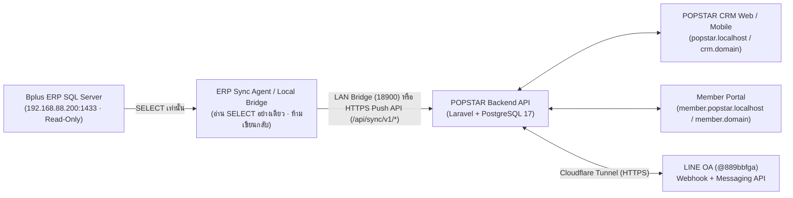

# คู่มือระบบ & โฟลว์การทำงาน — POPSTAR Connect (CRM + Member Portal + LINE OA)

> เอกสารคู่มือภาษาไทยฉบับใช้งานจริงสำหรับทีมผู้ดูแลระบบ (Admin), ผู้บริหาร (Executive), ทีมขายออกตลาด (Sales), และสมาชิก (Member)

---

## 1. ภาพรวมสถาปัตยกรรมและโฟลว์การทำงานทั้งระบบ

### กฎเหล็กความปลอดภัยของระบบ (ห้ามละเมิด)
1. **Bplus ERP เป็น Read-Only 100%**: ระบบ CRM อ่านข้อมูล (`SELECT`) จาก Bplus เท่านั้น **ไม่เคยเขียนแก้ไขหรือสร้างข้อมูลย้อนกลับเข้า Bplus**
2. **แยกตัวตนลูกค้าชัดเจน (Customer Master Architecture)**:
   - ลูกหนี้จาก Bplus (`erp_customers`) + ร้านใหม่ที่เซลล์เปิด (`crm_leads`) + บัญชีสมาชิก (`member_accounts`) ถูกเก็บแยกตารางและเชื่อมผ่าน `crm_customer_masters` เพื่อไม่ให้ข้อมูลทับกันเมื่อซิงก์ ERP
3. **การคำนวณยอดขายสุทธิจริง (Bplus Sales Rules)**:
   - นับเฉพาะบิลขายจริงก่อน VAT (`before_vat_amount`) หักใบลดหนี้/คืนสินค้า (`Doc 308`)
   - **แยกใบจอง (`Doc 207`) ออกต่างหาก** ไม่นำมารวมเป็นยอดขายจริง
   - ตัดลูกหนี้ที่ปิดกิจการ/เลิกติดต่อออกจากการแสดงผล active โดยอัตโนมัติ

---

## 2. โฟลว์การซิงก์ข้อมูล ERP (แบบใช้ LAN vs ไม่ต้องใช้ VPN)

### แบบที่ 1: โหมดดึงผ่าน Local Bridge (`http://127.0.0.1:18900`)
- **ใช้เมื่อ**: เครื่องที่รันเว็บ CRM อยู่ในวง LAN เดียวกับ Bplus SQL (`192.168.88.200:1433`) หรือต่อ VPN เข้าออฟฟิศอยู่
- **การทำงาน**: กดปุ่มในหน้า **ซิงก์ ERP (`/sync`)** → Laravel เรียก `local_bridge.ps1` (พอร์ต `18900`) → อ่าน `SELECT` จาก `192.168.88.200:1433`
- **ข้อสังเกต**: หากปิด VPN หรืออยู่นอกวง LAN ออฟฟิศ ปุ่มดึงตรงจะขึ้น `TCP Provider, error: 0 - The wait operation timed out` เพราะเข้าถึง `192.168.88.200:1433` ไม่ได้

### แบบที่ 2: โหมด Push API ผ่าน HTTPS (ไม่ต้องใช้ VPN — แนะนำสำหรับเซิร์ฟเวอร์ที่บ้านหรือ Cloud)
- **ใช้เมื่อ**: เว็บ CRM ตั้งอยู่ที่บ้าน (ผ่าน Cloudflare Tunnel) หรือบน Cloud/VPS คนละวง LAN กับออฟฟิศ
- **การทำงาน**:
  1. เครื่องในออฟฟิศที่เข้าถึง `192.168.88.200:1433` ได้ (เช่น เครื่อง 201) รัน `sync-agent` อ่านข้อมูลจาก Bplus แบบ Read-Only
  2. ยิงข้อมูลขาออกด้วย **HTTPS POST + HMAC-SHA256** ขึ้นมาที่ `https://crm.<โดเมนของคุณ>/api/sync/v1/*` (`customers`, `products`, `salespersons`, `invoices`, `sales-items`)
  3. ไม่ต้องต่อ VPN และไม่ต้องเปิดพอร์ต SQL Server (`1433`) ออกอินเทอร์เน็ต
  4. **วิธีทดสอบในหน้าเว็บ**: ไปที่ `/sync` → กด **`🚀 ทดสอบยิง Push API`** (ทดสอบปลายทางรับข้อมูลโดยไม่ต้องต่อ SQL ตรง)

---

## 3. สิทธิ์การใช้งานแยกตามตำแหน่ง (Role Matrix)

| สิทธิ์ (Role) | ขอบเขตการมองเห็น | การแก้ไขข้อมูล / ตั้งค่าระบบ |
| :--- | :--- | :--- |
| **👑 แอดมินระบบ (`admin`)** | เห็นทุกสายใบจอง ทุกเซลล์ และทุกหน้า | แก้ไขได้ทั้งหมด (ผู้ใช้, รหัสผ่าน, ผูกใบจอง, ตั้งเป้า, Token LINE OA, ซิงก์ ERP) |
| **📊 ผู้จัดการ (`manager`)** | เห็นทุกสายใบจองและทุกเซลล์ | อนุมัติ Lead, ตั้งเป้ายอดขาย/เข้าพบ, อนุมัติสมาชิก, จัดการของรางวัล |
| **👔 ผู้บริหาร (`executive`)** | เห็นภาพรวมและยอดขายทุกสาย (**ดูอย่างเดียว**) | **ไม่สามารถแก้ไขข้อมูลหรือตั้งค่าระบบได้** (เช่น เสี่ย, เจ๊, ผจก.ทั่วไป) |
| **🚀 พนักงานขาย (`sales`)** | เห็นเฉพาะลูกหนี้ ใบจอง และยอดขายในสายของตัวเอง | เพิ่มร้านใหม่, ปักหมุด GPS, บันทึกเข้าพบ + ถ่ายรูป, วางแผนออกตลาด, ออกใบเสนอราคา |
| **🪪 สมาชิก (`member`)** | เข้าผ่าน **Member Portal** เห็นเฉพาะบิลและแต้มของร้านตัวเอง (หลังผ่านการยืนยัน) | ส่งคำขอยืนยันร้านค้า, ผูก LINE OA, ดูประวัติบิลซื้อ, แลกของรางวัล |

---

## 4. คู่มือโฟลว์การทำงานหลักในแต่ละหน้า

### 4.1 โฟลว์ทีมขายออกตลาด (Sales Field Ops)
1. **เปิดดูงานวันนี้ (`/dashboard`)**: ดูแผนออกตลาดวันนี้ + งานติดตามที่ครบกำหนด + เป้ายอดขายรายเดือน
2. **วางแผนเส้นทาง (`/plans`)**: กด `＋ สร้างแผนออกตลาด` → เลือกดึงร้านในสายที่ยังไม่เคยเข้าพบ / หยุดซื้อเกิน 30 วัน อัตโนมัติ → กด `🧭 นำทางต่อเนื่อง Google Maps`
3. **ค้นหาลูกค้า / ดูข้อมูลร้าน (`/customers` หรือ `/customer-360`)**: ค้นหาได้ทั้งชื่อร้าน, รหัส AR, เบอร์โทร, จังหวัด แยกดูได้ทั้ง Customer Master, ลูกค้า ERP, และร้านใหม่ (Leads)
4. **บันทึกเข้าพบพร้อมหลักฐาน (`📸 บันทึกเข้าพบ` — 8 ขั้นตอน)**:
   - ขั้น 1: เลือก **🏢 ลูกค้าเดิม (ERP)** หรือ **🌱 ร้านค้าใหม่ (Lead)** พิมพ์ค้นหาแล้วแตะเลือกร้านจากการ์ด
   - ขั้น 2–3: กด Check-in เวลา + ดึงพิกัด GPS
   - ขั้น 4–5: ถ่ายภาพหน้าร้าน + ภาพสินค้า/พูดคุย (บีบอัดภาพอัตโนมัติ)
   - ขั้น 6–7: กรอกแบบสอบถาม 6 ข้อ + สรุปผลและวันนัดติดตามถัดไป → บันทึก (รองรับ **Offline Draft** หากไม่มีสัญญาณเน็ต)
5. **เปิดร้านใหม่ & ออกใบเสนอราคา (`/pipeline`)**: ลาก/เปลี่ยนสถานะ Lead → ออกใบเสนอราคาพิมพ์ PDF จากราคาสินค้า Bplus → กด `📨 ขอเปิดรหัส ERP` ส่งคิวให้แอดมิน

### 4.2 โฟลว์ผู้จัดการ / แอดมิน (Back-Office & Oversight)
1. **ตั้งเป้ายอดขายรายเดือน (`/dashboard` → บอร์ดเป้ายอดขาย)**:
   - เลือกเดือนของเป้า → กด `⚡ ตั้งเป้ารวมให้เซลล์ทุกคน` หรือ `⚙️ ตั้งเป้า` รายคน (กรอกเป้ารวมต่อเดือน เช่น `2,000,000` บาท/เดือน)
   - ระบบเทียบ **ยอดขายจริงทั้งเดือน vs เป้ารายเดือน** และแสดงค่าเฉลี่ยต่อวันคู่กัน (หากยังไม่ตั้งเป้าจะแสดงสถานะ "ยังไม่ตั้งเป้ารายเดือน" ไม่ใช้ค่าเริ่มต้นหลอก)
2. **จัดการผู้ใช้ & ผูกสายใบจอง (`/settings`)**:
   - เพิ่ม/แก้ไขผู้ใช้, รีเซ็ตรหัสผ่าน, ผูกสายใบจอง (`B10–BK6`) ให้เซลล์แต่ละคน
   - แท็บ **💬 ตั้งค่า Token LINE OA** (`/settings?section=line`) สำหรับจัดการ Channel ID / Secret / Access Token / LIFF ID
3. **ดูแลสมาชิก & แต้มสะสม (`/members`, `/loyalty`, `/rewards`)**:
   - คีย์เพิ่มสมาชิกจากหลังบ้าน (`➕ เพิ่มสมาชิก (คีย์หลังบ้าน)`) พร้อมผูก Bplus ERP และยืนยันสิทธิ์ทันที หรืออนุมัติคำขอที่สมาชิกสมัครเข้ามาเอง
   - เมื่อยืนยันสิทธิ์แล้ว ระบบซิงก์แต้มสะสมจากบิลขายให้ทันที
4. **ตอบแชทลูกค้า LINE OA (`/line-inbox`)**:
   - รับข้อความจากลูกค้า LINE OA เรียลไทม์ → ตอบกลับด้วยข้อความด่วน → ผูกห้องแชทกับลูกหนี้ Bplus เพื่อดูยอดซื้อและบิลล่าสุดได้ในหน้าเดียว
5. **ตรวจสอบสุขภาพระบบ (`/health-check` & `/sync`)**:
   - เช็กสถานะ Laravel API + PostgreSQL, Local ERP Bridge (`18900`), LINE OA API & โควต้าข้อความ, รอบซิงก์ล่าสุด และ error log ได้ในหน้าเดียว

---

## 5. การนำระบบขึ้นใช้งานจริงผ่านโดเมนตัวเอง (Cloudflare Named Tunnel — ไม่ต้อง NAT / ไม่ต้อง VPN)

1. ชี้ Nameserver โดเมนที่ซื้อไว้มาที่ Cloudflare (แผนฟรี)
2. สร้าง **Named Tunnel** ใน Cloudflare Zero Trust และติดตั้ง `cloudflared` เป็น Windows Service บนเครื่องเซิร์ฟเวอร์
3. ผูก Public Hostname:
   - `crm.<โดเมนของคุณ>` → `http://127.0.0.1:80` (HTTP Host Header = `popstar.localhost`)
   - `member.<โดเมนของคุณ>` → `http://127.0.0.1:80` (HTTP Host Header = `member.popstar.localhost`)
4. อัปเดต `backend/.env`:
   - `APP_URL=https://crm.<โดเมนของคุณ>`
   - `SESSION_DOMAIN=.<โดเมนของคุณ>`
   - `SANCTUM_STATEFUL_DOMAINS=crm.<โดเมนของคุณ>,member.<โดเมนของคุณ>`
   - `SESSION_SECURE_COOKIE=true`
   - รัน `php artisan config:clear`
5. อัปเดต LINE OA Webhook URL ใน LINE Developers เป็น `https://crm.<โดเมนของคุณ>/api/line/webhook`
